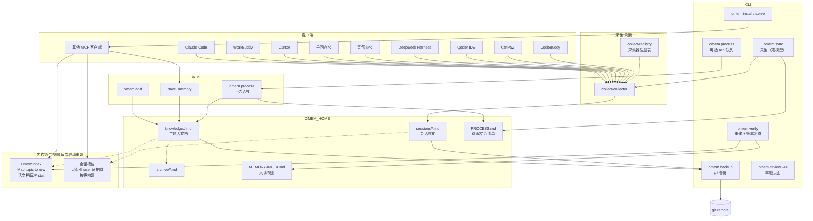
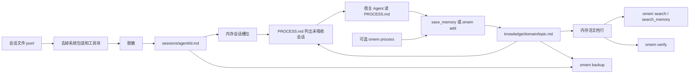
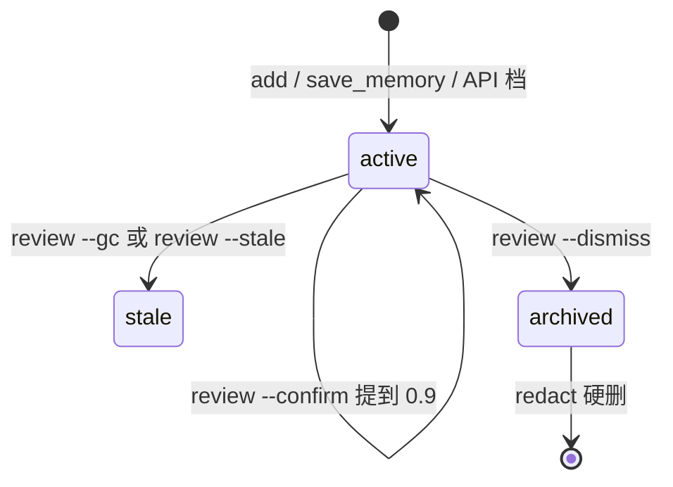

# 技术架构

omem 把个人记忆放在一个 git 仓库里。**Markdown 是唯一事实源**；没有数据库，索引是每次启动时从 Markdown 派生的内存视图。本文描述当前代码的分层和数据怎么流，不另写一份产品规划。文档索引（Current vs Archive）见 [`docs/README.md`](./docs/README.md)；v0.3 决策与进度见 [`docs/omem-v0.3-implementation-plan.md`](./docs/omem-v0.3-implementation-plan.md)（S0–S5 已完成，S6 证据分层推迟 v0.4，**未实现**）。

命令对应关系：`omem sync` 采集会话（永不调模型），`omem process` 可选 drain API 队列，`omem backup` 备份数据仓（git；WebDAV / 本地目录后端尚未交付）。

## 分层



| 层 | 代码 | 职责 |
| --- | --- | --- |
| 入口 | `src/cli.ts`、`src/mcp/` | 命令分发；stdio MCP，默认只有 `search_memory` / `save_memory` |
| 采集 | `src/collect/` | 只读扫描 9 个平台的会话目录，转成统一会话 |
| 采集注册表 | `src/collect/registry.ts` | 采集器 id、config 字段、隔离 env 的唯一真相源 |
| 加工 | `src/process/` | `omem sync` 只落原文并写 `PROCESS.md`；`omem process`（`runApiProcess`）才调用模型 |
| 存储与索引 | `src/core/` | Markdown 读写、脱敏、置信度、内存派生索引 |
| 审阅界面 | `src/web/` | `omem review --ui` 的本地页面与 HTTP 服务：只绑 127.0.0.1、一次性 token |
| 备份 | `src/sync/` | `SyncBackend`；本版只实现 GitBackend |
| 安装 | `src/install/` | 只改客户端配置里的 omem 段，先备份、原子写 |

## 采集器

采集器只读，不改源平台的任何文件。每个平台一个适配器，各自解析自己的落盘格式：

| ID | 源平台 | 落盘格式 | 默认根 |
| --- | --- | --- | --- |
| `claude-code` | Claude Code | JSONL | `~/.claude/projects` |
| `workbuddy` | WorkBuddy | JSONL | `~/.workbuddy/projects` |
| `cursor` | Cursor | JSONL | `~/.cursor/projects` |
| `qwenwork` | 千问办公 | JSONL（Claude Code 同构） | `~/.qwenworkcn/projects` |
| `doubao` | 豆包办公 | OpenAI messages 风格 JSONL | Windows 下 `%LOCALAPPDATA%/Doubao/.../.sessions` |
| `deepseek` | DeepSeek Harness | **zstd 压缩**的 typed JSONL | `~/.dsh/sessions` |
| `qoder` | Qoder IDE | 纯 JSONL | `~/.qoder` + `~/.qoder-cn`（双根） |
| `catpaw` | CatPaw | 纯文本 transcript | `~/.catpaw/projects` |
| `codebuddy` | CodeBuddy | JSONL（WorkBuddy 同构，timestamp 为毫秒） | `~/.codebuddy` + `~/.codebuddycn`（双根） |

每个采集器的根目录都可以用 `OMEM_<ID>_PROJECTS` 环境变量覆盖（Qoder 中文版是 `OMEM_QODER_CN_PROJECTS`）。这些环境变量是测试隔离的唯一手段——配置里的绝对路径优先于 env，只有以 `~` 开头的默认值才允许被 env 接管。变量名清单由 `src/collect/registry.ts` 统一定义，测试和冒烟脚本都从它派生，不各写一份。

DeepSeek 的会话是 zstd 压缩的，解析时需要解压。这是本项目**唯一的原生运行时依赖**（`@toondepauw/node-zstd`，prebuilt，无需源码编译，覆盖 win32/darwin/linux 的 x64 与 arm64）。其余功能不依赖任何原生模块——检索索引是从 Markdown 派生的内存视图，没有数据库。

## 索引：没有数据库，只有派生视图

SQLite 在 v0.2 被删掉了（重构方案 D3）。理由是它带来的负担远大于收益：WAL、跨进程锁、迁移脚本、`(size, mtime)` 快路径 + 内容哈希慢路径的双 hash 对账——全是为了维护一个**随时可以从 Markdown 重建**的东西。

现在的口径：

| 对象 | 什么时候构建 | 成本 |
| --- | --- | --- |
| 活文档行（`Map<topic, row>`） | 每次启动 / 每次调用 | 每个文件一次 `stat`（实测 1100 文件 ≈ 131 ms） |
| 活文档正文 | 命中后才读 | 只读命中的那几条 |
| 会话槽位 | `sync` / `search --sessions` / `verify` 才构建 | 只索引 `## user` 证据域（实测 2.1 MB 全量扫描 ≈ 1.4 ms） |

会话**只索引 `## user` 段**：助手的回答不能当证据，也不该出现在检索结果里。一条只命中助手段的会话等于「检索不到」——比给一条空摘录更诚实。

检索是**线性扫描 + 确定性排序**：命中词数 → 置信度（stale × 0.5）→ `last_confirmed`。没有 bm25、没有 FTS、没有倒排表——这个体量下暴力子串匹配是 1–2 ms，而排序规则保持成一个可解释、可复算的纯函数。

**分层对账**取代了跨进程锁：活文档每次 `stat`（便宜，能发现外部改动），会话只在需要时构建。写冲突从「写不进去」降级为「读到的可能是旧版本」。

## 数据怎么流

事实源只有两类 Markdown：`sessions/` 是对话原文，`knowledge/` 是结论。`PROCESS.md`、`MEMORY-INDEX.md`、`snapshots/` 都是派生文件，删掉可以重建。`logs/` 是追加日志。



采集不写 `knowledge/`。带同一个 `topic` 再写一次就是**覆盖**那份活文档——不再有「撞 topic 拒写 + 要求 supersedes」这道闸门（重构方案 D1-B′ / M2）。护栏只有一条：覆盖前先打快照（`snapshots/`，滚动保留 7 份）。git 历史是最终退路。

冲突不自动合并：`omem backup` 遇到冲突时保留本地版，远端版另存 `.conflict.md`。

`PROCESS.md` 有两条刷新路径：采集路径（`omem sync`）和写入路径（`save_memory` / `omem add` 落盘成功后立即重算）。写入路径这一条是必需的——MCP 的 `save_memory` 不经过 `omem sync`，若只在采集路径刷新，Agent 读到的待办清单会一直包含已吸收的会话。清单是派生物，刷失败不影响已经落盘的记忆（错误只记日志）。批量加工路径（API 档）传 `refreshGuide: false`，整轮结束时统一刷新一次。

`PROCESS.md` 分两段（重构方案 A-6）：

- `## Projects` —— 要干的活：待吸收会话按**项目指纹**分组（组标题是 `### <项目指纹>`）。项目指纹不是 topic 名。
- `## Topics` —— 词表：所有活文档的主题名，外加它来自哪个项目。Agent 复用这里的名字就是覆盖同一份文档，而不是为同一主题再开一份。

写入结论的路径（`save_memory` / `omem add`）默认各留**一笔本地提交**（`[process] auto_commit = "session"`，可设 `off` 关闭）；`omem sync` 一轮 run 一笔。`omem backup` 才负责推送远端，并在拉取前把未提交改动收成一次提交。仅有本地提交不等于已同步到远端。

## 一条记忆的状态

检索默认只看 `active`。`stale` 仍可搜到，但权重减半。`archived` 默认不出现（归档 = 文件移到 `archive/`，不删）。



硬删只有 `omem redact`（`--topic` 或 `--source`），两者都默认预览、必须显式 `--yes`，删除时同时移除 Markdown 和索引行。删除范围**仅限本地当前文件**：数据仓 git 历史里的旧版本、`snapshots/`、已推送的远端备份与其他机器上的副本都不受影响；omem 不改写 git 历史，也不按 topic 排除备份。**没有 `verified` 布尔位**（重构方案 D2）：信任只有一个数字 `confidence`，它永远描述当前这份正文；「人看过」由 `confirmations > 0` + `last_confirmed` 表达。

`review --confirm` 只把 `confidence` 提到 0.9，**不改变 `status`**：`stale` 不会因过目自动变回 `active`。`confirmations` / `last_confirmed` 是主题级记录——人工确认表示这个主题曾获得过人工关注，不表示当前正文已被逐项验证；正文被后续写入覆盖时它们仍会继承（v0.3 决策 D2，见 `docs/omem-v0.3-implementation-plan.md`）。

同理，**归档不会被一次写入静默撤销**：向 `archived` / `stale` topic 写入时，`commitEntry` 返回 `needs-reactivation`，说明状态变化与路径迁移，且不落盘、不提交、不进 `warnings`。只有显式意图才恢复——CLI `omem add --reactivate`，MCP `save_memory(reactivate: true)`；恢复后文档为 `active`，归档文件从 `archive/` 移回 `knowledge/`（v0.3 决策 D4）。

覆盖既有文档还可以带 `expected_revision`：`search_memory` 的命中给出 `revision`（全文 sha256/32，与 `index.hash` 同口径），写入前重新读盘比对，不一致返回 `stale-revision` 且不写盘、不提交。这是**best-effort**：`atomicWrite` 只保证单次写原子，读-比-写之间仍有 TOCTOU 窗口，v0.3 不提供跨进程锁，也不承诺绝不丢失更新（决策 D3）。

置信度五档（重构方案 M1）：

| 档 | 值 | 条件 |
| --- | --- | --- |
| 未锚定 | 0.35 | 引文在会话原文里找不到 |
| 待补会话 / 已锚定 | 0.55 起 | 锚定到 `## user` 原文 |
| 印证加成 | +0.10 / +0.06 / +0.03…，封顶 +0.25 | **独立来源**数 + 跨项目加成 |
| 自动上限 | 0.80 | 任何自动产出不得超过 |
| 人工过目 | 0.90 | 人在 `omem review` 里看过正文之后 |

五档描述的是**证据支持程度与排序用的分数**，不是「事实正确的概率」；0.90 表示人看过，不表示 90% 的正确率。

印证的计数单位是**独立来源**，不是会话文件：两份会话文件如果用户说的话一样（归一化后同指纹），只算一个来源；被引用会话自己的指纹先占位，所以来源的副本也不算印证。否则「同一段话复制 5 份」就能把 0.55 刷到 0.80。

MCP 侧**没有盖章通道**（重构方案 A-5）：`save_memory` 不接受 `confirm_ids`，过目只由人自己在 `omem review` 里做。

## 活文档与 topic

**topic 就是身份，就是文件名。** 路径是 `knowledge/<domain>/<topic>.md`，frontmatter 里**不写 topic**（`parseEntry` 从路径注入），所以主题名只有一个事实源，不存在「字段与路径漂移」。

- `coding` / `general` 是 **domain**，不是 topic。
- 只有**显式传 `topic`** 才算活文档；一次性记忆也强制有 topic。
- `project` 只用于 `PROCESS.md` 归组，不回落成 topic——两者是不同命名空间。
- 同一 topic 同时只有一份 `active`。再写一次 = 整篇覆盖那份文件；版本链由 git 承担（没有 `superseded` 状态、没有 `superseded_by`）。
- topic 归一化（`normalizeTopic`）：小写、非法字符折叠为连字符、合并连续连字符、≤ 64 code point、Windows 保留名加 `topic-` 前缀。CJK 合法。

更新是**整篇覆盖**，不是增量合并：

| 项目 | 行为 |
| --- | --- |
| 同一个 topic 再写 | 覆盖同一路径，文件数不变（`git log` 多一笔） |
| `created` | 沿用首次创建时间 |
| `source_sessions` / `evidence` | 继承并累积（`evidence` 去重后保留 8 条 / 2000 字） |
| `confidence` | **每次重算**（永远描述当前这份正文） |
| `confirmations` / `last_confirmed` | 继承（「人看过这个主题」是主题级事实） |
| 覆盖前 | 先打快照（`snapshots/<日期>/`） |

**可见性**：`MEMORY-INDEX.md` 用 `topic:xxx` 标签、`omem search` 的命中行、`omem review` 的第三列、`omem topics list`。写入前 `PROCESS.md` 会附一份 `## Topics` 词表。

**两个护栏**（只在 `core/commit.ts` 里，所有写入路径共用，产出**告警**而不是拒绝——拒绝会打断 Agent 写回）：

- 近似主题：新 topic 与既有 topic 互为前缀或去掉分隔符后相同 → 告警。
- 跨主题合并：报告将要消失的主题名。

## 目录

```text
~/.omem/                      # OMEM_HOME，本身是一个 git 仓库
├── config.toml
├── sessions/<agent>/<id>.md  # 原文，入库
├── knowledge/<domain>/<topic>.md
├── archive/<domain>/<topic>.md   # 归档，仍在仓库里
├── PROCESS.md                # 派生，不入库
├── MEMORY-INDEX.md           # 派生视图
├── skip.json                 # 被判定无价值的会话台账
├── snapshots/<日期>/         # 不入库，滚动保留 7 份
└── logs/                     # 不入库
```

外部改了 Markdown（例如用 Obsidian）之后，下次打开索引会按文件内容哈希把改动吸回内存视图。`omem verify` 会重建整个视图、重渲染 `MEMORY-INDEX.md`，并**用账本重算每条自动分的条目、与落盘值比对**——只报告差异，不改写文件（自动改写会在每次 verify 时抖动 git 历史，而且「谁该赢」不是机器能判的）。
