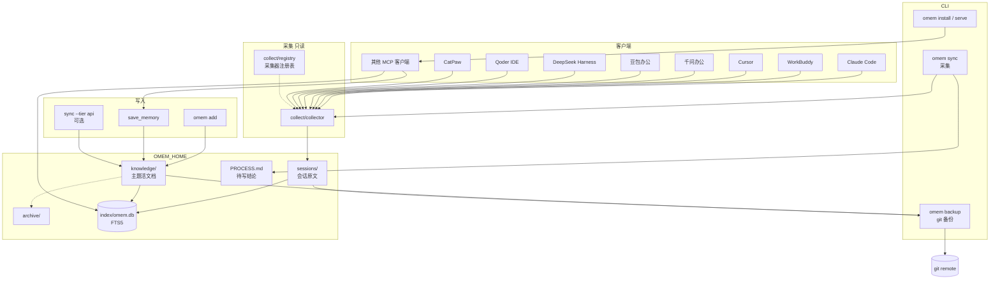
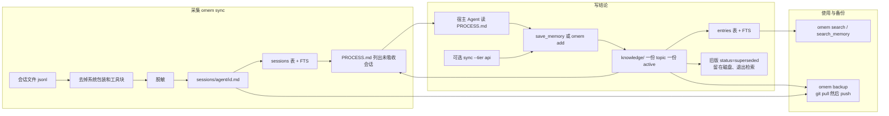
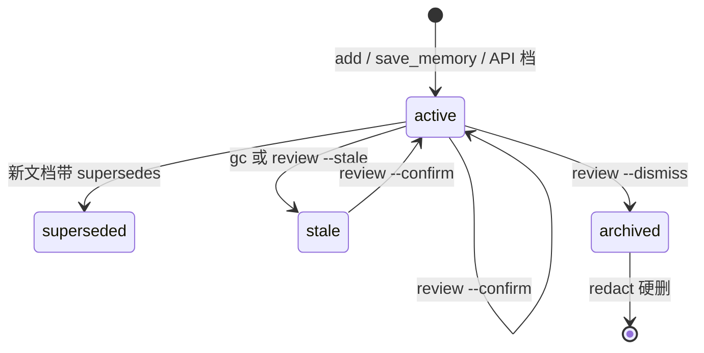

# 技术架构

omem 把个人记忆放在一个 git 仓库里。Markdown 是事实源，SQLite 只是可以删掉重建的索引。本文描述当前代码的分层和数据怎么流，不另写一份产品规划。

命令对应关系：`omem sync` 采集会话，`omem backup` 备份数据仓（git；WebDAV / 本地目录后端尚未交付）。

## 分层



| 层 | 代码 | 职责 |
| --- | --- | --- |
| 入口 | `src/cli.ts`、`src/mcp/` | 命令分发；stdio MCP，默认只有 `search_memory` / `save_memory` |
| 采集 | `src/collect/` | 只读扫描 8 个平台的会话目录，转成统一会话 |
| 采集注册表 | `src/collect/registry.ts` | 采集器 id、config 字段、隔离 env 的唯一真相源 |
| 加工 | `src/process/` | 默认只落原文并写 `PROCESS.md`；`--tier api` 才调用模型 |
| 存储与索引 | `src/core/` | Markdown 读写、脱敏、置信度、SQLite/FTS5 |
| 备份 | `src/sync/` | `SyncBackend`；本版只实现 GitBackend |
| 安装 | `src/install/` | 只改客户端配置里的 omem 段，先备份、原子写 |

## 采集器

采集器只读，不改源平台的任何文件。每个平台一个适配器，各自解析自己的落盘格式：

| ID | 源平台 | 落盘格式 | 默认根 |
| --- | --- | --- | --- |
| `claude-code` | Claude Code | JSONL | `~/.claude/projects` |
| `workbuddy` | WorkBuddy | JSONL | `~/.workbuddy/projects` |
| `cursor` | Cursor | JSONL | `~/.cursor/projects` |
| `qwenwork` | 千问办公 | JSONL（Claude Code 同构） | `~/.qwenworkcn/projects` |
| `doubao` | 豆包办公 | OpenAI messages 风格 JSONL | Windows 下 `%LOCALAPPDATA%/Doubao/.../.sessions` |
| `deepseek` | DeepSeek Harness | **zstd 压缩**的 typed JSONL | `~/.dsh/sessions` |
| `qoder` | Qoder IDE | 纯 JSONL | `~/.qoder` + `~/.qoder-cn`（双根） |
| `catpaw` | CatPaw | 纯文本 transcript | `~/.catpaw/projects` |

每个采集器的根目录都可以用 `OMEM_<ID>_PROJECTS` 环境变量覆盖（Qoder 中文版是 `OMEM_QODER_CN_PROJECTS`）。这些环境变量是测试隔离的唯一手段——配置里的绝对路径优先于 env，只有以 `~` 开头的默认值才允许被 env 接管。变量名清单由 `src/collect/registry.ts` 统一定义，测试和冒烟脚本都从它派生，不各写一份。

DeepSeek 的会话是 zstd 压缩的，解析时需要解压。这是本项目**唯一的原生运行时依赖**（`@toondepauw/node-zstd`，prebuilt，无需源码编译，覆盖 win32/darwin/linux 的 x64 与 arm64）。其余功能不依赖任何原生模块——SQLite 用 Node 22 内建的 `node:sqlite`。


## 数据怎么流

事实源只有两类 Markdown：`sessions/` 是对话原文，`knowledge/` 是结论。`index/`、`PROCESS.md`、`MEMORY-INDEX.md`、`snapshots/` 都是派生文件，删掉可以重建。`logs/` 是追加日志。



采集不写 `knowledge/`。同一 `topic` 已有 active 文档时，再次写入必须带 `supersedes`，否则拒绝。冲突不自动合并：`omem backup` 遇到冲突时保留本地版，远端版另存 `.conflict.md`。

`PROCESS.md` 有两条刷新路径：采集路径（`omem sync`）和写入路径（`save_memory` / `omem add` 落盘成功后立即重算）。写入路径这一条是必需的——MCP 的 `save_memory` 不经过 `omem sync`，若只在采集路径刷新，Agent 读到的待办清单会一直包含已吸收的会话。清单是派生物，刷失败不影响已经落盘的记忆（错误只记日志）。批量加工路径（API 档）传 `refreshGuide: false`，整轮结束时统一刷新一次。

写入不自动 commit。记忆先留在工作区，`omem backup` 才把它提交进 git 历史。

## 一条记忆的状态

检索默认只看 `active`。`stale` 仍可搜到，但权重减半。`superseded` 和 `archived` 默认不出现。



硬删只有 `omem redact`，同时删 Markdown 和索引行。确认（`verified: true`，置信度 0.9）只来自 `omem add` 或 `omem review --confirm`。

## 目录

```text
~/.omem/                      # OMEM_HOME，本身是一个 git 仓库
├── config.toml
├── sessions/<agent>/<id>.md  # 原文，入库
├── knowledge/<domain>/<YYYY>/<id>.md
├── archive/                  # 归档，仍在仓库里
├── PROCESS.md                # 派生，不入库
├── MEMORY-INDEX.md           # 热层派生视图
├── index/omem.db             # 派生，不入库
├── snapshots/                # 不入库，滚动保留 7 份
└── logs/                     # 不入库
```

外部改了 Markdown（例如用 Obsidian）之后，下次打开索引会按文件哈希把改动吸回 SQLite。`omem rebuild` 可以删掉索引再全量重建。
