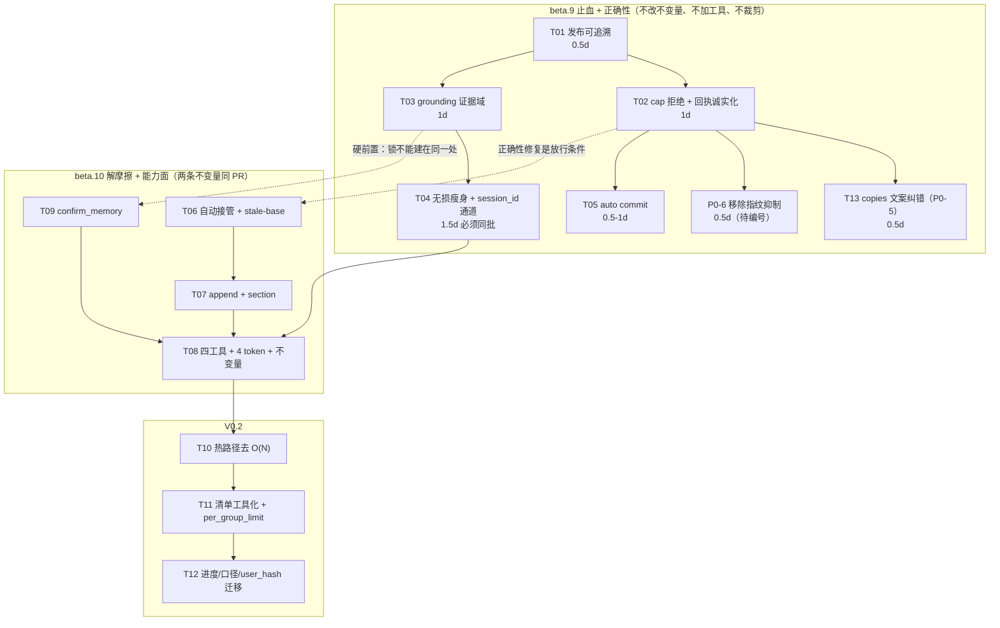

> 本文是 2026-10 的**历史记录**，保留当时的状态与结论。v0.2 之后的现状见 `docs/omem-重构方案-路B.md`（决策 + 进度）与 `ARCHITECTURE.md`。

# omem 改进规划方案（2026-10-28 三方协同 · 产品经理许清楚）**v1.2**

> 输入：`docs/2026-10-28-MCP实测反馈-beta8.md`（用户 12 条）／`docs/2026-10-28-三方协同-架构分析.md`（R1–R6 + H1–H10）／`docs/2026-10-28-MCP调用与写入实测-三方协同.md`（QA 复现 12 / 证伪 2 / 新增 N1–N6 / **§8 补测 H2·H3·H5**）／`docs/2026-10-28-三方协同-技术评审与任务清单.md`（架构评审 T01–T12）。
> 本文**不复述**上游内容，只引编号。产出是**决策与验收**，不是技术方案。目标锚点仍是用户原话三个词：**更灵活、更健壮、更简单**。
> 范围：不改源码、不 commit、不触碰 `C:\Users\wei\.omem`。
> **版本号沿革**：v1.0 → v1.1（并入架构评审 C-1~C-4）→ 中间版（并入 QA 补测 H2/H3/H5，team-lead 口径称 v2 / v2.1，内容相同）→ **v1.2（本轮收口）**。以本文件『修订记录』为唯一准。

## 修订记录

| # | 条目 | v1.0 | v1.1 | 触发方 |
| --- | --- | --- | --- | --- |
| 1 | Q4 N2 的截断策略 | 拒绝 + 落 `status: stale` + `tags: truncated`，把半截「挪出」检索面 | **改判①纯拒绝**。`stale` 仍在默认检索面（`search.ts:52` 只排 archived/superseded，`:108`/`:124` 只乘 `/0.5`），「挪开」不成立。回执给可执行出口 + **旧 active 保持 active** | 架构评审 C-1 |
| 2 | P0-3 的手段与 S2 门槛 | `per_group_limit=20` + 分页；门槛 `≤18,000 B` | **撤掉裁剪，改无损瘦身 ≈23,600 B / 551 行全保留**；门槛改实测四条（§2.1-S2）。18,000 B 是我拍的，无依据 | 架构评审 C-4 |
| 3 | `session_id` 取全文的版本 | beta.10（beta.9 只保留 `workbuddy/8225ff29` 形式） | **与 P0-3 合并同批进 beta.9**。该形式不是可读路径、`Read` 打不开；`install` 又不写 env，没有第二条路 → 分版本会留下「清单瘦了但打不开」，**比 80KB 更糟** | 架构评审 C-3 |
| 4 | Q3 的不可逆前提 | 「`omem install` 把该值写进客户端配置，改名 = 既有安装静默失效」 | **前提错误**：`install` 对 `OMEM_*` 零命中 → 无「既有安装」可破坏。定稿**冻结 4 个 token** 而非冻结工具清单；`status` 不独立成工具，并入 `pending_memory.totals` → 默认面 **4 工具** | 架构评审 C-2 |
| 5 | B1 的性质 | 「历史欠账 / 渲染方式错」 | 补一句：**是 `3fe8c9c` 引入的回归**。同批 1,101 会话：beta.8 渲染 64 行/7,221 B，HEAD 611 行/**117,752 B（16.3×）**，最大单组 478 行占全文 80%。P0-3 性质改为**回归修复**，但**顺序不动**（正确性仍优先） | QA 补测 H3 |
| 6 | D1 的定性 | 已修（文案层） | **退回「误修」，升为 P0-5**。26 个 `copies≥3` 组里 **25 组 assistant 段实质不同**（最大组 25 copies → 25 个不同回答），user 段 26/26 逐字一致 → `distilling the listed one covers all copies` 是**错误承诺**，按它操作最多静默丢 24 份独立结论。修法是**改文案不改折叠逻辑** | QA 补测 H5 |
| 7 | R4 的耗时基线 | 「2–4 秒（beta8 摘要）」；门槛 p50 <1s | 实测：`catchUp()` 596–848ms、只读调用 650–717ms（同代码 2 会话小库 10ms）、真写 1,526–1,613ms（其中落盘 + 清单重算 ≈820ms）。**2–4 秒未能复现**；门槛改为「p50 不劣化 + 增长斜率下降」 | QA 补测 H2 |
| 8 | N1 的严重性 / copies 折叠根因 | 「一道安全阀可被刷过」 | 强化为**两道锁在同一处失效**（`user_said` 核对与 evidence 走同一个 `evidenceIn`）；另查明 `(copies: N)` 只在 50/551 行出现是因 **fence 污染 `user_hash`**，片段级去重对带 metadata 会话**本来就没生效** | 架构评审补充 + QA §8.4 |
| 9 | Q4 的证据强度 | 「`stale` 仍在检索面、只降权」 | **四通道全关**：检索仍返回（×0.5）／永不进 `review` 队列（`review.ts:25`）／`gc` 跳过（`lifecycle.ts:49`）／只能 `redact` 硬删。②的「温和」直觉被彻底反驳 | 架构补充（v2.1） |
| 10 | 基线可信度 | 「57 vs 58 是两个口径」 | **真因是 `immutable=1` 忽略 WAL**：40MB WAL 内容被整段跳过，读的是主 db 旧快照。**连带 `superseded 41 / archived 7 / stale 2 / sessions 1101` 也可能落后** | 架构补充（v2.1） |
| 11 | P0-4 的治理点 | 「加 `files` 白名单 + `release-check`」 | **白名单已存在**（`package.json:31-36`）、`dist/` 已干净、加 `.npmignore` 是无效修法（`files` 优先级更高）。真缺口是**打包内容没有可断言的门**：`prepublishOnly` 现在只有 `npm run build` | 架构补充（v2.1） |
| 12 | P0-1 的改动边界 | 「改截断逻辑」 | `util.ts:46` 的 `truncate()` **一行不用改**：8 个调用方全是渲染，写入路径的截断是 `tools.ts:527` 的内联 slice，且无任何调用方依赖「截断成功」 | 架构补充（v2.1） |
| 13 | P0-5 的任务编号 | 「无对应，建议 T02b/T03b」 | **T13（beta.9 / 0.5 天）**，含 2 处文案 + 1 处断言 + `(copies: N)` 表现形式的复核 | team-lead 收口（v1.2） |
| 14 | 清单体积的基线口径 | 三个绝对值并列，`S2` 说「取最坏值 117,752 B」 | **绝对值全部作废为验收依据，只留相对口径**：同一渲染器、同一批会话，瘦身前→瘦身后对比。三个数（7,221 / 80,310 / 117,752）**都对**，是三个不同渲染器的产物 —— 这句话本身**就是 H3 的证明** | team-lead 收口（v1.2） |
| 15 | R6 的严重度与排期 | 「保留 V0.2」（与 QA 建议 P1 冲突） | **严重度取 P1、排期取 V0.2 首项**，两者分离；并加触发条件：beta.10 后实测 p50 恶化 >1.5× → 提前到 beta.10 | team-lead 收口（v1.2） |
| 16 | 「4 份副本」 | 门槛写「4 份同 PR」 | 改为**「消灭副本」**：`instructions.ts:11-15` 是唯一源头，`export.ts:32-34` 自动跟随，`tools.ts:163-180` 与 `guide.ts:121-131` 是**两处手写** → 改 import + grep 单测防复发。同步是一次性动作，消灭副本才是永久修复 | team-lead 收口（v1.2） |
| 17 | **账本级丢单（新 P0）** | 方案里完全没有 | `guide.ts:237-242` 建「已吸收指纹集」、`:296` 用它判待办 → **吸收兄弟组 1 份，其余 N−1 份一起退出待办**。结合 H5 → **最多 ≤143 份独立结论被静默丢单**（1,101 → 958 指纹组）。比文案错误更重：文案是误导，这是丢单 | 架构新证据（v1.2） |
| 18 | `overCap` 的执行方式 | 「pipeline 必须显式声明」（只覆盖 pipeline） | 改为 **`CommitInput.overCap` 必填、无默认值** → TypeScript 在编译期把 4 个调用点全部标红。**编译器就是执行机制**，不依赖 code review | 架构新证据（v1.2） |

> **被推翻的两条不删历史**（Q3 前提、Q4 立场②）：见 §3.4、§3.6 的「v1.0 原判 / 经技术评审修正」标记。这个产品的全部价值在可追溯。

---

## 0. 摘要

**一句话产品判断**：omem 现在的问题是 —— **每吸收一条记忆要先付大约 20,000 token 的过路费，付完之后还可能只存下半句，或者把 24 份独立结论当成 1 份。**

**七条裁决**

| # | 争议点 | 裁决 | 状态 |
| --- | --- | --- | --- |
| 1 | 正确性 vs 吞吐 | **正确性先。** N2/N1/P0-5 阻塞一切「降低写入摩擦」的变更；PROCESS.md 渲染修正可先发（纯派生、只改读不改写），但 C1 自动接管不得先于正确性修复 | 评审签字 |
| 2 | B1 的归因 | 不是「内容多」，是「**渲染方式错**」，且是**回归**（16.3×）→ 修渲染（无损、零信息损失），分页只能当兜底 | 评审 + QA 补测 |
| 3 | 「只用 MCP」自相矛盾 | 默认面从 2 个扩到**读闭环 4 工具**；写运维/破坏显式开启；`backup` 不提供；CLI-only 动作打 `<CLI-only>` 标签 | 评审签字 |
| 4 | verified 语义边界 | 接受历史数据语义并存（不改历史、不加 frontmatter 字段、**不重定义档位**） | 评审签字 |
| 5 | N6 是否 P0 | 是，**流程级 P0**，先于 beta.9 一切评测 | 评审签字 |
| 6 | N2 怎么修 | **纯拒绝**（v1.0 原判「落 `stale`」被代码事实推翻） | **v1.1 改判** |
| 7 | copies 承诺 | **P0-5**：改文案，不改折叠逻辑（v1.0 判 D1 已修，被 H5 推翻） | **v1.1 新增** |

**P0 六条**：①N2 半截事实 ②N1 grounding 元数据 ③PROCESS.md 回归修复 + session 读取通道 ④发布可追溯 ⑤copies 承诺误修（T13） ⑥**账本级丢单 ≤143 份**（v1.2 新增）。

---

## 1. 三个前提事实（决定方案内容，不是背景）

### 1.1 N2 的真身不是「截断策略错」，是「上限规则没有单一事实源」

| 写路径 | 上限行为 | 证据 |
| --- | --- | --- |
| MCP `save_memory` | **截断** + 回执 → 产生半截事实 | `tools.ts:526-529` |
| CLI `omem add` | **无上限**，原样落盘 | `add.ts:27-36` |
| pipeline | **无上限** | `commitEntry` 内无 cap 检查 |

**产品含义**：P0-1 的目标不能只写「把截断改成拒绝」——那是修一条路径。目标必须是「**2000 字上限在所有写路径上只有一处裁决点、只有一套行为**」。这也解释了为什么 C1 必须先等它：自动接管删掉的是「停下来想」这一步，而三条路径纪律仍不一致 —— **降低摩擦的同一个动作，会把上层策略问题放大成事实源污染**。
**副作用**：cap 下沉 `commitEntry` 后 `omem add` 从「静默接受」变「拒绝」，是 **CLI 行为变更**，须一次说清、不留中间态（`--force` 可绕过）。

### 1.2 N1 让 `confirm_memory` 的两道锁在同一处失效

两道锁都走**同一个** `evidenceIn` + `userSectionText`（`score.ts:58`、`:154`）：
- 锁一 `confidence >= 0.55` → 元数据可满足（QA N1/W9 实证）；
- 锁二 `user_said` 必须能在 `## user` 段核对上 → `user_said` 写成 `{"message_id":"…","timestamp":"…"}` 一样核对成功。

**产品含义**：这不是「一个字段可以被刷」，是 **grounding 这个判据本身从「用户说过」退化为「字符串在 user 段出现过」**。所有依赖 `confidence` 的排序/过滤/晋升都建在它上面 → 必须在**不变量层**约束，不是当 bug 修。

### 1.3 copies 的承诺是错的（v1.1 新增，改变 D1 定性）

`user` 段 26/26 组逐字一致（去重依据没错）；`assistant` 段 **25/26 组各不相同**，最大组 25 copies 携带 25 个不同回答（1,075–3,073 字符）。所以 `guide.ts:126` 的 "distilling the listed one covers all copies" 是**错误承诺**。
**产品含义**：它与 N2 是**同型缺陷** —— 都是「以为记下了、其实内容没了」。区别只是 N2 丢半句、这条丢 24 份独立结论。因此必须与 N2/N1 同批进 beta.9（P0-5），修法是**改文案 + 改头部渲染文案，折叠逻辑不动**（按 `user_hash` 折叠本身没错，错的是承诺）。

---

## 2. 三目标的可验收定义

> **编号约定**：本节 R1–R9 是「健壮度量」编号；§8 的 R1–R14 是「风险」编号，两套独立。引用时写全 `§2.3-R1` / `§8-R1`。

### 2.1 更简单（Simple）

| 编号 | 度量 | 现状（实测） | 门槛（v1.1） | 版本 |
| --- | --- | --- | --- | --- |
| S1 | 单轮吸收的**工具往返数** | 2 次（拒绝 + 重写，QA W2）＋开工读清单 1 次 | **≤2 次** | beta.10 |
| S2 | PROCESS.md 被宿主 `Read` 一次读完 | **HEAD 渲染 611 行 / 117,752 B / session 行 572 / 最大单组 478**（est 20,060 tokens 被拒）；现场 80,310 B / 551 行；beta.8 7,221 B / 64 行 | **①`Read` 实测成功（唯一真门槛）②`wc -c ≤ 30,000` ③session 行数不减（相对：**≥572**）④`grep -c 'C:\\Users' == 0` ⑤topic 行数 = active 数（58/58）**。T04 按最大单组 478 行重算 **≈24.4 KB / 572 行**（宿主 est ≈6,050 tokens、真实 tokenizer ≈10,800，均 <20,000） | beta.9 |
| S3 | 首次接上的工具面固定税 | 10,219 字符 / 2 工具（QA R8） | **≤12,500 字符 / ≤4 工具**（核算 ≈12,100，余量 400） | beta.10 |
| S4 | 判断「吸收到什么程度」的动作 | `omem status` → `Unknown command` | 并进 `pending_memory.totals`，1 次调用 1 行数 | V0.2 |

> **S2 的门槛与基线（v1.2 定稿）**：验收**一律用相对口径** —— 同一渲染器、同一批 1,101 会话，瘦身前 → 瘦身后对比，不跨口径引用绝对值。绝对阈值只有两条：`Read` 实测成功、`wc -c ≤ 30,000`。
> **三个体积数全部为真，且它们本身就是 H3 的证明**：7,221 B / 64 行（`v0.1.0-beta.8` 渲染）、80,310 B / 551 行（现场，**但由某个中间构建写出，版本号仍标 beta.8**）、117,752 B / 611 行（HEAD 渲染）。同一批数据、三个渲染器、三个结果 —— **这比统一数字有价值得多**，因为它同时证明了「B1 是回归」和「版本标签已无法归属任何 commit」（P0-4 被反向验证为真 P0）。
> **beta.8 的 64 行也不是目标形态**：旧逻辑按自然序 `slice(0,5)`，566 会话的大组永远进不了窗口 —— **beta.8 的缺陷是「积压看不见」，HEAD 是「无窗口渲染」，两者都不是目标。** 目标是「全量可见 + 有预算」。

### 2.2 更灵活（Flexible）

| 编号 | 度量 | 现状 | 门槛 | 版本 |
| --- | --- | --- | --- | --- |
| F1 | 满文档追加时**被迫新建 topic** | active 中 ≥1800 字 4/58（6.9%）、≥1900 字 3 份 | 对这 4 份追加 **0 新建 topic** | beta.10 |
| F2 | 提交正文量与**实际新增信息量**之比 | 1841 字文档追加 300 字 → 需提交 2,141 字或被拒；≈6:1（H4 待验） | **≥3×** | beta.10 |
| F3 | 「父文档已满」所致的**碎片率** + **隐藏率** | 本轮 3 会话 → 新建 2 + 合并 1；beta.9 起有 `GUIDE_MAX_BYTES=30_000` 预算护栏，超限按阶梯降级并输出 `hidden by the size budget` 行 | ①因文档满而新建 = **0** ②**因尺寸预算被隐藏的会话数 = 0**（V0.2 后恒成立）。注：T11 的分页与 beta.9 的降级阶梯是**同一不变量的两种实现，T11 应替换而非叠层** | beta.10 → V0.2 |
| F4 | 满文档的**更新可行性与可恢复性** | ≥1800 字文档无合法更新路径；强行更新会 supersede 旧文档使其**内容永久退出检索** | 4 份满文档各可成功追加 ≥1 条；**任何失败都不改变旧文档状态** | beta.10 |

### 2.3 更健壮（Robust）

| 编号 | 度量 | 现状 | 门槛 | 版本 |
| --- | --- | --- | --- | --- |
| R1 | **半截事实落盘数** | 1,990 + 73 字 → `99. 新增事实：…`，`status: active`（QA N2/W7） | **0**；且旧文档被拒后**仍 active 且内容未变** | beta.9 |
| R2 | **grounding 不可被元数据满足** | metadata JSON → `Grounded 1/1` + 0.55（QA N1/W9） | 该用例 0.35；随机 10 个 workbuddy 会话剥离前后成功率下降 **≤5%** | beta.9 |
| R3 | 每次写入有**版本历史** | 13 次写 + 1 次 `omem add` → **0 提交** | commit 数 = 写入轮次数 | beta.9 |
| R4 | 单次工具调用耗时 | `catchUp()` 596–848ms；只读 650–717ms；真写 1,526–1,613ms | **p50 不劣化 且 随会话数增长的斜率下降**（不设绝对阈值——`2–4 秒`未复现，不能拿没发生过的数字当目标） | V0.2 |
| R5 | 回执**诚实度** | supersede 掉 0.9 的 verified，回执一字未提 | 必含 `previous verified status (0.9) was dropped; old version kept at <id>` | beta.9 |
| R6 | 写入的**并发安全** | 仅测同一 stdio 连接流水线 | 多写入方并发 0 双活、0 静默丢内容 | beta.10 |
| R7 | **发布可追溯** | 安装包 = HEAD 构建、version 未 bump、带测试残留 | 包 md5 登记 + `--version` 带 short commit + 0 测试残留 | beta.9 |
| R8 | **上限规则的单一事实源** | 三条写路径三套纪律（§1.1） | 1 处裁决点；`omem add` 变更一次性说明 | beta.9 |
| R9 | **copies 承诺正确** | 26 组中 25 组 assistant 段不同（QA H5） | 头部与 description 文案不再声称「一份覆盖全部」；**给「同组 N 份须各自判断」的显式提示** | beta.9 |

---

## 3. 冲突裁决

### 3.1 冲突 1｜会静默产生半截事实的写入器，能不能先做吞吐？

**裁决：不能。吞吐优化必须排在正确性之后。但「读路径」与「写路径」分开处理。**

**理由一：可察觉性不对称。** 吞吐是用户会说的摩擦；N2 是**不可察觉的错误** —— YAML 完整、`status: active`、有回执但没人回读，git 也看不出「这份 active 是半句话」。下一个 Agent 会当真事实检索出来、当基础继续 supersede，**污染沿事实源往下传，事后无法用 diff 发现**。产品原则：可察觉的摩擦 < 不可察觉的错误。

**理由二：吞吐优化是缺陷发生率的分母。** 摩擦降低 = 写入频次上升 = 「每次写入有 p 概率产生半截事实」乘上更大基数。**加速一个会写坏事实源的写入器 = 加速写坏。**

**理由三：修复成本极低。** N2 最小可交付 ~1 天；P0-5 只改文案 ~0.5 天。用 1.5 天换取「任何吞吐变更的放行资格」。

**区分（避免被读成「什么都等」）**：
- **允许先发**：P0-3 渲染修正。纯派生、可 `omem sync` 重算、不碰事实源，且只改**读**不改**写**（不含 C1，Agent 仍付 2 次调用）。
- **不允许先发**：R1-C1 自动接管、append、任何「顺手就写」的优化。
- → 本方案对交付顺序唯一的结构性改动：**把架构原定的「A1 + C1 同 PR」拆成两个版本。评审已签字。**
- **P0-3 的顺序也不动**：它是回归修复（§3.2），但**不提前于 P0-1/P0-2**。正确性优先这条不因为是回归而让步。

### 3.2 冲突 2-改写A｜B1 是回归，且修法是「无损瘦身」

| 版本（同批 1,101 会话） | 行数 | 字节 | session 行 | 最大单组 |
| --- | --- | --- | --- | --- |
| `v0.1.0-beta.8` | 64 | **7,221** | 29 | 8 |
| HEAD `c665702` | 611 | **117,752（16.3×）** | 572（97.4% 字节） | **478 行（占全文 80%）** |
| 用户现场实测 | 612 | 80,310 | 551（94.1%） | — |

**归因**：`3fe8c9c`「大组优先」只加**组维度**窗口（`guide.ts:368` batch=5），组内会话**无上限**（`guide.ts:162-169`）→ 478 行的巨组被整组铺开，`copies` 省下的 51 行不足以抵消。**这是回归，不是陈年欠账。**

**裁决**：
1. **beta.9 只做无损瘦身**：去绝对路径（50.7% 是零信息冗余）+ topic 全列（5/58 → 58/58）+ 头部删 3 条与 `save_memory` description **逐字重复**的 bullet。实测 **≈23,600 B / 会话行全保留 / 信息损失 0**。**撤掉 `per_group_limit`** —— 它会把 551 条裁到 100，**451 个会话消失且无法翻页**（分页在 V0.2），是**能力回归**，正是 §7-5 反对的「用丢待办换体积」。
2. **分页 / `per_group_limit` 的正确落点是 V0.2（T11）**，与 `pending_memory` 的 cursor 同批。分页不能做首选：它让 Agent 看不到全量 topic 词表 → 新造 topic 名 → 加剧碎片化。
3. **路径压缩与 `session_id` 取全文必须同批**：`workbuddy/8225ff29` 不是可读路径，`Read` 打不开；`install` 不写 env，没有第二条路 → 分版本会留下「清单瘦了但打不开」，**比 80KB 更糟**（80KB 至少 `head` 能读）。
4. **不要整体 revert `3fe8c9c`**（v2.1 明确）：大组优先的**排序**本身是对的（它的目标是让大组不被窗口饿死）；错的是「排序触发整组无窗口渲染」。**修的是组内会话维度的预算，不是排序**。整体 revert 会把「大组永不被看到」的老问题带回来。

### 3.3 冲突 2-改写B｜N6 单独立项，流程级 P0

**裁决：单独立项、P0、但归「流程 P0」不占功能 P0 名额。**
理由：它让**所有实测结论的版本归属失真**（用户说的「beta.8 实测」= HEAD 行为）；让**用户 bug 无法定位**；让**回归基线不可信**。不影响任何功能契约、修复 0.5 天 → 作为 beta.9 前置门。**新规则：version 未 bump 禁止 `npm publish`。**
副作用：架构的 H3 **在换包路径上验不出来**（QA N6：两者字节一致），只能 `git stash` 到 tag 自建 —— QA 补测正是这么做的，才拿到 7,221 B。
**v1.2 反向验证**：现场那份 80,310 B 既不是 beta.8（7,221 B）也不是 HEAD（117,752 B），而是**某个中间构建**写出、版本号仍标 beta.8 —— **版本标签已无法归属任何 commit**。这不是"文档不可信"，是"发布流程不可信"，因此 P0-4 是真 P0 而非洁癖。

### 3.4 冲突 3｜「只用 MCP」的自相矛盾

**裁决：默认面从 2 个扩到「读闭环 4 工具」；写运维/破坏显式开启；`backup` 永不提供。**

**为什么必须改**：PROCESS.md 自己的指令里有 3 类强制动作（`skip` / `add`·`review --confirm` / `topic list`）在 MCP 侧 `Unknown tool`（QA R10/R11），第 611 行尤其循环 —— 让你用 `topic list` 发现 topic 名，而 `search_memory(topic=X)` 要求**你已经知道名字**。纪律在自身文档里不可执行，不是用户的问题。

| 分组 | 工具 | 默认 | 理由 |
| --- | --- | --- | --- |
| 读闭环 | `search_memory`, `save_memory` | ✅ | 现状不变 |
| 读扩展 | `pending_memory`（**含 status 字段**）, `topic_list` | ✅ | `readOnlyHint`；`topic_list` 缺失是碎片化直接成因（架构 §2-R4） |
| 写运维 | `skip_session`, `confirm_memory`, `memory_feedback` | ❌ | 改变事实源状态但不删除 |
| 破坏性 | `redact_entry` | ❌ | 「永不自动删除」（`AGENTS.md:13`）是叙事核心 |
| 不提供 | `backup` | ❌ | 涉及远端推送与 `assertExportAllowed` |

**v1.0 原判**：「该值由 `omem install` 写进客户端配置，改名 = 既有安装静默失效，所以产品无法单方面决定形态」。
**经技术评审修正（C-2）**：`install` 对 `OMEM_*` **零命中** → 没有「既有安装」可破坏。真正持有者只有两类：按 `docs/记忆可信度的人工核实与Agent协作手册.md:88` 手改 `mcp.json` 的用户 + 两个测试文件。**因此定稿更自由：冻结 4 个 token 而非冻结工具清单**（未来加工具不用用户改 env）。我保留的三条要求全部写入门槛：`core` **恒含读扩展**、并列值 ≤4、`feedback` 归 `ops-write`。
**两处按评审调整**：①`status` 不独立成工具，字段并入 `pending_memory.totals`（`pendingTopics` 已算出那几个数）→ 默认面 **4 工具**、核算 ≈12,100 字符；②`<CLI-only>` 标签必须做 —— 当前问题不是「Agent 做不到」，是「不知道自己做不到」，在文档指令与工具面之间反复试错。
**要改的不变量**：`AGENTS.md:27`。

### 3.5 冲突 4｜verified 的语义边界

**裁决：接受历史数据语义并存；改不变量；拒绝任何新 frontmatter 字段；不重定义档位。**

**先修正事实前提**（QA W4/D2）：supersede 后旧版本仍保留 `verified: true / 0.9`，只是挂在默认检索不到的历史版本上。B3 的真实损失是 **「活文档降级 + 调用方不知情」**，不是「验证信息蒸发」。→ **回执诚实化（R5）是比 `confirm_memory` 更便宜的救命手段**：一句提示就能消掉 beta8 现场「我因此主动放弃吸收」的成本。

1. **不改历史数据。** (a) 回填需写迁移，109MB index + 40MB WAL 下任何迁移都可能变成「逼用户 rebuild」，我明确反对（§7-2）；(b) 回填判据（哪些历史 verified 是「人看过」）不可判定。
2. **只对未来放宽。** 新语义 = 「有一个可核对的用户原话，**且**该条目证据已真实落地」。签字的关键理由：**历史 `verified: true` 在新语义下仍为真** —— 这不是放宽，是来源集合从「1 条路径」扩为「2 条路径」。若新语义会让历史数据变假，我会拒绝。
3. **不改档位、不加字段。** `reverified_by`/`verified_by`/`sections`/`tags: truncated` 全不加。审计用 `source`（manual vs agent）+ `tags: user-assented`。**架构 R2-B 被否。**
4. **实现必须是「新增函数」而非「改现有函数」**：新增 `evidenceUserText()`，**`userSectionText` 与 `sessionUserHash` 一行不动** —— 后者是前者输入（`session-store.ts:188`），改了 `user_hash` 全体变化；而 `guide.ts:273` 优先用落盘旧值 → 新旧两套指纹并行、**无任何报错**。**边界：T03 只剥证据域，不重算 hash**（详见 §8-R12）。

**必须同 PR 改的不变量**：`AGENTS.md:17` + `instructions.ts:14` 的 `RULE_VERIFIED` + `export.ts:34`。**评审补充：这套规则实际有 4 份副本**（`tools.ts:163-180`、`guide.ts:121-131` 是手写），改 import + 加单测断言「无第二份」。

### 3.6 冲突 1 的附加裁决｜N2 怎么修（v1.1 改判）

**v1.0 原判**：拒绝 + 允许「保留尾巴」但落 `status: stale` + `tags: truncated`，把半截从 active 检索面挪开。
**经技术评审修正（C-1），改判①纯拒绝。** 三条代码事实：
1. **`stale` 不在检索面之外**：`search.ts:52` 默认只排除 `archived`/`superseded`，`stale` 仍返回，只乘 `/0.5`（`:108`/`:124`）→ 「挪开」不成立。
2. **语义不符**：`stale` 是「曾经成立、待复认」（`lifecycle.ts:35` 文案 `not reconfirmed (cooled)`），半截事实**从未成立**；且 `review --confirm` 对非 active 是拒绝的（`:220-225`）→ 用户连「确认它」的出路都没有。
3. **②仍把半截写进事实源**，唯一清掉它的是 `redact` 硬删 —— **用更贵的清理换更少的报错**。

**v2.1 加固：`stale` 的四条通道全是关的**（架构复核源码）

| 通道 | 状态 | 证据 |
| --- | --- | --- |
| 检索 | **仍返回**，只乘 `/0.5` | `search.ts:52`、`:108`、`:124` |
| 人工复查 | **永久不进 `review` 队列** | `review.ts:25` → `if (fm.verified \|\| fm.status !== 'active') return false` |
| GC | **被直接跳过**，永不老化清理 | `lifecycle.ts:49` → `if (loc.entry.fm.status !== 'active') continue` |
| 清除 | 只剩 `redact` 硬删（违反「永不自动删除」的叙事） | `AGENTS.md:13` |

四通道合成一个**最差象限**：留在检索面 / 进不了复查 / gc 不管 / 只能硬删。**这使「②比①温和」的直觉彻底反过来** —— ①至少把旧文档留在 active 且完整。这条不是偏好差异，是②在四个方向上同时更差。

**我的核心担忧被正面回答**：拒绝不是「彻底写不进」，是**严格改善** ——

| | 现状（截断） | 改后（拒绝） |
| --- | --- | --- |
| 旧文档 | 被 supersede → 退出检索，**内容永久丢失** | **保持 `active` 且完整** |
| 新事实 | 落盘 `99. 新增事实：…`，**是 active** | 不落盘，回执给出口 |
| 可恢复性 | 需人肉发现 + 手改 | 一次重试即可 |

**出口写在回执里（产品真正要的东西）**：超限字数 + **旧文档仍 active 未被改动** + `overflow_preview`（仅回执可见、不落盘）+ **现有小节列表**（供"追加到某一节"的建议）+ 两个选项（压缩后重发 / 新建更窄 topic）。**连 `tags: truncated` 都不要** —— 标签是事实源的一部分，与 §3.5-3 冲突。

### 3.7 冲突的延伸｜账本级丢单：copies 折叠不只是文案错，还会**不写**（v1.2 新增，P0-6）

`guide.ts:237-242` 建了「已吸收指纹集」，`:296` 用它判定待办 —— 于是**吸收兄弟组的 1 份，同指纹的其余 N−1 份一起退出待办**。结合 H5（25/26 组 assistant 段不同），这意味着**最多 24 份独立结论从未被读取就被标记为已处理**。

**上界可算**：1,101 份 → 958 个指纹组 → **≤143 份**可能被静默丢单。量级可控，但性质严重。

**为什么它比 P0-5 更重**：P0-5 是「文案误导，Agent 可能只吸一份」；P0-6 是「**账本直接把其余 N−1 份从待办里划掉**，Agent 连"还有东西可读"都不知道」。**误导可以被警惕，丢单不能。**

**裁决：移除该抑制。成本论证不成立的说法被推翻** —— 显示侧已有按 `project → uh` 的折叠（`guide.ts:344-354`），兄弟被标 pending 会**折进已有行、`copies` 递增，不新增行** → 体积成本 ≈0 字节。
**副作用必须进 release note**：`405 unabsorbed` 会变大，**而变大是对的** —— 之前的数字是虚低，用户看到的「进度」比实际好。这属于「让度量变难看但变真」的变更，必须明说，否则会被当成回归。

---

## 4. 需求池

### 4.1 P0（6 条，阻塞发布）

| ID | 需求 | 问题 | 用户可感知的损失 | 目标 | 验收口径（可测） | 依赖 | 影响的不变量 | 最小可交付 |
| --- | --- | --- | --- | --- | --- | --- | --- | --- |
| **P0-1** | 禁止半截事实 + 上限单一事实源 | ①三条写路径三套纪律（§1.1）②截断落在尾部而新事实总在尾部（QA N2/W7）③**无出口** | 「记住了」变成「记住半句」，且是 active、会被下次检索当真 | 0 半截落盘 + 1 处裁决点 | ①N2 用例（1,990+73）`excluded` ②**旧文档被拒后仍 active 且未变** ③回执四段（超限字数/旧文档未变/`overflow_preview`/**现有小节列表**+两个出口）④全库 active 中 `len==2001 且以 … 结尾` = 0 ⑤2 份存量样本进 fixture | 无 | 强化 `status: active` 含义；`omem add` 变更需 release note | cap 下沉 `commitEntry` + 拒绝前置（supersede 之前返回）+ 回执；**`CommitInput.overCap` 必填、无默认值**（TS 编译期把 4 个调用点全部标红 = 执行机制，不靠 code review）：`save_memory`/`omem add`/pipeline 三路各自显式表态 `reject`；**`util.ts:46` 的 `truncate()` 一行不动**（8 个调用方全是渲染；写入截断是 `tools.ts:527` 内联 slice，无人依赖「截断成功」）；1 天 |
| **P0-2** | grounding 剥离元数据 | fence 内 JSON 可作 evidence（QA N1/W9）；`confirm_memory` 两道锁同源（§1.2） | `confidence 0.55` 不再意味「用户说过」 | 元数据不计入证据域 | ①N1 用例 0.35 ②成功率下降 ≤5% ③全角标点证据仍 anchor（`0355873` 禁回退）④**`user_hash` 全体不变**（`copies` 数不因剥离突变） | 无（P1-2 的硬前置） | 新增一条：evidence 必须来自用户自然语言 | **新增 `evidenceUserText()`**；`scope=sessions` snippet 也走新函数；**不重算 hash**；1 天 |
| **P0-3** | PROCESS.md 回归修复 + session 读取通道 | 16.3× 回归（§3.2）；50.7% 路径冗余；topic 只列 5/58 | 每轮开工第一笔税；看不到全量 topic 名 → 新造 → 碎片化 | 无损瘦身 ≈23,600 B 且会话行全保留 | ①`Read` 实测成功 ②`wc -c ≤30,000` ③会话行数不减 ④`grep -c 'C:\\Users' == 0` ⑤topic 58/58 ⑥**`search_memory(session_id=…)` 取回剥净 `## user` 段 + 字符范围** ⑦**基线冻结**：所有计数（topic 数 / session 行数）先用 `mode=ro`（**不带 `immutable`**）或磁盘渲染重取一次再冻结，否则 58/58 会反复对不上（§8-R10） | P0-2（纯净引文依赖 fence 剥离） | 若改工作循环第 1 步文案 → `AGENTS.md:23` 四处同 PR | 三区块瘦身（**不裁剪、不加摘要**）+ `session_id`/`offset`/`limit`（+335 字符，0 新工具）；**同批**；1.5 天 |
| **P0-4** | 发布可追溯（流程级） | 安装包 = HEAD 构建、version 未 bump、带测试残留（QA N6） | 版本归属失真；bug 无法定位；回归基线不可信 | 产物可追溯到唯一 commit | ①`version === git describe --tags --exact-match` ②`npm pack` 产物 md5 登记 ③`npm pack --dry-run` 无测试残留 ④`--version` = `0.1.0-beta.9+<short-commit>` | 无，须先于 beta.9 一切评测 | 无 | 0.5 天；**`prepublishOnly` 改为 `build && test && node scripts/release-check.mjs`**（现在只有 `npm run build`），断言四件事。**不加 `.npmignore`** —— `files` 白名单已存在（`package.json:31-36`，含 `dist`/`bin`/`README.md`/`NOTICE`）且优先级高于 `.npmignore`，加它是无效修法；`dist/` 本身已干净 |
| **P0-5** | copies 承诺误修（v1.1 新增） | 25/26 组 assistant 段实质不同，文案却承诺「一份覆盖全部」（QA H5） | 按文案操作最多**静默丢 24 份独立结论**，比 N2 丢得更多 | 文案不再说谎 | ①`guide.ts:126` 文案改为「同一 user 指纹只折叠**提问**；各份的回答可能不同，须各自判断」②`save_memory` description 同步 ③真实仓 26 个 `copies≥3` 组抽样 5 组，按新文案流程吸收后 `assistant` 段结论覆盖率 100% ④（待议）`(copies: N)` 是否降级为 **`(user-dup: N)`** 更准确 —— 我倾向 V0.2 再改：字段名变更会影响 PROCESS.md 解析与 Agent 既有习惯，不能与赶工同批 | 无（纯文案） | 与 §3.5-3 一致：**不改折叠逻辑、不加字段** | 改文案（`guide.ts` 头部 + `tools.ts` description）；**标记名定稿 `(same-user-text: N)`**（不是 `user-dup` —— `dup` 仍在断言「这 N 份彼此重复」，而那正是错误本身；标记只应说明**共享的是 user 段文本**）；+ 1 处断言；**= T13，0.5 天** |
| **P0-6** | 移除「已吸收指纹」对待办的抑制（v1.2 新增） | `guide.ts:237-242` + `:296`：吸收兄弟组 1 份 → 其余 N−1 份一起退出待办，Agent 连「还有东西可读」都不知道（§3.7） | **最多 ≤143 份独立结论从未被读取就被标记为已处理**（1,101 → 958 组；单组最多丢 24 份） | 0 丢单 | ①1,101 份真实数据上，移除抑制后 `pending_sessions` 增加量 = 958 组里 `copies` 之和 − 组数（预期 ≤143）②**显示行数不增加**（兄弟折进已有行、`copies` 递增）③release note 明写「`405 unabsorbed` 会变大且变大是对的」④任意 `copies≥3` 组，5 份全部可被列为待办 | 无（可与 T13 同批） | 不改字段、不改折叠逻辑；**只移除"以指纹代账"这一处推断** | 删掉 `:296` 处「指纹已吸收 → 跳过」的分支；≈0.5 天（含 release note 与一条断言） |

### 4.2 P1（8 条）

| ID | 需求 | 问题 → 目标 | 验收口径 | 依赖 | 版本 |
| --- | --- | --- | --- | --- | --- |
| **P1-1** | supersede 自动接管 + **stale-base 护栏** | 正常更新 ≠ 2 次往返 → 1 次 | 省略 `supersedes` 且 topic 命中 active 时成功、返回 `auto_superseded`；`supersedes` 与当前 active 不一致时 `excluded/stale base`，**不静默合并** | P0-1 先完成 | beta.10 |
| **P1-2** | `confirm_memory` | MCP-only 永远无法把候选提到 verified（`confirm_ids` 封顶 0.8） | ①grounded 条目 ≥2/3 能核对上原话（H9）②`ungrounded` 100% 拒 ③**metadata 原话 100% 拒** | **P0-2 硬前置** + 不变量同 PR | beta.10 |
| **P1-3** | `mode:"append"` + `section` | 1841 字追加 300 字要提交 2,141 字 → ≥3× | 满文档追加成功、不新建 topic、提交 ≤500 字；重复 append 同内容 `deduped` | P1-1 + Q1 判据 + P0-1 | beta.10 |
| **P1-4** | 回执诚实化（纯 copy） | supersede 掉 verified 回执不提 → 必提 | 含旧 `confidence` + 旧 id；遗漏率 0 | 与 P0-1 同批 | beta.9 |
| **P1-5** | auto commit | 13 次写 0 提交 → commit 数 = 写入轮次 | `auto_commit=session`；非 git 仓静默跳过 + warning | 无 | beta.9 |
| **P1-6** | 四工具 + 4 token + `<CLI-only>` | 纪律不可执行 → 读闭环恒开、其余显式 | ①默认 4 工具 ②`tools/list` ≤12,500 字符 ③0 个已知 token → core ④未知 token 走 stderr ⑤`AGENTS.md:27` 同 PR | Q3 已定稿 | beta.10 |
| **P1-7** | `scope=sessions` 纯净可复制引文 + 字符范围 | 摘录常取自 `## assistant`（不能当证据）、窗口 12 token 只剩 14 字符 | 返回 `segments[{role:'user',chars,text}]` + `assistant_segments` 计数 + `note` | P0-2 | **beta.9（并入 P0-3）** |
| **P1-8** | 热路径去 O(N) | 只读调用 100% 成本是对账（0.7s vs 检索本体 0.01s ≈70×）；写路径 45% | 连续 5 次只读耗时 + `catchUp()` 单独计时 + **老库 `addColumn` 自动补齐、不需 rebuild**（H10） | 无（H2 已验：方向成立、量级不足升 P0） | **严重度 P1 / 排期落点 V0.2 首项**；**若 beta.10 后实测 p50 恶化 >1.5×，提前到 beta.10** |

### 4.3 P2（4 条）

| ID | 需求 | 门槛 |
| --- | --- | --- |
| P2-1 | 进度度量（并入 `pending_memory.totals`） | `405 unabsorbed / 1,101 collected / 58 topics`；**同时输出 entries 与磁盘渲染两个数，不一致时打印 `index/file drift: N`** |
| P2-2 | `topic list` TITLE 不截断 + 超长 topic 名换行（**归属 T12**：`topic.ts:169` 自适应） | 58 topic TITLE 全可见 |
| P2-3 | `search_memory(topic=不存在)` 给近似建议（**归属 T12**：与 save 侧对称） | 与 save 侧对称 |
| P2-4 | `user_hash` 的 fence 剥离 + 版本迁移 | **修正方式：只改文案承诺（已在 P0-5），折叠逻辑不动**；hash 重算需版本标记 + 全量重算，本轮冻结 `userSectionText` 语义，V0.2 与 T12 一起做 |

### 4.4 P0/P1 ↔ 架构任务编号映射（研发不用跨文档对照）

| 产品编号 | 架构编号 | 版本 | 备注 |
| --- | --- | --- | --- |
| P0-4 | **T01** | beta.9 | 流程级，先于一切评测 |
| P0-1 + P1-4 | **T02** | beta.9 | cap 拒绝 + 回执诚实化合并在一个任务 |
| P0-2 | **T03** | beta.9 | 新增 `evidenceUserText()`，不重算 hash |
| P0-3 + P1-7 | **T04** | beta.9 | 渲染瘦身与 `session_id` 通道**同批** |
| P1-5 | **T05** | beta.9 | auto commit |
| **P0-5** | **T13** | beta.9 | copies 文案纠错 + 断言；`(copies: N)` 表现形式复核 |
| **P0-6** | **（待架构师编号，建议 T14）** | beta.9 | 移除「已吸收指纹」对待办的抑制；见 §10-1 |
| P1-1 | **T06** | beta.10 | 自动接管 + stale-base |
| P1-3 | **T07** | beta.10 | append + section |
| P1-6 | **T08** | beta.10 | 四工具 + 4 token + 不变量改写 + **README「`verified` 是什么意思」一节（并入 T08，不新开）** |
| P1-2 | **T09** | beta.10 | confirm_memory |
| P1-8 | **T10** | V0.2（首项） | 热路径；严重度 P1、排期 V0.2，恶化 >1.5× 则提前 |
| §3.2-2 分页 + `per_group_limit` | **T11** | V0.2 | 这里才是裁剪的落点；**三要素验收见 §5.3** |
| P2-1 + P2-2 + P2-3 + P2-4 | **T12** | V0.2 | 进度、口径、`topic.ts:169` TITLE 自适应、search 近似建议、`user_hash` 迁移 |

---

## 5. 版本排期与发布门槛

| 版本 | 主题 | 任务 | **发布门槛（不满足即不发）** |
| --- | --- | --- | --- |
| **beta.9**（止血 + 正确性） | 让清单能读且读得到正文、让事实不被写坏、让产物可信 | T01 → T02 → T03 → T04（同批）→ T05 → **T13** → **P0-6（待编号，建议 T14）** | ①`Read` 实测成功、`≤30,000 B`、session 行数 ≥572、topic 58/58、无 `C:\Users` ②N2 用例 `excluded` 且**旧文档仍 active** ③N1 用例 0.35、成功率下降 ≤5% ④`user_hash` 全体不变 ⑤**P0-5/T13 文案两处改完 + 抽样 5 组覆盖 100%** ⑤b **P0-6 移除抑制后：`pending_sessions` 增量 ≤143、显示行数不增加、release note 已写「`405 unabsorbed` 变大是对的」** ⑥包 md5 登记 + version == tag ⑦**不含 `AGENTS.md` 改写、不含新工具、不含 C1/append、不做裁剪** ⑧**P0-3 未修则不得发布** —— 不能发一个清单刚回归 16×（117,752 B）的版本，否则用户拿到手的第一印象就是「清单又读不进了」，前面所有正确性修复的信任收益会被这一条抵消 |
| **beta.10**（解摩擦 + 能力面，不变量集中改） | 让一次写就够，让 MCP 闭环 | T06 → T07 → T08 → T09 | ①beta.9 全部 P0 回归绿 ②S1 ≤2 次往返 ③F1 满文档 0 新建 topic ④**`AGENTS.md:17` 与 `:27` 与实现同一个 PR**，且该 PR 完成**常量单点化**：`instructions.ts:11-15` 为唯一源头、`export.ts:32-34` 自动跟随、**`tools.ts:163-180` 与 `guide.ts:121-131` 两处手写改为 import**，并加 **grep 单测断言字面串不再出现第二份**（「同步 4 份」是一次性动作，「消灭副本」才是永久修复） ⑤**发布说明用用户可读语言**说明 verified 语义变化（「只能 CLI 确认」→「CLI 或对话内确认 + 原话可核对」），**README 一节「`verified` 是什么意思」并入 T08 同 PR** ⑥4 token 定稿写入「永不再改」记录 ⑦`section` 判据定稿 ⑧P0-2 后存量 0.55 未被伪证污染的自查 ⑨F2 ≥3× |
| **V0.2**（规模与工具化） | 让它随库增长不变慢，让清单成为工具 | T10 → T11 → T12 | ①p50 不劣化、增长斜率下降 ②**老库无需 `omem rebuild`**（H10）③PROCESS.md ≤80 行（对齐 `MEMORY-INDEX.md` 的 `MAX_LINES=80`）④真实 token 总量下降（不只往返数）⑤`user_hash` 迁移方案显式 ⑥分页上线时**必须给「某组会话被截断」的显式提示**，**三要素见 §5.3**（team-lead 已收口：要；理由：否则积压里有一批会话永远不可见且 Agent 不知道）⑦**T11 替换 beta.9 的 `GUIDE_MAX_BYTES` 降级阶梯，不叠两层**（同一不变量的两种实现） |

### 5.3 T11 的截断提示验收（三要素，架构提议我采纳为硬口径）

1. **每组各自标记**，不能只在全局说一句。依据是 H3 的真实形状：失败模式是**单组 478 行占全文 80%**，全局提示会把「某一组独大」掩盖掉。
2. **标记必须含数字 + 取得方式**：`- …412 more in this group — pass cursor="<opaque>" to continue`。只说 `…more` 等于告诉 Agent「有东西你看不到但拿不到」，**比不提示更糟**（它会把「只能这样了」当成结论）。
3. **可断言的一致性**：`∑每组 hidden + 已显示行数 == totals.pending_sessions`，不等即 fail。这条把「截断」从「可能漏」变成「**不可能静默漏**」。

**交付顺序一句话**：**先让事实写不坏（T02/T03/T13/T14）→ 再让清单读得到且读得进正文（T04）→ 再让写一次就够（T06/T07）→ 最后让 MCP 闭环（T08/T09）→ 再谈规模（T10/T11）。**

---

## 6. 五个问题的评审收敛

### 结论 A｜Q1 `section` 与既有 `##` — 采纳我的三条立场并细化为可实现判据

知识库正文**基本不用 `##`**（正文是叙述 + 编号列表），`##` 只在**会话文件**里作分隔符 → `section` 不与现有数据冲突，风险在未来。
判据：省略 = 追加文末；给了则行首精确匹配 `^##\s+<section>\s*$` → 命中 0 新建 / 1 替换该节 / **≥2 拒绝并列出行号**；1–60 字符、不得以 `omem-` 开头、不得含换行；**禁止任何启发式**（QA N2 的教训就是启发式 = 静默吃内容）。
**顺序陷阱（我原方案漏了）**：`commitEntry:161` 在**入参**上算 `contentHash`，append 的片段永远匹配不到 → 正确顺序 `解析 base → 读旧 body → 合并 → cap → contentHash(合并后全文) → 落盘`，副作用是重复 append 天然幂等。

### 结论 B｜Q2 `confidence` 档位 — 采纳我的退让立场：不重定义

- **好消息**：「只影响新写入」**自动成立、零迁移** —— `confidence` 是落盘常量，`scoreEvidence` 只在写入时调。我担心的「回填需迁移」不存在。
- **必须避开的坑**：不要改 `userSectionText`（`user_hash` 全体变化 → 与 `guide.ts:273` 的「优先用旧值」叠加 → 两套指纹并行无报错）。
- 定稿：新增 `evidenceUserText()`，只剥段首围栏块（**不做正则全文清洗** —— 用户真粘 JSON 时要保留）；档位 0.35/0.55/0.75/0.8/0.9 全部保持；成功率下降 >5% 则回退到「只剥 `message_id`/`timestamp` 两键所在 JSON 块」的更窄规则。

### 结论 C｜Q3 定稿 — 我的三条要求被采纳，`status` 独立成工具被否

冻结 **4 个 token**（`core`/`ops-write`/`ops-destructive`/`all`），包含关系且缺低档自动补；**识别到 0 个已知 token → 按 core 处理**；`feedback` → legacy 别名 `ops-write`；未知 token 走 stderr 告警。
默认面 = **4 工具**（不是 5）：`status` 并入 `pending_memory.totals`，预算 ≈12,100 < 12,500。

### 结论 D｜Q4 — 我的②被代码事实推翻，改判①纯拒绝（详见 §3.6）

两条担忧都被回答：「挪开」不成立（stale 仍返回）；「满文档无法更新」不成立（现状旧文档被 supersede 后内容永久丢失，拒绝是严格改善）。
**保留我的一个坚持**：回执必须给可执行出口，否则「拒绝」真的变成「写不进」。**主动放弃 `tags: truncated`**：与我签的「不加新字段/新状态」冲突，一致性优先。

### 结论 E｜Q5 — 采纳「参数扩展、0 新工具」，但升级为「必须与 P0-3 同批」

`search_memory` 加 `session_id`/`offset`/`limit`（+335 字符，`tools/list` → ≈10,550）；返回剥净的 `segments` + `assistant_segments` 计数 + `note`。**同时交付 P1-7 与 C2 的正确修法**：QA A3 的根因是 `snippet()` 不知道段落归属，按 id 直取就绕过了。
**我接受升级**：v1.0 写的「beta.9 只去前缀、保留 `workbuddy/8225ff29`」不成立 —— 那不是可读路径。

### 结论 F｜QA 补测三条（v1.1 新增，均改变结论）

| 假设 | 结论 | 对方案的影响 |
| --- | --- | --- |
| **H3** B1 是回归 | **成立，16.3×**（7,221 B → 117,752 B，最大单组 478 行占 80%） | P0-3 性质改「回归修复」，**顺序不动**；S2 基线改用 HEAD 渲染值 |
| **H5** copies 等价 | **证伪，25/26 组被推翻** | D1 退回「误修」→ **升 P0-5**，与 N2/N1 同批进 beta.9；修法只改文案 |
| **H2** 对账占大头 | **方向成立、量级要改**：`catchUp()` 596–848ms，只读 650–717ms（小库 10ms），真写 1,526–1,613ms（清单重算 ≈820ms）。**2–4 秒未复现** | R4 基线改实测；门槛改「不劣化 + 斜率下降」；**R6 方向成立但量级不足升 P0，保留 V0.2 作首项**；beta8 的「2–4 秒」标注为**来源不可复现，可能含客户端/传输开销** |

---

## 7. 不建议做的（明确否决）

| # | 不建议做 | 理由 |
| --- | --- | --- |
| 1 | **只把 `max_content_chars` 调大**（架构 R1-B） | ①线性推高单次重发成本，与 R6 的 O(N) 叠加成最坏组合；②QA W7 证明「截断落在尾部而新事实总在尾部」，调大只把撞墙点后移，撞墙时损失一样；③**掩盖 N2** —— 短期不再撞墙，缺陷从视野消失但变成低频偶发。 |
| 2 | **任何要求用户 `omem rebuild` 的方案** | ①109MB index + 40MB WAL 让用户为我们的缺陷付费；②`sessions` 是普通表、`addColumn` 可自动补老库（H10）；③「记忆要重算」对信任的伤害远超性能收益。**只有 rebuild 一条路的方案，直接否决。** |
| 3 | **在正确性未修前发布「降低写入摩擦」的变更** | 摩擦降低 = 写入频次上升 = 缺陷绝对数量上升。三条路径上限纪律仍不一致时，自动接管会把上层策略问题放大成事实源污染。 |
| 4 | **`supersede` 继承 verified / 新增 `reverified_by`·`sections`·`tags: truncated`** | ①动 `FM_ORDER` 不可逆；②让新事实白拿旧文档背书，破坏 `AGENTS.md:19`；③R2-A 用**零新字段**达成同一目标。**产品签字：本轮不新增任何 frontmatter 字段与新状态标记。** |
| 5 | **把分页 / `per_group_limit` 当 beta.9 的修法** | 551 行裁到 100 = **451 个会话消失且无法翻页** → 能力回归；且分页让 Agent 看不到全量 topic 词表 → 加剧碎片化。**正确落点是 V0.2/T11。** |
| 6 | **在 session 行加「首条 user 文本裁 60 字」摘要**（beta8 B1 建议①） | 中文 UTF-8 **3 字节/字符** → 60 字 = **180 B/行**，100 行 = 18,000 B，**单这一项吃掉整个预算**；且与 Agent 下一步动作**重复**（拿到摘要仍要读原文抠 evidence）。替代品：已有的 `(long; read in parts)` 提示（`guide.ts:165`），便宜 40 倍。 |
| 7 | **把 `redact` / `backup` 默认开进 MCP** | `redact` 是唯一硬删路径，「永不自动删除」是叙事核心；`backup` 涉及推送与 `assertExportAllowed`，必须用户显式执行。 |
| 8 | **把 `status` 做成第五个工具** | token 预算只够 4 个工具（≈12,100/12,500）。`pendingTopics` 已算出那几个数，独立工具是纯 token 税。 |
| 9 | **把 `AGENTS.md:17` 与 `:27` 的改写拆到两个版本** | 一次放宽两条不变量风险已够高；拆开只会让「文档说不允许、实现允许」的窗口变长。**team-lead 已裁决：同版本一次改写**，另加两条执行约束（§5）。 |
| 10 | **在 `package.json` 未 bump 版本号时 `npm publish`** | QA N6 的直接成因。发布纪律决定「我们能不能知道改进有没有效」。 |
| 11 | **在 T03 里顺手把 fence 从 `user_hash` 里剥掉**（v1.1 新增） | `user_hash` 变了会让 `guide.ts:273` 的落盘旧值与新算法并行 → `copies` 折叠与「已吸收指纹」判定一半新一半旧，**且无任何报错**。T03 的边界是**只剥证据域**；hash 重算必须带版本标记 + 全量重算，放 V0.2。 |
| 12 | **整体 revert `3fe8c9c`**（v2.1 新增） | 大组优先的**排序**本身是对的，它解决的是「大组永不被窗口看到」。错的是「排序触发整组无窗口渲染」→ 修**组内会话维度的预算**，不是撤排序。整体 revert 会把老问题带回来，属于用更大的问题换更小的问题。 |
| 13 | **用 `.npmignore` 修 P0-4**（v2.1 新增） | `files` 白名单已存在且**优先级高于 `.npmignore`**，加它等于什么都不做。真缺口是 `prepublishOnly` 只有 `npm run build`，没有对打包内容做断言。**不能用一个无效修法结掉一个流程缺口。** |

---

## 8. 风险与开放问题

| # | 风险 / 开放问题 | 影响 | 处置 |
| --- | --- | --- | --- |
| **R1** | ~~PROCESS.md 真实 token 数未知~~ → **已由实测取代** | 宿主判据 `字符数÷4>20000`（80,199 字符只差 199 就被拒），真实门槛远低于 23,600 B | 不再用估算阈值；**「`Read` 实测成功」是唯一真门槛**，`≤30,000 B` 只为 tokenizer 差异留余量 |
| **R2** | **beta8 的「2–4 秒」不可复现** | 实测真写 1,526–1,613ms，无 2–4 秒样本 | 标注为**来源不可复现，可能含客户端/传输开销**；基线改用设备本地实测值，避免拿没发生过的数字当目标 |
| **R3** | **跨 profile 的 supersedes 未测** | profileA 写、profileB 检索可能双活 | QA W11 文案已有 `or in another profile` → 概念存在。**T06 之前必须补测** —— 自动接管拿错 base 就是静默双活。 |
| **R4** | **多写入方并发未测** | 真实场景多 Agent 同连 `~/.omem`；与 N2 叠加 = 两个半截互相 supersede | T06 的 **stale-base 护栏不得省**；`supersedes` 与当前 active 不一致时 `excluded/stale base`，不静默合并。 |
| **R5** | **N6 需要长期机制** | 可能再次发生 | 四件套：①未 bump 禁 publish ②`--version` 带 short commit ③CI 断言 `npm pack` 无测试残留 ④checklist 加：干净目录装 tarball 后跑 PROCESS.md 尺寸快照存档 |
| **R6** | **「动作数」是代理指标** | `pending_memory` 工具化：往返 +1、token −20k | beta.10 验收**双口径**：往返数 + 真实 token 总量；任一恶化 >10% 重新评审 |
| **R7** | **H5 已证伪 —— 处置如下**（v1.1 改写） | `guide.ts:126` 是**错误承诺**，按它操作最多静默丢 24 份独立结论 | ①D1 记为 **误修** ②升 **P0-5** 进 beta.9 ③**只改文案不改折叠逻辑**（`user_hash` 折叠本身正确）④验收抽样 5 组覆盖率 100% |
| **R8** | **存量 2 份 2,001 字符文档** | 是既有事实源的一部分 | **不自动改写**。beta.9 发布说明列出 id（`2026-10-27-1f19b7`、`2026-10-27-574cdd`）；V0.2 的 `totals.truncated` 给计数 |
| **R9** | ~~中间窗口~~ → **已关闭** | 评审指出 `workbuddy/8225ff29` 不可读，只去前缀会留下「清单瘦了但打不开」 | 升级为硬约束：**T04 内部渲染瘦身与 `session_id` 通道同批**，写入 beta.9 门槛 |
| **R10** | **基线可信度：`immutable=1` 会让只读查询忽略 WAL**（v2.1 重写） | QA §1 用 `mode=ro&immutable=1` → 告诉 SQLite「文件不会变、无 WAL 可应用」，**40MB WAL 被整段忽略**，读到的是主 db 旧快照。57 vs 58 的真因在此（不是笔误、也不是 stale 计入）。**连带 `superseded 41 / archived 7 / stale 2 / sessions 1101` 也可能全部落后**，而它们被引作验收基线（「4/58 ≥1800 字」、§8-R8 的「2 份 2,001 字符」、P0-3 的「topic 58/58」） | ①以**磁盘渲染 / `listEntries()`** 为准（`AGENTS.md:15`「Markdown 是事实源」）②**所有 sqlite 派生基线用 `mode=ro`（不带 `immutable`）重取一次后冻结**，再写进验收口径 ③`pending_memory.totals` 同时输出两个数，不一致时打印 `index/file drift: N`。**这是 P0-3 / P0-5 验收的前置动作，不做就必然反复对不上。** |
| **R11** | **cap 下沉后 `omem add` 行为变更** | 超长内容从「静默接受」变「拒绝」 | release note 一次说清；`--force` 绕过；**`CommitInput.overCap` 必填无默认值** → TS 编译期把 4 个调用点全部标红，三路各自显式表态，不靠 code review |
| **R12** | **fence 污染 `user_hash` → 片段级去重对带 metadata 的会话本来就没生效**（v1.1 新增） | 解释了「551 行只有 50 行带 copies」；**D1 的表面收益比宣称的小** | **本轮只改文案与标记，不改 hash 算法**：`same-user-text` 标记改名（T13）与 hash 升级是同一件事的两面 —— 改名后「N 份共享 user 段」这个陈述才可核对；hash 算法升级要等 V0.2 的版本标记 + 全量重算。**P0-2 的边界：只剥证据域、不重算 hash**（§7-11），否则触发无人报错的指纹漂移 |
| **R13** | **「更简单」可能被误读为「功能更少」** | 默认面**加了** 2 个读扩展工具 | beta.10 发布说明明确：「简单」= 少动作/少 token/少歧义，不是少能力。默认面增加是为了让纪律可执行，否则用户付的是「回 CLI」的隐性成本。 |
| **R14** | **三处体积数字口径**（v1.2 定稿） | 7,221 B / 64 行（beta.8 渲染）、80,310 B / 551 行（现场，**中间构建产物**）、117,752 B / 611 行 / session 行 572（HEAD 渲染） | **绝对值不作验收依据**：验收一律「同一渲染器、同一批会话，瘦身前→瘦身后」。三个数都对，且**这三者并存本身就是 H3 的证明**。`S2` 的绝对阈值只有 `Read` 成功与 `≤30,000 B`；行数基线用 **572** |
| **R15** | **P0-6 会让 `405 unabsorbed` 变大**（v1.2 新增） | 用户看到的「进度」会变差，容易被当成回归 | 这是**让度量变难看但变真**：之前 405 是虚低。处置：①release note 明写「数字变大是对的」②与 T13 同批，让「文案纠错 + 账本纠错」一起解释 ③`pending_memory.totals` 里给「本轮新增可见会话数」 |
| **R16** | **QA 报的 `.omem-test` 残留架构师本机未能复核到**（v2.1 新增） | 两处观测的 `npm root -g` 指向不同 node（一处指向 WorkBuddy 内置 node），可能根本不是同一个包 | **结论不变**（`prepublishOnly` 缺断言是结构事实，与残留是否存在无关），但**取证必须写明观测环境**：断言「tarball 内无 `test/`/`.omem-test/`/`docs/`」仍然要做 —— 它防的是未来，不是只解释过去 |

---

## 9. 本方案的自我边界

1. **不含技术方案**：不写函数签名、不给行号改动。所有「怎么做」交架构师（T01–T13 + P0-6 待编号 T14）；本文只写「做什么、做到什么程度、怎么验收」。
2. **验收口径全部引用实测**，不引估算。v1.0 里唯一一个我自己拍的数字（`≤18,000 B`）已改掉并留档为自我纠错样本；v1.2 进一步把**三个体积绝对值全部降级为"参考"**，只用相对口径 —— **连"最坏值"这种看似稳妥的用法也放弃了，因为它仍然是在跨口径比较。**
3. **H 系列假设是排期前置门**：H2/H3/H5 已验（结论见 §6-结论F）；**H6/H10 未验完不排 beta.9 工期**（H10 决定 R6 能否灰度上线，H6 决定 P0-2 的存量影响面）。用未验证假设排期，等于把推断当事实。
4. **回退点**：T04（纯派生，`omem sync` 即重算）、T05（`auto_commit=off`）、T08（`OMEM_MCP_TOOLS` 不带扩展位 → **回到 core 的 4 个工具**；v1.0 写的「回到 2 工具面」**已不存在**，因为 core 含读扩展）、P0-5（纯文案，revert 即回）。**T02/T03/T09 不可回退**（改变的是「什么算写成功了」的判定），必须最严格验证，一次都不许放宽。
5. **决策权边界**：产品定「做什么、优先级、验收口径、是否接受不变量改写」；架构定「怎么做、契约细节、不可逆约束的技术后果」。本次评审推翻我 2 处（Q4②、P0-3 手段）、修正我 2 处前提（Q3 不可逆、Q5 中间窗口）、QA 补测推翻我 1 处定性（D1 已修 → 误修）—— 全部接受，因为它们都基于**实测或代码事实**，而我的原判断基于**当时的可观测行为**。这是我应该被纠正的地方。

---

## 10. 不一致清单（v1.2 收口后：已关闭 6 条 / 遗留 2 条）

| # | 事项 | v1.2 处置 | 状态 |
| --- | --- | --- | --- |
| **1** | P0-5 无任务编号 | **= T13**（beta.9 / 0.5 天），team-lead 已同步架构师 | ✅ 关闭 |
| **2** | PROCESS.md 基线三个数 | **绝对值不作验收依据**，改「同一渲染器前后对比」；行数基线 **572**；并新增前置动作「`mode=ro` 不带 `immutable` 重取后冻结」（§8-R10） | ✅ 关闭（口径已定，重取待 QA 执行） |
| **3** | R6 严重度 vs 排期 | **严重度 P1 / 排期 V0.2 首项**，两者分离；beta.10 后 p50 恶化 >1.5× 则提前 | ✅ 关闭 |
| **4** | 「4 份副本」 | 改写为**「消灭副本」**：2 处手写改 import + grep 单测防复发 | ✅ 关闭 |
| **5** | README「`verified` 是什么意思」无归属 | **并入 T08 同 PR**，不新开 T08b | ✅ 关闭 |
| **6** | P2-2 / P2-3 无编号 | **均归 T12**（`topic.ts:169` TITLE 自适应 + search 侧近似建议） | ✅ 关闭 |
| **7** | **`(copies: N)` 是否降级 `(user-dup: N)`** | 我列为 P0-5/T13 的「表现形式复核」，倾向 **V0.2** 改（字段名变更影响 PROCESS.md 解析与 Agent 既有习惯）；**文案必须先改**，否则承诺仍是错的 | ⏳ **遗留：需 team-lead 定「本轮改 / V0.2 改」** |
| **8** | **P0-6 无任务编号** | 建议 **T14**（beta.9 / 0.5 天，与 T13 同批）；架构师已把「移除指纹抑制」列入其裁定，但尚未进任务清单 | ⏳ **遗留：需 team-lead 让架构师正式编号 + 确认是否进 beta.9 门槛** |
| **9** | 基线重取的执行归属 | 影响所有 sqlite 派生验收基线（57/58、41、7、2、1,101） | ⏳ **遗留：需 team-lead 指定 QA 执行** |

**明确记录的三处一致**：①「正确性先于吞吐」+「P0-3 不提前于 P0-1/P0-2」三方一致；②`AGENTS.md` 两条不变量同版本一次改写（team-lead 已裁决），执行约束改为「常量单点化 + 单测防复发」；③T11 的截断提示三要素（每组标记 / 数字 + cursor / `∑hidden + 显示 == totals`）架构提议、我采纳为硬口径（§5.3）。
