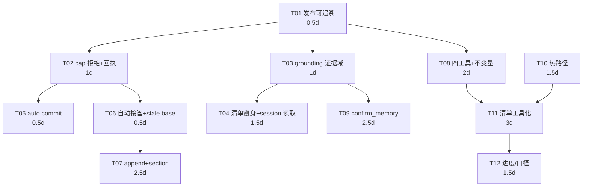

> 本文是 2026-10 的**历史记录**（已归档）。现行真相见 [`docs/README.md`](../README.md)：`docs/omem-v0.3-implementation-plan.md`（v0.3 工程决策）、[`ARCHITECTURE.md`](../../ARCHITECTURE.md)、[`docs/omem-重构方案-路B.md`](../omem-重构方案-路B.md)（v0.2 决策）。

# 规划方案技术评审与落地任务清单（2026-10-28 · 架构师高见远）

> 被评审：`2026-10-28-三方协同-改进规划方案.md`（产品经理）＋`2026-10-28-MCP调用与写入实测-三方协同.md`（QA）。
> 本文只做三件事：**裁定两处顺序改动**、**答复 Q1–Q5**、**给可落地的任务清单（含文件级改动范围）**。不复述上游。
> 行号以 HEAD=`c665702` 为准。未改任何源码，未 commit。

---

## 0. 评审结论

**有条件签收。** 骨架（正确性先于吞吐 / N2 阻塞 C1+append / P0-2 阻塞 confirm_memory / 不加 frontmatter 字段 / 分页不是首选）**全部成立，我逐条接受**。

但有 **4 处技术事实需要修正**，其中 2 处会改变方案内容：

| # | 产品方案里的表述 | 技术事实 | 后果 |
| --- | --- | --- | --- |
| **C-1** | Q4 立场②「拒绝 + 保留尾巴落到 `status: stale`，把半截从 active 检索面挪开」 | **`stale` 不在检索面之外**。`whereClause` 默认排除的只有 `archived`/`superseded`（`src/core/search.ts:52`），`stale` 仍返回，只是排序里乘 `/0.5`（`search.ts:108`、`:124`）。且 `formatStaleness` 对 stale 的文案是 `recorded …, not reconfirmed (cooled)`（`src/core/lifecycle.ts:35`）——语义是「曾经成立、待复认」，半截事实从未成立 | **②不成立，改判①（纯拒绝）**，见 §3-Q4 |
| **C-2** | Q3「该值由 `omem install` 写进 `~/.claude.json`，改名 = 所有既有安装静默失效」 | **`install` 从不写任何 `OMEM_*` 环境变量**：`src/install/` 与 `src/commands/install.ts` 对 `OMEM_HOME`/`OMEM_MCP_TOOLS` **零命中**（只有 `APPDATA`/`LOCALAPPDATA` 两处系统变量）。`OMEM_MCP_TOOLS` 只存在于 `tools.ts:266` 与测试、文档 | **Q3 的不可逆风险被高估**：改名没有"既有安装"可破坏，只需兼容手工改过 `mcp.json` 的少数人 → 定稿可以更自由，见 §3-Q3 |
| **C-3** | Q5 与 PM §2.2-改写A-3「beta.9 去绝对路径前缀、保留 `workbuddy/8225ff29`」 | `workbuddy/8225ff29` **不是可读路径**，`Read` 打不开。而 `omem install` 不写 env（C-2）意味着拿不到 path 就没有第二条路 | **P0-3 的路径压缩与 Q5 的 `session_id` 读取通道必须同批发布**，否则 beta.9 会新增一个「清单里的会话打不开」的能力缺口，见 §2 与 §4-T04 |
| **C-4** | P0-3 验收「`wc -c ≤ 18000`」＋「`per_group_limit=20`」 | 551 条 session 行裁到 20/组 = 100 行 → **451 个会话从清单消失且无法翻页**（`pending_memory` 在 V0.2）。这是**能力净损失**，不是瘦身 | **beta.9 不做 `per_group_limit`**，只做路径压缩 + topic 全列 + 头部瘦身，实测可到 ~24KB 且 551 行全保留。见 §2 |

**净效果**：PM 的两处顺序改动我**都接受**（拆 A1/C1、P0-2 硬前置），但 P0-3 的**手段与验收口径要改**，改完后 beta.9 反而更简单（少一个配置项、少一次二次改渲染）。

---

## 1. 两处顺序改动的裁定

### 1.1 「A1 与 C1 拆开、N2 阻塞 C1+append」→ **接受，且技术上必须如此**

产品给的三条理由我全部认同，补一条**代码层**的依据：截断发生在 `src/mcp/tools.ts:526-529`，即 **`save_memory` 自己的入参截断**，不是 `commitEntry` 的存储策略——`omem add`（`commands/add.ts:27`）与 pipeline **完全没有上限**。也就是说现在是三条写路径三套上限纪律：

| 写路径 | 上限行为 | 证据 |
| --- | --- | --- |
| MCP `save_memory` | 截断 + 回执（→ N2 半截事实） | `tools.ts:526-529` |
| CLI `omem add` | **无上限**，原样落盘 | `add.ts:27-36`（无 cap 分支） |
| pipeline | **无上限** | `commitEntry` 内无 cap 检查 |

所以 N2 不只是「截断策略错」，是「上限这条规则没有单一事实源」。若先做 C1（自动接管）而不修它：自动接管把「停下来想」这一步删掉，而三条路径的上限纪律仍然不一致——**降低摩擦的同一个动作，会把一个上层策略问题放大成事实源污染**。产品在这个点上的方向判断与代码结构一致，我签字。

### 1.2 「P0-2 → R2-A 硬依赖，不允许并行」→ **接受，且比产品描述的更严重**

产品只说「fence 内 JSON 能拿到 0.55，所以安全阀第一道条件可被刷过」。实际是 **`confirm_memory` 的两道锁会同时失效**：

- 锁一「`confidence >= 0.55`」→ 元数据可满足（QA N1/W9 实证）。
- 锁二「`user_said` 必须能在 `## user` 段核对上」→ 走的是**同一个** `evidenceIn` + `userSectionText`（`src/process/score.ts:58-62`、`:154`）。`user_said` 写成 `{"message_id": "…", "timestamp": "…"}` 一样核对成功。

即 N1 不是削弱一道锁，是让「grounding」这个判据本身从"用户说过"退化为"字符串在 user 段出现过"。**在 N1 修好前上线 `confirm_memory`，等于发一个任何人都能把自己刷成 0.9 的权限提升通道。** 硬依赖成立，且这条应写进 `AGENTS.md` 的新不变量段落（见 §4-T08）。

---

## 2. 对 P0-3 的两处技术修正（唯一实质改动的需求）

### 2.1 为什么不能做 `per_group_limit=20`

PROCESS.md 现在是「5 组 × 全部会话」。改成 20/组后：

- 可见会话从 **551 → 100**，剩下 451 个**从清单里彻底消失**，且 beta.9 没有 `pending_memory` 可以翻页（它在 V0.2）。
- 后果不是"不够瘦"，是**能力回归**：今天 Agent 至少能看到全部待办，改完只能看到 18%，且没有"下一批"的入口。这正是产品在 §7-5 反对「用加剧碎片化的手段修碎片化」的同一类错误——用丢待办的方式换体积。

**结论：`per_group_limit` 与分页绑定，整体移到 V0.2**，与 `pending_memory` 的 cursor 一起上线。beta.9 只做无损瘦身。

### 2.2 beta.9 的无损瘦身方案（含字节预算）

只砍**冗余**，不砍**信息**：

| 区块 | 现状（QA R6 实测） | 目标 | 手段 | 信息损失 |
| --- | --- | --- | --- | --- |
| 头部指令 | 4,093 B / 40 行 | ≈2,600 B | 删掉 3 条与 `save_memory` description **逐字重复**的 bullet（QA R8：save desc 1,780 字符与头部 4,093 字符讲同一套循环） | 0（`AGENTS.md:23` 要求的 PROCESS.md 路径声明必须保留） |
| session 行 | 75,590 B / 551 行 | ≈16,500 B / 551 行 | 去绝对路径，行格式 ``  - `workbuddy` / `8225ff29` ``（≈30 B/行，现状 137 B/行） | 0（551 行**全保留**） |
| `## Existing topics` | 1,259 B，只列 5/58 | ≈3,200 B，列 58/58 | 行格式压到 `` - `name`  `2026-10-28-xxxxxx` ``，去掉 confidence 与日期两列（可从 `search_memory(topic=)` 一行取到） | 0（反而从 5/58 变 58/58） |
| 其他 prose | ≈1,000 B | ≈1,300 B | 不动 | 0 |
| **合计** | **80,310 B / 612 行** | **≈23,600 B / 612 行** | | **0** |

**验收口径改为三条（替换 `≤18,000 B`）**：
1. `Read ~/.omem/PROCESS.md` **实测成功**（这是唯一真正的门槛；18KB 是拍的，宿主的实际判据是 `字符数 ÷ 4 > 20000`，见 QA R5 的 80,199 字符 → est 20,060）；
2. `wc -c ≤ 30,000`（留 25% 余量给真实 tokenizer 差异）；
3. **会话行数 ≥ 瘦身前**（防止用丢信息换体积），且 `grep -c 'C:\\Users' == 0`、topic 行数 = `omem topic list` 的 active 数。

### 2.3 一条明确否决：不要加「首条 user 文本裁 60 字」的摘要

beta8 B1 建议①把它列为首选，PM 未采纳（P0-3 最小可交付里没有它）——我确认**必须继续不采纳**，并把理由量化：

- 中文 UTF-8 是 **3 字节/字符**，60 字 = **180 B/行**。100 行 = 18,000 B，**单这一项就吃掉整个预算**。
- 而且它与 Agent 的下一步动作**重复**：Agent 拿到摘要之后仍然要读会话原文才能抠 evidence（`## user` 段 ≥12 字符原话）。
- 摘要的收益是"让 Agent 判断这条值不值得读"，这个判断用 `agent` + `id` + `copies` 已经能做（QA B3：50/551 行带 copies）。

替代方案（零成本）：把 `(long; read in parts)` 这个已有的体积提示（`guide.ts:165`，阈值为 100KB）保留，它比摘要便宜 40 倍且回答的是同一个问题。

---

## 3. Q1–Q5 逐条答复

### Q1｜`append` 的 `section` 与既有正文 `##` 标题的命名空间

**结论：接受产品的三条立场（不落 frontmatter / 撞名拒绝 / 落盘只是普通 `##`），并把"拒绝"的判据写死到可实现的程度。**

现状事实：知识库正文**基本不用 `##`**——正文是叙述 + 编号列表（QA A1 的 body 以标题句开头、`D3` 的样本是 `49. 既存结论…` / `99. 新增事实：…`）。`##` 只在**会话文件**里作为 `## user`/`## assistant` 分隔符（`session-store.ts:175`）。所以 `section` 不与现有数据冲突，风险在于**未来**。

**定稿规则（写进 `AGENTS.md` 新增段 `Living-document sections`）**：

1. `section` 可选。**省略时 = 追加到文末**（最后一个非空行之后，空行分隔），语义是"加一段话"，不新建标题。
2. 给了 `section` 时，在旧 body 内按行首**精确匹配** `^##\s+<section>\s*$`（`section` 先过 `normalizeSection`：trim + 连续空白收成一个 + 大小写不敏感比较，但**落盘保留调用方原样**）：
   - 命中 **0 处** → 新建：`\n\n## <section>\n\n<content>\n`；
   - 命中 **1 处** → **替换**该节正文（从该标题行之后，到下一个 `^##\s` 行或 EOF 之前）。这是"更新这一节"的唯一语义；
   - 命中 **≥2 处** → `status:"excluded", reason:"ambiguous section: ## <section> appears at lines <a>, <b>"`，**不猜、不取最后一个**。
3. **禁止**任何启发式（"取末尾最后一个 `##`" / "取最长的那个"）。QA N2 的教训是启发式 = 静默吃内容。
4. `section` 约束：长度 1–60 字符；不得以 `omem-` 开头（保留前缀，留给未来的元数据小节）；不得含换行。
5. **幂等与去重的顺序必须改**：现在 `commitEntry` 在**入参**上算 `contentHash` 去重（`src/core/commit.ts:161`）。append 时入参只是片段，永远匹配不到库里的全文 hash。正确顺序：`解析 base → 读旧 body → 合并 → cap 检查 → contentHash(合并后全文) 去重 → 落盘`。好处是重复 append 同一节同一内容会自然 `deduped`（幂等），**不需要新参数**。
6. 成本：服务端每次 append 本来就要读旧 body 做 cap 检查，所以"不知道有哪些节"不产生额外 IO；**不需要索引列、不需要 frontmatter 字段**。

**与产品的分歧：无。** 我把它从"立场"细化成"判据"，因为 §6.1 那条不可逆约束（分隔符一旦进正文就是事实源的一部分）要求第一条规则就精确。

### Q2｜grounding 修完后 `confidence` 各档是否重定义

**结论：不重定义档位（采纳产品的退让立场作为首选），并且 P0-2 必须实现为「新增函数」而不是「改 `userSectionText`」——否则会连带改动 `user_hash`，产生一次隐性语义漂移。**

**先说好消息：「只影响新写入」是自动成立的，零迁移。** `confidence` 写在 frontmatter 里（`entry.ts:41` 的 `FM_ORDER`），是落盘时算好的常量；`scoreEvidence` 只在写入时调用（`tools.ts:556`）。改打分逻辑**不可能**改动存量文件，也不需要回填。产品担心的"需要写迁移"不存在。

**再说必须避开的坑：不要改 `userSectionText`。** 它是三处共用：
| 用途 | 调用点 | 改了会怎样 |
| --- | --- | --- |
| evidence 核对 | `score.ts:93`、`:154`、`:220` | 目标行为，正确 |
| `sessionUserHash` 的输入 | `session-store.ts:188-190` | **`user_hash` 全体变化** |
| `user_hash` 的消费 | `guide.ts:237-242`、`:295` | 待办折叠/`copies` 口径漂移 |

而且这里藏着一个**存量陷阱**：`guide.ts:273` 是 `stored.userHash ?? sessionUserHash(stored.body)`——**优先用落盘时的旧值**。改了算法之后，新采集的会话用新 hash、旧会话仍用旧 hash，同一批数据两套指纹并行，`copies` 折叠与"已吸收指纹"判定会一半新一半旧，且**没有任何报错**。

顺带一个发现（对 Q2 有正面价值，但不建议本轮动）：因为 `normalizeForHash` 会删掉 `\p{P}`（`util.ts:13`），`{`/`"`/`:` 都在内，但 `message_id`/`timestamp` 的值本身不同 → **带 per-session metadata 围栏的会话，其 `user_hash` 天然不同，片段级去重对这类会话本来就没生效**。这解释了 QA B3「551 行里只有 50 行带 copies」——不是折叠算法弱，是 fence 污染了指纹。剥离 fence **能**让去重变好，但**不能在本轮做**，因为要同时处理 `userHash` 的版本迁移。

**定稿**：
1. 新增 `evidenceUserText(body): string`（`collect/session-store.ts`）：在 `userSectionText` 基础上，**只剥开头的围栏块**——若段首为 `Conversation info (untrusted metadata):` / `Sender (untrusted metadata):`，跳过其后（可选 ``` 围栏）直到围栏闭合或出现第一个非围栏非空行。**不做正则全文清洗**（用户真粘 JSON 时要保留）。
2. `scoreEvidence` / `scoreApiDoc` / `confirm_memory` 一律改调 `evidenceUserText`；**`userSectionText` 与 `sessionUserHash` 一行不动**。
3. 档位语义**不重定义**：0.35/0.55/0.75/0.8/0.9 的常量与含义全部保持（`score.ts:9-15`），`AGENTS.md:17` 的证据阶梯段落不改。
4. 验收补一条产品没提的：**修完后真实仓随机 10 个 workbuddy 会话的 grounding 成功率下降 ≤5%**（产品已写，我确认这条是必须的——防止剥离规则写宽了把真人话也剥掉）。若超过 5%，说明剥离边界错，回退到"只剥 `message_id`/`timestamp` 两键所在的 JSON 块"这个更窄的规则。
5. `user_hash` 的算法升级（含 fence 剥离）→ V0.2，与 `omem status` 一起做，且必须带「`user_hash` 版本标记 + 一次性全量重算」的显式方案。

### Q3｜`OMEM_MCP_TOOLS` 键名定稿

**结论：冻结 4 个 token（不是冻结工具清单）；`core` 恒含读扩展；`feedback` 作 legacy 别名映射到 `ops-write`。并且借 C-2 的事实把"不可逆"降级为"低风险"。**

先纠正前提：**`install` 不写 env**（C-2），所以不存在"改名会破坏既有安装"。真正持有 `OMEM_MCP_TOOLS` 的只有两类：①按 `docs/记忆可信度的人工核实与Agent协作手册.md:88` 手工改 `mcp.json` 的用户；②`tests/mcp-tools.test.ts:39-40` 与 `tests/mcp-probe.mjs`。

**定稿形态**：
```bash
OMEM_MCP_TOOLS=                                        # 缺省/空 = core（含读扩展）
OMEM_MCP_TOOLS=core                                    # 同缺省，显式写法
OMEM_MCP_TOOLS=core,ops-write                          # + skip_session, confirm_memory, memory_feedback
OMEM_MCP_TOOLS=core,ops-write,ops-destructive          # + redact_entry（destructiveHint, 双参确认）
OMEM_MCP_TOOLS=all                                     # = 三档全开（等价，方便手写）
```
**解析规则（`tools.ts:266` 一处改，逐条写死）**：
1. `split(',')` → trim → lower → 去空；
2. 识别 `core` / `ops-write` / `ops-destructive` / `all`；
3. **任一档命中即打开该档；档位是包含关系**：`ops-write ⊃ core`，`ops-destructive ⊃ ops-write ⊃ core`（即 `ops-destructive` 这个词本身就要求 core 与 ops-write 一起给，但缺 core 时**自动补**——不允许"给了高档却少了低档"导致基础工具消失）；
4. **识别到 0 个已知 token → 按 `core` 处理**（这条是向后兼容的关键：`feedback` 时代"值只有 feedback"的配置不会变成空工具面）；
5. `feedback` 作 legacy 别名 → 等价于 `ops-write`（因为它改变 `confidence`/`verified`，属写运维）；
6. **未识别的 token 不静默丢弃**：进 stderr 一行 `unknown OMEM_MCP_TOOLS token(s): x`（`AGENTS.md:27` 的纪律要求可见，且 stdout 只走协议）。

**为什么"冻结 token 而不是工具"**：产品的约束是"并列值 ≤4 个"，同时未来还要加工具。解法是——**token 集合冻结，工具挂载关系可以随版本演进**。这样未来加工具不需要用户改 env，也不需要第二次发布"永不改名"声明。

**与产品的分歧：一处。** 产品把 `status` 当独立工具。我建议**不新增 `status` 工具，把它的字段并进 `pending_memory` 的返回体**（`totals: {pending_sessions, pending_groups, absorbed_sessions, topics, verified, truncated}`）——因为 `pendingTopics` 已经算出这四个数（`guide.ts:373-383`），多一个工具是纯 token 税。这样默认面是 `search_memory` / `save_memory` / `pending_memory` / `topic_list` 四个工具，而不是五个。

**token 预算核算（对齐 S3 ≤12,500 字符）**：

| 项 | 现状/估算 | 依据 |
| --- | --- | --- |
| 现状 2 工具 | 10,219 | QA R8 |
| `topic_list`（desc ≤400 + schema ≈250） | +≈700 | 需 ≤400 字符的 desc 硬约束 |
| `pending_memory`（desc ≤400 + schema ≈450，含 status 字段） | +≈900 | 同上 |
| `search_memory` 增 `session_id`/`offset`/`limit`（Q5） | +≈300 | 三个短属性 |
| **合计** | **≈12,100** | < 12,500，余量 400 |

结论：**四个工具 + 三个新参数 = 12,100，可行**；若再塞第五个工具就超预算，所以 `status` 必须并进 `pending_memory`。

### Q4｜N2 的截断策略：拒绝 vs 保留尾巴

**结论：选①（纯拒绝），否决产品的②。判定依据是代码事实而非偏好。**

**②不成立的三条理由**：

1. **`stale` 不在检索面之外。** `search.ts:52` 默认只排除 `archived`/`superseded`；`stale` 仍出现在默认结果里，只在排序上乘 `/0.5`（`search.ts:108`、`:124`）。产品写「把半截从 active 检索面挪开」——`stale` 只降低权重，**不挪开**。半截事实仍会被下一个 Agent 检索到、当基础继续 supersede。
2. **`stale` 的语义是"曾经成立待复认"，用它装"从未完整成立"是新增一条错误语义。** 文案 `recorded …, not reconfirmed (cooled)`（`lifecycle.ts:35`）+ `gc` 本来就会按 `last_confirmed` 老化写入 stale（`lifecycle.ts:40-67`）。把截断产物也标 stale，之后无法区分"这是冷却的真事实"和"这是半句话"，而 `review --confirm` 对非 active 条目是拒绝的（`lifecycle.ts:220-225`）——**用户连"确认它"这条正常出路都没有**。
3. **②仍然把半截写进事实源。** 唯一清掉它的是 `redact` 硬删（`AGENTS.md:13`），而"永不自动删除"是叙事核心。产品用 ② 想避免"完全无法更新"，代价是**在事实源里生产需要人工硬删的垃圾**——用更贵的清理换更少的报错。

**①不是"彻底写不进去"（产品的担忧），是"比现在更好"**：

| | 现状（截断） | 改后（拒绝） |
| --- | --- | --- |
| 旧文档 | 被 supersede → 退出检索，**内容永久丢失** | **保持 `active` 且完整** |
| 新事实 | 落盘为 `99. 新增事实：…`，**是 active** | 不落盘，回执给出口 |
| 用户可恢复性 | 需要人肉发现 + 手改 | 一次重试即可 |

即拒绝是**严格改善**：现状连"旧文档完好"都保不住（它被 supersede 了），拒绝至少保住了旧文档。

**定稿（P0-1 的最小可交付）**：
1. cap 检查从 `tools.ts:526-529` **下沉到 `commitEntry`**，通过 `CommitInput.overCap?: 'reject' | 'truncate'`（默认 `reject`）控制。理由：三条写路径三套上限纪律是 N2 的结构成因（`add.ts`/pipeline 无上限）。统一后 `omem add` 对超长内容也会拒绝——**这是行为变更，必须写进 release note**，`--force` 可绕过（`force` 已有"绕过护栏"的语义，`commit.ts:155`）。
2. 拒绝分支必须**在 supersede 之前**返回，保证旧文档不被改动（复用 W11 已验证的原子性口径）。
3. 回执给出四件事（这是"出口"，产品的核心担忧在这里被回答）：
   ```
   Not written: content is 2,063 characters, over the 2,000 limit by 63.
   Nothing was superseded; 2026-10-28-4f2525 is still active and unchanged.
   Over-cap preview (not written): "99. 新增事实：指数退避…"
   Options: (a) tighten the existing body to stay under 2,000 and resend;
            (b) start a narrower topic, e.g. "matea-hermes-runs", for the new fact.
   ```
4. **不给 `truncated` 落盘路径**（连 `tags: truncated` 都不要）：标签是事实源的一部分，而产品已签字"不加新 frontmatter 字段/新状态"。
5. 存量 2 份 2,001 字符文档按产品 §8-R8 处置（只登记 id、不自动改写）——**同意**。

**与产品的分歧：只有这一条（①②之选），且这是唯一一处我建议推翻产品立场的地方。** 若产品坚持②，我的技术意见是：②必须在 `whereClause` 里把 `stale` 也默认排除（改一行），否则"挪开"这个既定目标不成立；而改默认排除会让 `gc` 冷却的真事实也从检索面消失——**一个需求引出的第二个不变量改动**，成本远大于收益。

### Q5｜「按 session 短 id 取全文」归 core 还是 ops-读

**结论：`search_memory` 参数扩展，0 新工具、+≈300 字符、技术上完全可行。但它必须与 P0-3 的路径压缩同批（见 C-3）。**

**可行性核对**（`src/mcp/tools.ts:344-398`）：
- 现状 `toolSearch` 的入口守卫是 `if (!query && !topic) throw`（`:351`），`scope=sessions` 又要求 `query`（`:357`）。加 `session_id` 只需在这两处放行，并在 `scope==='sessions'` 分支前加一个 `session_id` 优先的短路。
- 读取侧已有现成件：`readSessionsById(home, id)`（`tools.ts:22` 已 import，`score.ts:147` 在用）→ 不需要新 IO 代码。
- 输出侧：返回 `## user` 段（**剥离后**）+ 每段字符范围 + `## assistant` 段的计数（不进正文）。这同时交付 PM 的 **P1-7（纯净可复制引文 + 字符范围）** 的一半，而且是 C2 的正确修法——QA A3 说"摘录越可读越可能是 assistant 段"，根因是 `snippet()` 只在 FTS 上做，不知道段落归属；按 `session_id` 直取就绕过了这个问题。

**定稿契约**：
```jsonc
// search_memory 新增
"session_id": { "type": "string", "description": "Bare session id from PROCESS.md (no collector prefix). Given with scope=sessions, returns that transcript's ## user text as quotable segments; query is then optional." },
"offset":     { "type": "number", "minimum": 0, "description": "scope=sessions + session_id: start of the returned segments." },
"limit":      { "type": "number", "minimum": 1, "maximum": 20, "description": "scope=sessions + session_id: max segments (default 5)." }
```
返回体（新增字段，不改既有字段）：
```jsonc
{ "scope":"sessions", "session_id":"8225ff29",
  "path":"C:\\…\\workbuddy\\8225ff29.md",
  "segments":[ { "role":"user", "chars":[1204,1480], "text":"…剥净后的可复制原文…" } ],
  "assistant_segments": 6,
  "note": "Only ## user text is returned; assistant text is never evidence." }
```
**字节成本**：`session_id` desc ≈110 + `offset` ≈90 + `limit` ≈95 + schema 骨架 ≈40 ≈ **335 字符** → tools/list 从 10,219 → ≈10,550，仍在 S3 内。

**P0-3 的依赖关系（C-3）**：路径压缩后 Agent 只有 `agent/id`，必须能凭它取到正文与可复制引文。所以 **T04（渲染）与 T05（读取通道）必须同一版本发布**；若分版本，beta.9 会留下"清单瘦了但打不开"的窗口，这比 80KB 更糟（80KB 至少 `head` 能读）。

---

## 4. 落地任务清单

分组原则：**按用户可见结果分组，不按文件拆**；每个版本 ≤5 个任务；每个任务至少 3 个相关文件。

### beta.9（止血 + 正确性，5 个任务）

#### T01 · 发布可追溯（P0-4，流程级）
**源文件**：`package.json`、`src/core/version.ts`、`src/commands/cli` 侧版本输出（`src/cli.ts`）、`.npmignore`（或 `package.json` 的 `files` 白名单）、`scripts/release-check.mjs`（新增）
**改动**：①`version.ts` 输出 `0.1.0-beta.9+<short-commit>`；②`package.json.files` 显式白名单（排除 `tests/`、`.omem-test/`、`docs/`）；③`scripts/release-check.mjs` 断言 `version === git describe --tags --exact-match` 且 `npm pack --dry-run` 无测试残留；④发布 checklist 落 `docs/`
**依赖**：无（先于一切评测）
**测试**：`tests/unit/cli.test.ts`（版本串）、`scripts/release-check.mjs` 自测、`tests/smoke.sh` 加一条产物审计
**验收**：产品 §4.1 beta.9 门槛⑤

#### T02 · 写入正确性：cap 拒绝 + 回执诚实化（P0-1 + P1-4）
**源文件**：`src/core/commit.ts`（`overCap` 策略 + 拒绝分支前置 + `previousTrust` 回传）、`src/mcp/tools.ts`（去掉 `:526-529` 的截断、拼装新回执）、`src/commands/add.ts`（`--force` 语义说明）、`src/process/pipeline.ts`（确认批量路径传 `overCap:'truncate'` 或显式拒绝）
**改动**：①`CommitInput.overCap` 默认 `reject`；②拒绝在 supersede 解析**之前**返回（保护旧文档）；③回执四段（超限字数 / 旧文档仍 active / overflow_preview / 两个出口）；④supersede 掉 verified 文档时回执加 `previous verified status (0.9) was dropped; old version kept at <id>`
**依赖**：T01
**测试**：`tests/unit/commit.test.ts`（新增 N2 复现用例 1,990+73 → 必须 `excluded` 且旧文档仍 active）、`tests/unit/save-feedback.test.ts`（回执含旧 confidence）、`tests/unit/pipeline.test.ts`（批量路径不被误拒）
**不变量**：无改写；强化 `status: active` 的含义
**验收**：产品 §4.1 ①

#### T03 · grounding 证据域（P0-2）
**源文件**：`src/collect/session-store.ts`（**新增** `evidenceUserText`，`userSectionText` 与 `sessionUserHash` 一行不动）、`src/process/score.ts`（`scoreEvidence`/`scoreApiDoc` 改调新函数）、`src/core/search.ts` 或 `tools.ts`（`scope=sessions` 的 snippet 也走新函数，否则 N1 从摘要侧复发）
**改动**：只剥段首 metadata 围栏块；不做全文正则清洗
**依赖**：T01（与 T02 可并行）
**测试**：`tests/unit/score-ladder.test.ts`（N1 复现用例必须 0.35）、`tests/unit/evidence-merge.test.ts`、`tests/unit/commit.test.ts`（全角标点证据仍 anchor 成功——`0355873` 已有用例，禁回退）、新增「真话不被剥」用例
**验收**：产品 §4.1 ②+ 我加的「grounding 成功率下降 ≤5%」

#### T04 · 清单可读性闭环：渲染瘦身 + `session_id` 读取通道（P0-3 + Q5 + P1-7 的前半）
**源文件**：`src/process/guide.ts`（`renderGuide` 行格式/topic 全列/头部瘦身/**`GUIDE_MAX_BYTES` 预算兜底**）、`src/mcp/tools.ts`（`session_id`/`offset`/`limit` 三个属性 + `toolSearch` 守卫放行 + `segments` 返回体）、`src/context/instructions.ts`（工作循环第 1 步文案）、`src/context/export.ts`（如果引用了行格式）
**改动**：见 §2.2 预算表 + §3-Q5 契约。**不做** `per_group_limit`、**不加**摘要、**不砍**会话行数
**依赖**：T03（纯净引文依赖 fence 剥离）
**测试**：`tests/unit/guide-{dedup-skip,docid,queue,topics}.test.ts`、`tests/unit/process-guide-refresh.test.ts`、`tests/unit/run-summary.test.ts`、`tests/unit/mcp-tools.test.ts`（schema 断言）、`tests/mcp-probe.mjs`
**不变量**：如果改工作循环第 1 步文案 → `AGENTS.md:23` 的三处同 PR
**验收**：§2.2 的三条（Read 成功 / ≤30KB / 会话行数不减）

#### T05 · 写路径 auto commit + 版本收口（P1-5）
**源文件**：`src/core/commit.ts`、`src/sync/git.ts`（复用 `git()` 封装 `:14`）、`src/core/config.ts`（`[process] auto_commit`）、`src/mcp/tools.ts`（`vcs` 回执字段）、`tests/smoke.sh`
**改动**：一次工具调用一个 commit；非 git 仓静默跳过 + warning（照抄 `refreshGuide` 的吞异常纪律 `commit.ts:130-136`）；`off` 时回执提示 `omem backup`
**依赖**：T02（同一处回执拼装）
**验收**：产品 §1.3-R3（commit 数 = 写入轮次）

### beta.10（解摩擦 + 能力面，4 个任务）

#### T06 · `supersede` 自动接管 + stale-base 护栏（P1-1）
**源文件**：`src/core/commit.ts`（`:200` 已有的 `findActiveByTopic` 结果改为接管而非拒绝）、`src/mcp/tools.ts`（`auto_superseded` 回执）、`src/commands/add.ts`（`--force` 不再需要绕这里）
**护栏（不可省，对应产品 §8-R3 跨进程并发）**：给了 `supersedes` 但与当前 active 不一致 → `status:"excluded", reason:"stale base"`，**不静默合并**
**依赖**：T02（N2 必须先修）
**测试**：`tests/unit/commit.test.ts`（原"拒绝"用例改为"自动接管"）、新增 stale-base 用例
**验收**：产品 S1 ≤2 次往返

#### T07 · `mode:"append"` + `section`（P1-3）
**源文件**：`src/core/entry.ts`（新增 `splitSections`/`mergeSection` 纯函数）、`src/core/commit.ts`（合并 → cap → 去重的**顺序调整**）、`src/mcp/tools.ts`（三个新参数 + 回执 `sections`）、`AGENTS.md`（新增 `Living-document sections` 段）
**依赖**：T06 + T02 + §3-Q1 定稿
**测试**：`tests/unit/commit.test.ts`（撞名 0/1/≥2 三种分支、幂等 append、cap 拒绝）、`tests/unit/entry.test.ts`（序列化往返）
**验收**：产品 F1/F2/F4（满文档 0 新建 topic、比值 ≥3×）

#### T08 · 工具面四工具 + 不变量改写（P1-6）
**源文件**：`src/mcp/tools.ts`（4 token 解析 + `topic_list` + `pending_memory`）、`src/mcp/server.ts:58`（`buildTools(process.env)` 显式传参）、`src/context/instructions.ts`（每个新工具一句用途 + `<CLI-only>` 标签）、`AGENTS.md:27`（**改写**）
**依赖**：T01；token 定稿见 §3-Q3
**验收**：产品 §1.1-S3（`tools/list` ≤12,500 字符，我的核算 ≈12,100）

#### T09 · `confirm_memory` + `AGENTS.md:17` 改写（P1-2）
**源文件**：`src/mcp/tools.ts`（新工具，`ops-write` 档）、`src/core/lifecycle.ts`（复用 `reconfirm`，加校验壳）、`src/context/instructions.ts:14`（`RULE_VERIFIED`）＋`src/context/export.ts:34`（引用同一常量，自动跟随）＋`src/mcp/tools.ts:163-180` 与 `src/process/guide.ts:121-131` 的**手写副本**、`AGENTS.md:17`
**硬依赖**：T03（N1 未修前上线 = 权限提升通道，见 §1.2）
**验收**：产品 §4.1-⑦ + QA H9

### V0.2（规模与工具化，3 个任务）

#### T10 · 热路径去 O(N)（P1-8）
**源文件**：`src/core/index.ts`（`reindexSessionFiles` 去重读 + `sessions` 加 `size`/`mtime_ms` 两列走 `addColumn`）、`src/mcp/server.ts:61`（对账节流）、`src/core/commit.ts:280`（清单刷新改增量或移出热路径）
**关键**：`sessions` 是**普通表**，`ALTER TABLE ADD COLUMN` 可行（`index.ts:120-123`），**不是** FTS5 虚表 → **不需 rebuild**。这是与「topic 不进 FTS」（`AGENTS.md:22`）那条教训的分界，必须在实现说明里写清
**依赖**：QA H2/H10 验证成立

#### T11 · 清单工具化（PROCESS.md → ≤80 行 + `pending_memory` cursor）
**源文件**：`src/process/guide.ts`（`per_group_limit` + cursor）、`src/process/pipeline.ts:395-411`、`src/mcp/tools.ts`（`pending_memory` 分页）、`src/context/instructions.ts`
**依赖**：T08（工具面已存在）——**这是 `per_group_limit` 的正确落点**（见 §2.1）

#### T12 · 进度与去重口径（P2-1/2/3/4 + `user_hash` 升级）
**源文件**：新增 `src/commands/status.ts` + `src/cli.ts` 注册、`src/commands/topic.ts:169`（TITLE 自适应）、`src/mcp/tools.ts`（search 侧近似 topic 提示）、`src/collect/session-store.ts`（`userHash` 版本标记 + 一次性重算）
**依赖**：QA H5（若证伪，`guide.ts:126` 文案改为「copies 仅保证 user 段相同」并升 P0）



**注**：T05 / T06 / T07 / T08 / T09 的文件重叠集中在 `commit.ts` + `tools.ts`，但**不是线性依赖**（除 T06→T07 与 T03→T09）。beta.10 建议 T06/T07 一人、T08/T09 一人并行，T08 先合（T09 的新工具要挂到 `ops-write` 档）。

---

## 5. 技术约束确认（对产品 §6.1/§6.3 的回应）

**必须一次做对（我确认产品的四条，并补两条）**：
1. `instructions` / `save_memory.description` / `export.ts` RULE 常量 —— **实际 4 份副本**（`instructions.ts:11-15` 常量、`export.ts` 引用、`tools.ts:163-180` 手写、`guide.ts:121-131` 手写）。建议加一条单测：断言 `RULE_EVIDENCE`/`RULE_VERIFIED` 的字符串在 `tools.ts` 与 `guide.ts` 中**不出现第二份手写副本**（改成 import 即可根治）。
2. `append` 的 `## <section>` 分隔符（§3-Q1）。
3. `OMEM_MCP_TOOLS` 的 **token 集合**（不是工具清单，见 §3-Q3）。
4. `verified` 的语义边界 —— 产品已签字"历史语义并存、只对未来放宽"，我确认**加上 `source` + `tags: user-assented` + `confirmations` 足够审计**（`EntrySource` 已有 `manual` 值，`entry.ts:8`）。
5. **新增**：cap 策略（`overCap`）一旦落进 `commitEntry`，`omem add` 对超长内容从"静默接受"变为"拒绝"，这是 CLI 行为变更，**必须一次说清**，不要留"某些路径有上限、某些没有"的中间态。
6. **新增**：`user_hash` 的算法在本轮**冻结**（不许顺手改 `userSectionText`）。它的任何变化都是隐性迁移，必须与版本标记同批（T12）。

**可灰度（我确认产品的三条，并说明边界）**：
- P0-3 渲染：纯派生，但**必须与 T04 的读取通道同批**（C-3），否则灰度窗口里清单不可用。
- T05 auto commit：`auto_commit = off` 即回退。
- T08 工具面：`OMEM_MCP_TOOLS` 不带扩展位即回到 core（**注意**：core 现在含读扩展，所以"回到 2 工具面"这个回退点**不存在**了——回退点是"回到 core 的 4 个工具"，产品 §9-4 的表述需相应修正）。

---

## 6. 排期前置门：技术判定条件

产品把 H2/H5/H6/H10 写成前置门，我同意并给出**由谁判、判什么**：

| 门 | 判定动作 | 我的技术判定阈值 | 不通过时我的方案变动 |
| --- | --- | --- | --- |
| **H2**（catch-up 占比） | 对比 5 次 `search_memory`（只读）与 5 次 `save_memory` 的耗时；单独计 `index.catchUp()` | 只读耗时 ≥ 写入的 60% → 延迟主体是 R6 | T10 从 V0.2 提到 beta.10；R4 验收改口径 |
| **H5**（copies 等价性） | 找 `copies≥3` 的组，逐份 diff `## user` 与 `## assistant` | **任意一份 assistant 段有实质差异即证伪** | `guide.ts:126` 文案改为「copies 仅保证 user 段相同」；D1 从「已修」退回「误修」；升 P0-5 |
| **H6**（fence 占比） | 10 个 workbuddy 会话统计段首围栏比例 | >30% → P0-2 影响面大；<10% → 优先级可降但仍要做 | 影响 T03 的回归样本量 |
| **H10**（`addColumn` 免 rebuild） | 复制真实 db，用改动后代码打开 | `PRAGMA table_info(sessions)` 自动补齐 + `catchUp` 无错 | 不通过 → T10 重新设计（`rebuild` 路线直接否决，产品 §7-2） |
| **R10**（57 vs 58） | 见下 | 见下 | — |

**R10 的技术答复**：57 与 58 的差不是笔误，是**两个口径**：`entries` 表（`index.countByStatus()`，`index.ts:375`）与磁盘文件（`listEntries()`，走 `knowledge/`+`archive/`）。QA §1 读的是 sqlite（57），R7/W16 读的是磁盘渲染（58）。**按 `AGENTS.md:15`「Markdown 是事实源」，验收一律以 `listEntries()` 为准**。但两者差 1 这件事本身值得留一个检测：**T12 的 `omem status` 同时输出两个数并在不一致时打印 `index/file drift: N`** —— 把口径问题变成一个漂移告警，这比统一口径更有价值（索引漂移是"可 rebuild 但不能静默"的那类错误）。

---

## 7. 我这一轮不改的（避免范围蔓延）

| 项 | 为什么现在不做 |
| --- | --- |
| `scope=sessions` 的 snippet 半径（12 token / 40 code point 两套口径） | T04 的 `session_id` 直取已经绕开它；改半径要动 `searchSessions` 的 FTS 分支 |
| search 侧近似 topic 建议（P2-3） | 纯 copy，V0.2 与 `topic_list` 一起做才有词表可用 |
| `user_hash` 加 fence 剥离（能改善 copies 折叠） | 需要版本标记 + 全量重算，T12 |
| `install` 补写 `env` | 它现在连 `OMEM_HOME` 都不写（C-2），补写是新功能且触碰「install 六条纪律」（`AGENTS.md:28`），应独立评估 |
| `omem status` 的命令实现 | 归 T12，但**建议 beta.9 的发布说明里先给一条 `sqlite3` 只读快照命令**当临时替代 |

---

# §8 补测数据裁决（H2 / H3 / H5）

> 输入：QA 追加的 §8（`2026-10-28-MCP调用与写入实测-三方协同.md`，518 行）。方法已交叉核对：真实仓整套复制到隔离 HOME；PROCESS.md 用 `git archive v0.1.0-beta.8` + `tsc` 分别构建，对**同一批 1,101 会话**各渲染一次。
> 本节只写**改判**与**由此产生的任务变更**，不重写 §0–§7。

## 8.0 五条裁定一览

| # | 问题 | 裁定 |
| --- | --- | --- |
| 1 | T04 预算是否重算 / 「大组优先」是否该撤 | **手段不变**（路径压缩 + topic 全列 + 头部瘦身，551→572 行全保留）；**排序不撤**；但**必须新增字节预算护栏**，否则同型回归会以另一种形式再来 |
| 2 | P0-3 从「历史欠账」变「回归修复」，是否提前 | **确认 team-lead 口径**：仍在 beta.9，**不提前于 T02/T03**；但新增一条「渲染回归测试」，且 beta.9 不得在没有它的情况下发布 |
| 3 | H5 是否新增任务 | **新增 T13（P0-5，beta.9，≤0.5 天）**；且 H5 连带暴露**第二个同类缺陷**（`absorbedUserHashes` 静默隐藏兄弟会话），一并纳入 T13 |
| 4 | H2 之后 R6/T10 落点与验收 | 确认留 V0.2；**R6 降 P1**；验收按读/写分列，**不写全局 p50<100ms**（写路径到不了）；读路径 700ms→100ms 量级**可达** |
| 5 | D1 退回误修 / 是否 P0 候选 | **是，P0-5**；§0 盘点表 D1 行改为「误修」；beta.9 任务数 **5 → 6** |

## 8.1 H3：P0-3 的性质变更与 T04 预算重算

### 8.1.1 关键修正：**不要把 beta.8 的 64 行当成目标形态**

| 版本 | 行数 / 字节 | session 行 | 最大单组 | copies 合并 |
| --- | --- | --- | --- | --- |
| `v0.1.0-beta.8` | 64 行 / 7,221 B | **29** | 8 行 | 0 行 |
| HEAD `c665702` | 611 行 / 117,752 B | **572**（占字节 97.4%） | **478 行**（`local:7578434e` ≈ 9.4 万字节 = 全文 80%） | 51 行 |

beta.8 只有 29 条 session 行，不是因为它瘦，是因为它**看不见积压**：旧逻辑按 `listSessions()` 自然序 `slice(0,5)`，566 会话的大组永远进不了窗口。所以：

- **HEAD 的缺陷是「无窗口渲染」，beta.8 的缺陷是「积压不可见」，两者都不是目标形态。**
- 撤销 `3fe8c9c` 整体 = 把「看不见」改回「看不见」，必须否决。

### 8.1.2 「排序」与「渲染窗口」必须分开对待（避免研发整体 revert）

| 代码 | 作用 | 判定 |
| --- | --- | --- |
| `guide.ts:366-367`（按未吸收会话数降序 + 最近活跃时间） | 让大组能进窗口 | **保留**。它解决的是真问题，β8 的 29/1,101 就是它修掉的 |
| `guide.ts:368`（`batch=5` 只限组数） | 组数窗口 | 保留 |
| `guide.ts:162-169`（组内 `for (const s of topic.sessions)` 无上限） | **缺陷所在**：窗口只加了一个维度 | 由 T04 加「字节预算」处理 |

一句话给研发：**排序是对的，缺的是第二个维度的窗口；revert `3fe8c9c` 会把「看不见积压」原样装回去。**

### 8.1.3 T04 预算按「单组上限」重算——结论：手段不变，但必须加预算护栏

| 区块 | 算法 | 字节 |
| --- | --- | --- |
| 最大单组（478 行 × ≈30 B） | 去路径后 `` `agent` / `id` `` | ≈14.3 KB |
| 其余 4 组（572−478 = 94 行 × 30 B） | 同上 | ≈2.8 KB |
| 头部（删 3 条与 save description 重复的 bullet） | 4,093 → ≈2,600 | ≈2.6 KB |
| `## Existing topics` 58/58（行格式压到 `name` + `id`） | 58 × ≈45 B | ≈2.6 KB |
| copies / long 标记（51 行 × ≈15 B） | — | ≈0.8 KB |
| 其他 prose | — | ≈1.3 KB |
| **合计** | | **≈24.4 KB / 572 行** |

**可读性判定（两个口径都要过）**：
- 宿主本机判据 `字符数 ÷ 4 > 20,000` → 24.4 KB ≈ 24,200 字符 → est 6,050 tokens，**3.3× 余量**；
- 真实 tokenizer 口径：ASCII session 行 ≈17 KB ≈ 4,300 tokens + CJK（头部/topic/prose ≈7 KB）≈ 6,500 tokens ≈ **10,800 tokens < 20,000**，2× 余量。

→ **手段不变，24 KB 可读。** 但必须补一条 beta.9 就生效的护栏，因为 H3 的真正教训不是"文件太大"，是**"渲染没有任何预算"**：

| 护栏 | 规格 |
| --- | --- |
| `GUIDE_MAX_BYTES = 30_000` | `renderGuide` 返回后校验，超限按降级阶梯处理并 `appendLog(home,'guide',{degraded:true,...})` |
| 降级阶梯（顺序固定） | ①先删 `## Existing topics` 的 `id` 列，只留名字（省 ≈1.7 KB）②再按「组内从末尾截」等比隐藏 session 行，**每组输出一行显式标记** ③头部永不删 |
| 显式标记（不可省） | `  - …N more in this group (hidden by the size budget; search_memory(scope="sessions") or raise process.guide_batch)` |
| 单测 | 造 1,400 条会话的 fixture → 断言输出 ≤30 KB **且**每组都有 `hidden by the size budget` 行 |

> 这条护栏也是给 PM 那个问题的答案：**任何"看不见"都必须是显式的、带数字的**。它在 beta.9 可能永不触发（24 KB < 30 KB），但它是防止「下一次无窗口增长」的唯一机制。

## 8.2 H5：D1 退回「误修」→ P0-5 / T13

### 8.2.1 判定

QA 按 `user_hash` 重算真实库 1,101 份：958 个指纹组，`copies≥3` 的 26 组里 **25 组 assistant 段实质不同**（最大组 25 copies → 25 个不同回答，1,075–3,073 字符），`## user` 段 26/26 逐字一致。唯一"成立"的组是 assistant 段全空。

**`guide.ts:126` 的 "distilling the listed one covers all copies" 是错误承诺，按它操作最多静默丢 24 份独立结论。**
**D1 从「已修」退回「误修」**，定 P0-5，与 N1/N2 同批（同型错误：以为记下了、其实内容没了）。它比 N2 更常见——N2 命中 4/58 份满文档（6.9%），H5 命中 25/26 组（96%）。

### 8.2.2 QA 未测但 H5 直接连带的第二个同类缺陷（本裁决新增）

`guide.ts:237-242` 建了一个「已吸收指纹集」，`:296` 用它判定待办：

```ts
const absorbedUserHashes = new Set<string>();      // 任何文档引用过的会话的 user_hash
...
const isPending = !handled && !absorbedUserHashes.has(uh);   // :296
```

结合 H5：**吸收兄弟组中的 1 份，同指纹的其余 N−1 份会一起退出待办**——而它们的 assistant 段各不相同，也就是**最多 24 份独立结论被永久移出积压，且无任何提示**。这比文案错误更严重：文案是"误导"，这是**账本级的静默丢单**。

**上界可以算**：1,101 份 → 958 个指纹组，多出 143 份"组内副本"。所以被静默隐藏的会话 **≤143 份**，量级可控。

**为什么可以放心移除这个抑制（成本论证）**：显示侧已经有一层按 `project → uh` 的折叠（`guide.ts:344-354` 的 `seenHashByGroup`），兄弟会话被标 pending 后会**折进已有的行**（`copies` 递增），**不会新增行**。所以移除抑制 ≈ **0 字节**，只让 `copies` 数字变诚实。

**裁定：T13 移除 `absorbedUserHashes` 抑制**（保留 `skippedSessionIds` 与逐 id 的 `absorbed` 判定）。副作用要写进 release note：**`405 unabsorbed` 这个数字会变大**（虚低被纠正），而变大是对的。

### 8.2.3 T13 定稿（确切文案 + 标记改名）

| 项 | 内容 |
| --- | --- |
| **文案替换**（`guide.ts:126` 原文：`- Sessions sharing one user-section fingerprint are collapsed into a single line with \`(copies: N)\`; distilling the listed one covers all copies.`） | `- Sessions sharing one \`## user\` fingerprint are collapsed into one line as \`(same-user-text: N)\`. They share **only what the user typed** — the assistant's answers differ across the N sessions, so read every copy you intend to distil, or say in the body which answer you relied on.` |
| **标记改名** | `(copies: N)` → `(same-user-text: N)`。理由：`copies` 在英文里就是"副本 = 等价"，改名是消除暗示；成本 +8 B × 51 行 ≈ **410 B**（可忽略） |
| **折叠逻辑** | **不改**。按 `user_hash` 折叠作为**显示层去重**是对的（自动化重复落盘是常态）；错的是文案承诺了它没做的事 |
| **移除抑制** | 删 `guide.ts:237-242` 与 `:296` 的 `absorbedUserHashes` 分支；`absorbed`（逐 id）保留 |
| **验收** | ① `grep -c "covers all copies" PROCESS.md == 0` ② `grep -c "same-user-text" ≥ 1` ③ 造「3 份同 user 段、assistant 各不同」的 fixture → 三者都应出现在待办（折进 1 行、标 `same-user-text: 3`）④ 待办总数变化被记录（预期上升，≤143）⑤ `guide-dedup-skip.test.ts` 的「按指纹吸收」用例改为断言"不因兄弟被吸收而退出" |
| **工时** | ≤0.5 天 |
| **与 T04 的关系** | **同改 `guide.ts:121-131` 同一代码块** → 必须**同一人、同一分支、T13 先合**（T04 要删 3 条重复 bullet，若 header 还写着错误承诺，删哪三条的判断会变） |

## 8.3 H2：R6 降 P1、留 V0.2，验收线按读/写分列

### 8.3.1 采纳 QA 的口径修正，并撤回我自己的两处表述

| 我原来的说法 | 实测 | 修正 |
| --- | --- | --- |
| 「2–4 秒」是写入成本 | `catchUp()` 596–848 ms；只读 ×5 = 650–717 ms；真写 1,526–1,613 ms，减 `dry_run` ⇒ 落盘 + PROCESS 重算 ≈ **820 ms** | 我设的两条 P0 判定线（只读普遍 2–4s / catchUp >1s）**都未触发** |
| 「写入通道是健康的」 | 写入本体 ≈0.8 s 健康；**读路径被对账从 10 ms 压到 700 ms（≈70×）** | 改为「写入本体 0.8 s 健康，**读路径被对账压垮**」 |
| R6 应进 P0 | 不阻断，只是把 10 ms 变 700 ms | **降 P1，留 V0.2 / T10** |

`commit.ts:280` 全量重算 PROCESS.md **确认是第二段**（≈820 ms），与 catchUp（≈700 ms）同量级叠加。

### 8.3.2 三项改动能不能把 700 ms 压到 100 ms 量级——能，但要分开说

| 项 | 现状成本 | 改后预估 | 依据 |
| --- | --- | --- | --- |
| `reindexSessionFiles` 去重复读（`index.ts:345` + `:346`→`session-store.ts:266`） | 1,101 份 × 2 次 `readFileSync` + regex | 减半 I/O，≈**−35%** | 纯去冗余，不改变语义 |
| `sessions` 加 `(size, mtime_ms)` 快路径 | 每份都读全文才算 `content_hash` | 稳态下 1,101 次 `statSync`、**0 次读全文** ≈ **40–60 ms** | `entries` 已有同款快路径（`index.ts:237`），`sessions` 只是缺列 |
| 清单重算移出热路径 | 每份已吸收 session 走 `readSessionsById`（705 份）+ 未吸收逐份 `statSync`/`readStoredSession`（≈400 份） | 增量台账 ≈ **−700 ms** | 需要 T11 的 cursor 或持久化 absorbed-hash 台账 |

**结论与验收线（不自欺的写法）**：

| 指标 | 现状 | 目标 | 能否到 100ms 量级 |
| --- | --- | --- | --- |
| **读路径** `search_memory` p50 | 650–717 ms | **≤120 ms** | **能**（唯一大头是 catchUp，快路径后可到 40–60 ms + 查询 ≈70 ms） |
| **写路径** `save_memory` p50 | 1,526–1,613 ms | **≤400 ms** | **不能到 100 ms**：落盘 + 索引 + 清单重算是真实工作，要再降必须先做 T11 的增量台账 |
| **斜率** | 会话数翻倍 ≈ 线性恶化 | 1,100→2,200 时读路径增量 **≤ +60 ms** | 能（stat-only 路径是 O(N) 但常数极小） |
| 全局 `p50 <1s`（PM §1.3-R4 原文） | — | **改为上表三行** | 「p50 <1s」对写路径今日已达标，测不出改进；对读路径又太松 |

> 一句话：**不要把「p50 <1s」写成 R6 的验收线**——它现在就已经满足（1.5 s 是 p50 还是 p95 未区分），既测不出收益，也会掩盖「读路径 70× 退化」这个真问题。

## 8.4 顺序、任务数与 §0 盘点表的修订

| 项 | 修订 |
| --- | --- |
| beta.9 任务数 | **5 → 6**（新增 T13；T13 与 T04 同文件，T13 先合） |
| beta.9 内顺序 | T01 → **T13** → T02 → T03 → T04 → T05。T13 提前到 T04 之前（同代码块），但**仍在 T02/T03 之后**（正确性优先：N2/N1 优先于文案） |
| P0-3 定位 | 从「历史欠账」改为「**回归修复**」（`3fe8c9c` 引入，16.3×）。**不得在没有 T04 的情况下发 beta.9**——不能发一个刚回归 16× 的版本 |
| §0 盘点表 D1 行 | `已修` → **`误修`**（`guide.ts:126` 承诺"covers all copies"，实测 25/26 组不成立）；§0 摘要句「1 条已修」→「**0 条已修、1 条误修**（其余不变）」 |
| §0 新增一行 | `H5 连带：absorbedUserHashes 静默隐藏兄弟会话（≤143 份）` → **未修**，归 T13 |
| P0-4 的性质 | H3 反向验证了它：用户现场那份 80,310 B **不是 beta.8 的形态**（beta.8 只有 7,221 B），说明它由某个中间构建写出，而版本号仍标 beta.8。**版本标签已无法归属任何一个 commit** → P0-4 维持 P0，且应排在 T13 之前（T01 本来就在最前） |

## 8.5 对 PM v2 的两处回复

**① `overCap` 由「pipeline 显式声明」升级为「三条路径全部必填」。**
PM 的约束（不许让默认值意外改变批量行为）我认同，但只对 pipeline 显式仍会漏掉 `add`。定稿：`CommitInput.overCap: 'reject' | 'truncate'` **设为必填、不设默认值**——TypeScript 会在编译期把 4 个调用点全部标红，**编译器就是执行机制**，不依赖 code review。三条路径各自表态：`save_memory` → `reject`；`omem add` → `reject`（行为变更，写 release note，`--force` 可绕）；pipeline → `reject`（批量也应显式，失败可见优于静默半截）。

**② V0.2 分页必须给「该组被截断」的显式提示——要，且必须三要素。**
PM 的判断对，我加三条硬要求（写进 T11 验收）：
1. **每组各自标记**，不能只在全局说一句（失败模式是单组 478 行，全局提示会掩盖它）；
2. 标记必须含 **数字 + 取得方式**：`…412 more in this group — pass cursor="<opaque>" to continue`；
3. **可断言的一致性**：`∑每组 hidden + 已显示行数 == totals.pending_sessions`，不等即 fail。这条把"截断"从"可能漏"变成"不可能静默漏"。

> 同时提醒：8.1.3 的 `GUIDE_MAX_BYTES` 降级阶梯与 T11 的分页是**同一个不变量**的两种实现（beta.9 用"显式隐藏"顶住，V0.2 用"可翻页"根治）。T11 落地时应把降级阶梯替换为分页，而不是叠加两层。
