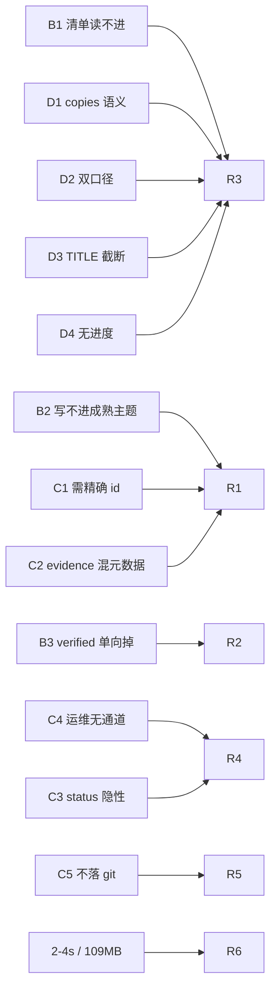
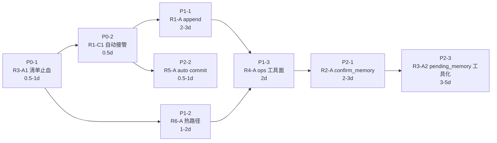

> 本文是 2026-10 的**历史记录**（已归档）。现行真相见 [`docs/README.md`](../README.md)：`docs/omem-v0.3-implementation-plan.md`（v0.3 工程决策）、[`ARCHITECTURE.md`](../../ARCHITECTURE.md)、[`docs/omem-重构方案-路B.md`](../omem-重构方案-路B.md)（v0.2 决策）。

# omem 架构分析（2026-10-28 三方协同 · 架构师高见远）

> 输入：`AGENTS.md`（不变量）、`2026-10-28-MCP实测反馈-beta8.md`（12 条现象）、HEAD=`c665702`（`v0.1.0-beta.8-4-gc665702`）源码通读。
> 目标锚点：**更灵活、更健壮、更简单**。本文不逐条回应 12 个现象，而是把现象收敛为 6 个结构性根因，再对根因给方案。
> 范围声明：只读分析，未改任何源码，未触碰 `~/.omem`。所有行号以 HEAD 为准。

---

## 0. 先做「已修 / 未修」盘点（避免重复提已修项）

beta8 记录的 12 条现象里，HEAD 相对 tag 多了 4 个提交，其中 **1 条已修、3 条部分修、8 条未修**。

| 反馈项 | HEAD 状态 | 证据（`文件:行号`） |
| --- | --- | --- |
| A1 `save_memory` 后刷新 PROCESS.md | 已修（beta8 已验证） | `src/core/commit.ts:280` → `src/process/guide.ts:199` |
| A2 grounding 回执可用 | 已修 | `src/mcp/tools.ts:642-644` |
| A3 `supersedes` 多 id 生效 | 已修 | `src/core/lifecycle.ts:12-26` |
| **B1** PROCESS.md 80KB 读不进 | **未修，且 HEAD 风险更高** | 组窗口 `src/process/guide.ts:368`（`batch`）；组内会话无上限 `guide.ts:162-169`。`3fe8c9c`「大组优先」`guide.ts:366-367` 让 566 会话的大组**必然**进窗口并被整组渲染 → 611 行 ≈ 5 组 × ~120 会话行 |
| **B2** 2000 字上限 + 整篇重发 | 未修 | 上限 `src/core/config.ts:65`；`save_memory` 参数面 `src/mcp/tools.ts:181-227` 无 `mode`/`append`/`section`；`body: text` 全量覆盖 `src/core/commit.ts:271` |
| **B3** 更新必然丢 verified | 未修 | `src/core/commit.ts:261`（`verified: input.verified`）、`src/mcp/tools.ts:583`（MCP 恒 `false`）、不变量 `AGENTS.md:19` |
| **C1** `supersedes` 需精确 id | 未修 | `src/core/commit.ts:199-213` 仍「拒绝 + 给出 id」，`findActiveByTopic` 已在手（`commit.ts:200`）却不自动接管 |
| **C2** evidence 混元数据 | **部分修** | `8a7d54b` 只修了**切段**（`src/collect/session-store.ts:163-185` 只认 `^## user|assistant$`）；`Conversation info (untrusted metadata):` 前缀**未剥**；`scope=sessions` 仍只给 `snippet`，不给可复制纯净引文（`tools.ts:373-377`、`search.ts:186-194`） |
| **C3** CLI 无 status 标注 | **部分修 / 表述隐性** | `src/commands/search.ts:80` 的 `formatStaleness` 已能输出 `— superseded by X` / `— archived`（`src/core/lifecycle.ts:29-37`），但 **active 是无标注的默认值**，且 stdout 里没有 `[active]` 徽标 |
| **C4** 运维无 MCP 通道 | 未修 | `src/mcp/tools.ts:60-283` 仅 2 默认工具 + `feedback`；`src/mcp/server.ts:58` |
| **C5** 写路径不落 git | 未修 | `commitEntry` 无 git 调用；`src/mcp/tools.ts:180` 明写 "never runs `git commit`" |
| **D1** `copies: N` 语义 | **已修** | `src/process/guide.ts:126` 明写 "distilling the listed one covers all copies" |
| **D2** 分组双口径不自洽 | **已修** | `src/process/guide.ts:139-149` 三口径分说 + `c665702` 断言对齐 |
| **D3** `topic list` TITLE 截断 | 未修 | `src/commands/topic.ts:169`（`deriveTitle(body, 50)`）、`:24`（`NAME_WIDTH=44` 截 topic 名） |
| **D4** 无进度度量 | **部分修** | PROCESS.md 头部已给组/会话双口径 `guide.ts:145-147`；仍无 `omem status`（`src/commands/` 无 `status.ts`） |
| **追加发现（beta8 未记）** | 已修 | `8a7d54b` 修掉「正文内嵌 `## 标题` 被当段落边界 → 深处证据一律 ungrounded」（实测 user 段 2413 → 23016 字符）。这是 C2 的地基，**不要**当成待改进项重提 |

**两条必须提前排除的误判**：
1. beta8 C3 说 CLI「完全没有任何 status 标注」——不准确（`search.ts:80` 已有文案）。真正的缺陷是「active 不可见」而非「status 缺失」。
2. beta8 B1 建议「砍掉 session 路径可省 30–40%」——**不能直接砍**。Agent 必须读会话原文才能抠 evidence，砍了 path 就得同时补一个「按 session_id 取全文」的 MCP 工具，否则砍完清单也读不了正文。这是把文件职责转成工具职责，不是删字段。

---

## 1. 现状判断：骨架与契约边界

### 1.1 骨架

omem 是**五面对一个事实源**的收敛式架构：一条记忆 = 一个 Markdown 文件，其余四层全部是派生。

```mermaid
graph TD
  subgraph 事实源（不可派生）
    MD["knowledge/*.md + archive/*.md<br/>frontmatter + body"]
  end
  subgraph 派生层（可删可 rebuild）
    IDX["index/omem.db<br/>entries + entries_fts + sessions + sessions_fts"]
    MI["MEMORY-INDEX.md ≤80 行"]
    PG["PROCESS.md 待办清单"]
  end
  MD --> IDX
  MD --> MI
  IDX --> PG
  MCP["MCP 面<br/>search_memory / save_memory"]
  CLI["CLI 面<br/>21 个命令"]
  FILE["文件面<br/>Read/Edit 直读"]
  GIT["git 面<br/>omem backup"]
  MCP --> IDX
  MCP -->|写| MD
  CLI --> IDX
  CLI -->|写| MD
  FILE -->|直读| MD
  GIT --> MD
  GIT --> IDX
```

| 面 | 入口 | 写入能力 | 读清单能力 | 运维能力 |
| --- | --- | --- | --- | --- |
| MCP 面 | `src/mcp/server.ts:58` | ✅ 单文档全量覆盖 | ❌ 只有 `search_memory` | ❌ 无 |
| CLI 面 | `src/cli.ts` / `src/commands/*` | ✅（`add` 可置 verified） | ✅（`topic list` / `run`） | ✅（`redact` / `skip` / `backup`） |
| 文件面 | 宿主 Read 工具 | ❌（破坏索引） | ⚠️ PROCESS.md 是唯一入口 | ❌ |
| 索引面 | 内部 | 派生 | `searchEntriesPage`（`src/core/search.ts:75`） | `rebuild` |
| git 面 | `src/sync/git.ts` | ✅ push（唯一对外通道） | `status` | 手动 |

### 1.2 哪一层在承担不该它承担的职责

| 越位点 | 证据 | 后果 |
| --- | --- | --- |
| **`core/commit.ts` 反向依赖 `process/guide.ts`** | `commit.ts:18` + 注释 `guide.ts:3-5` 承认「放一起是为了避免成环」 | 写入路径被迫承担「重算并重写 80KB 派生清单」的 O(N) 成本（`commit.ts:280`） |
| **`process/guide.ts` 一文件五职责** | 待办计算 `:227`、渲染 `:111`、落盘 `:182`、进度度量 `:373-383`、topic 词表 `:83` | 任一项膨胀压垮其余四项；B1 与 D2 都是这个耦合的产物 |
| **写入许可策略内嵌在 commit** | `commit.ts:199-213`「topic 有 active → 拒绝」 | 唯一的合法策略是「拒绝 + 让 Agent 自己再查一次」；服务端已握 `findActiveByTopic` 却不用 |
| **同一套 Agent 规则有 4 份副本** | `src/context/instructions.ts:11-15`（常量）、`src/context/export.ts:22-37`（引用常量）、**`src/mcp/tools.ts:163-180` 手写第二遍**、`src/process/guide.ts:121-131` 手写第三遍 | `AGENTS.md:23` 声称「description 与 instructions 是一份契约」，实际只有 2 处共享常量，另 2 处是手写。这是**契约漂移的结构性入口** |
| **索引一致性代价放在热路径上** | `server.ts:61` 每次工具调用 `prepareToolCall` → `index.ts:218` `catchUp()` → `index.ts:342-373` 遍历全部会话文件且**每文件读两遍**（`index.ts:345` + `index.ts:346`→`session-store.ts:266`） | 2–4 秒不是「写入」的成本，是「一致性检查」的成本；随会话数线性恶化 |

---

## 2. 根因归因：12 个现象收敛为 6 条



### R1 · 写入单位是「文档」，不是「事实」

**解释现象**：B2（成熟主题写不进 → 碎片化）、C1（每次写前先检索取 id）、C2 的一半（证据必须逐字复制进整篇重发）。

**机理**：`commitEntry` 的输入语义就是「这篇文档现在长这样」——`body: text` 全量覆盖（`commit.ts:271`），`index.upsert` 每次重写整条 FTS 行（`index.ts:152-155`）。上限 `max_content_chars=2000`（`config.ts:65`）因此不是「正文预算」而是「写入失败边界」：一旦撞上，Agent 的**唯一合法出路是新建 topic**。实测 1930/2000 = 97% 满时只能另开 `matea-hermes-runs-integration`（beta8 B2）。更隐蔽的是 `mergeEvidence` 的 `limit=8 / maxChars=2000`（`entry.ts:192-197`）：文档越长，继承证据越先占满配额，**越更新越丢证据**。

**判断：设计缺陷，必须改。**
依据：用户侧结论明确写「主题碎片化是工具约束逼出来的，不是设计选择」（beta8 B2）；且证据配额与正文上限指向同一个病灶——「文档」是唯一的寻址与信任单位，没有任何「块级」概念。

### R2 · 信任附着在「整篇文档」上，且只有下降通道

**解释现象**：B3（0.9 → 0.55，用户主动放弃吸收）。

**机理**：`supersede` 必重置 `verified`/`confirmations`（不变量 `AGENTS.md:19`，实现 `commit.ts:261`）；而 MCP 侧 `verified` 被硬编码为 `false`（`tools.ts:583`），`confirm_ids` 只到 0.8（`tools.ts:223`、`lifecycle.ts:82`）。`verified` 的唯一来源是 `omem add` / `review --confirm`（`instructions.ts:14`、`add.ts:33`），而使用纪律要求「只用 MCP」。这不是「信任会掉」，是**信任在唯一被允许的通道里永远不会升**。

**判断：拆成两半。**
- 「supersede 即重置」= **设计选择，保留**。依据：整篇重发时旧文档的验证对象（旧正文）已不存在，继承 verified 等于让新内容白拿旧背书。这条要写进文档，不是改。
- 「verified 无回升通道」= **设计缺陷，必须改**。依据：`lifecycle.ts:85-87` 拒绝置 verified 的论证是「omem 看不到聊天记录」。但 omem 有会话文件，`evidenceIn` 已能核对 `## user` 原文（`score.ts:58-62`）——「用户在这一轮明确说了」是可取证的，只是没被建模。

### R3 · 「读清单 → 决定写什么」没有服务端支持，靠一份无预算的派生物硬撑

**解释现象**：B1（80,310 字节 / 611 行 / Read 工具直接拒绝）、D1、D2、D3、D4。这一条吃掉**写入前 ~70% 成本**（beta8 摘要）。

**机理**：PROCESS.md 同时是 4 样东西（见 §1.2）。`3fe8c9c` 的两处改动方向相反：
- 好的：`(copies: N)` 片段级去重 + `skip` 台账 + 双口径文案 → D1/D2 已修；
- 坏的：「大组优先」（`guide.ts:366-367`）**只加了组维度窗口**（`batch=5`，`guide.ts:368`），**没有加会话维度窗口**（`guide.ts:162-169` 无条件遍历 `topic.sessions`）。于是「让大组能被看到」直接升级成「必须渲染整个 566 会话的大组」。**HEAD 的 PROCESS.md 比 beta.8 更大，不是更小**——这是本轮最需要立刻止血的点。

**判断：一个设计缺陷（职责聚合）+ 一个实现错误（窗口只加一维），后者是 P0。**
依据：`MEMORY-INDEX.md` 有硬预算 `MAX_LINES=80`（`lifecycle.ts:299`），PROCESS.md 没有任何预算约束——两个同性质派生视图的纪律不一致，这不可能是设计意图。

### R4 · 能力面与执行面不对齐：唯一被允许的通道不具备闭环最小集

**解释现象**：C4（`redact` / `topic list` / `backup` 只能回 CLI）、C3（MCP 有 `status` 字段但清单里看不到 topic 词表）。

**机理**：「最小工具面」是显式设计选择（`tools.ts:1-2`「对齐 codegraph」，不变量 `AGENTS.md:27`「Do not expand the default tool surface」）。它的前提是「读写两件就够闭环」——实测否证：本轮必须做的三件运维事全部没有 MCP 路径（beta8 C4），且 `topic list` 缺失意味着 Agent 永远不知道该用哪个 topic 名，这直接把 R3 的碎片化风险放大。当前的开关是二值的（`OMEM_MCP_TOOLS=feedback`，`tools.ts:266`），而 `feedback` 恰是三个候选里最不紧急的一个。

**判断：设计选择已被实测证伪 → 转为设计缺陷。**依据：选择的前提（2 工具闭环）不成立，而开关的形态（单值）无法表达「读扩展 vs 写扩展 vs 破坏性扩展」的差别。

### R5 · 「永不自动删除」的安全网（git）没有接在写路径上

**解释现象**：C5（43 个未提交改动）。也是用户「不敢用 `redact`」的隐含原因——`redact` 是唯一硬删路径（`AGENTS.md:13`），删完若没 commit 就不可逆。

**机理**：不变量承诺「永不自动删除」，实现上唯一的兜底是 git；但 `commitEntry` 不 commit（`tools.ts:180` 明写），`omem backup` 是手动命令（`src/commands/sync.ts:1-2`）。**不变量与实现之间有一条未闭合的依赖链**：承诺的撤销能力依赖一个用户必须记得执行的动作。

**判断：设计缺陷。**依据：`commit` 与 `push` 被混为一谈（怕自动 commit 污染历史），但「本地固化」和「对外发布」是两件事，前者风险极低且是承诺的兑现前提。

### R6 · 索引一致性的代价被放在每次工具调用的热路径上

**解释现象**：单次 `save_memory` 2–4 秒、109MB 索引、随库增长只会更慢。这条 beta8 未记录，但它是「更健壮」目标的头号敌人。

**机理**（三段 O(N) 串联，全部单次工具调用内完成）：

| 阶段 | 代码 | 成本 |
| --- | --- | --- |
| 1. 对账 | `server.ts:61` → `index.ts:342-373` | 遍历全部 1101 会话文件，**每文件 `readFileSync` 两遍**（`index.ts:345` 一次，`index.ts:346`→`session-store.ts:266` 再一次），再 regex 解析 |
| 2. 写盘 | `commit.ts:273-277` | 单文件 + `generateMemoryIndex`（`listEntries` 全量解析 56 个 md） |
| 3. 刷清单 | `commit.ts:280` → `guide.ts:199` → `guide.ts:227-384` | 对每个已吸收 session 调 `readSessionsById`（`guide.ts:239`），对每个未吸收会话 `statSync` + `readStoredSession`（`guide.ts:267-279`） |

`AGENTS.md:15` 声称「(size, mtime) 快路径」——**这只对 entries 成立**（`index.ts:237`），sessions 表根本没有 `size`/`mtime_ms` 列（`index.ts:101-110` + `addColumn` 只补了 `agent`/`path`/`content_hash`/`api_state`，`:112-115`）。

**判断：设计缺陷（性能与规模），非契约问题 → 可灰度，不需要一次做对。**

---

## 3. 改进方向

> 每条给 1–2 个候选；★ = 推荐。所有契约变更都写了具体签名。

### R1 ★方案 A：`save_memory` 增 `mode: "append"` + 小节键（**不改存储模型**）

契约：
```jsonc
// save_memory 新增三个可选参数
"mode":    { "enum": ["replace", "append"], "default": "replace" },
"section": { "type": "string", "description": "append 目标小节标题，不带 ##。省略则追加到文末。" },
// 返回体新增
"mode": "append", "section": "hermes-runs", "merged_chars": 2210,
"cap": 2000, "sections": ["adapters", "hermes-runs"], "cap_exceeded": false
```
语义：`append` 时服务端**读旧 body → 按 `## <section>` 定位 → 替换或追加该节 → 合并后全文过 cap → 仍走原 `supersede` 路径**。
关键洞察：这是 **Agent 侧的 token 契约，不是存储层的模型变更**。落盘仍是「一份完整 markdown + 旧文档转 superseded」，因此：
- 不动 `supersedes` 不变量、不动 `entries_fts` 结构、**不需要 index 迁移**；
- `mergeEvidence` 的 8 条配额问题依然存在，但 append 时**只提交本节新增证据**，配额消耗从「文档数」降为「本节数」，实际缓解。

必须配套的护栏：
1. `append` 要求同时给 `supersedes`（或用 R1-C1 的自动接管），否则并发写会静默丢内容 → 服务端在 `supersedes` 与当前 active id 不一致时返回 `status:"excluded", reason:"stale base"` 而**不是**静默合并。
2. cap 语义从「硬截断」改为「append 时超限 → 拒绝并返回 `cap_exceeded` + 建议新建 topic」，因为截断 append 会静默丢刚写的事实。

影响面：`src/mcp/tools.ts`、`src/core/commit.ts`（`CommitInput` 加 `append?`）、`src/core/entry.ts`（`splitSections/mergeSection` 纯函数）、`tests/unit/commit.test.ts`、`mcp-tools.test.ts`。**无 index 迁移。**
不变量冲突：无。`AGENTS.md:19`（继承 trail 不继承 trust）保持；`AGENTS.md:14`（一 topic 一活文档）保持。
风险/回退：中低。最坏情况是 section 解析与既有手写正文的 `##` 标题冲撞 → 用「只在 `append` 且显式给 `section` 时才按节切分」把影响限制在显式调用上；回退 = 客户端不用 `mode` 即回到现状。
**收益量化**：`matea-pluggable-brain-decisions` 1841 字，追加第 9 条约 300 字 → 单次写入 token 从 1841 降到 ~300（**约 6×**），且不再需要新建 topic。

### R1 方案 B：只调大 `max_content_chars`
工作量 0，但**明确不推荐**：beta8 已判定「调大只会让单次重发更贵、更容易截断」。它把 R1 的 token 成本线性推高，且与 R6 的 O(N) 叠加成最差组合。

### R1 顺带解 C1 ★：`topic` 命中时自动接管 supersede

契约：`save_memory` 省略 `supersedes` 且 `topic` 命中 active 时，**服务端自动把它当 base**，返回体显式写出 `auto_superseded: ["<id>"]`；只有无 active 时才新建。
`commit.ts:199-213` 的拒绝分支改为：`if (active && !supersedes.includes(active.id)) supersedes = [active.id]`，并把 `caller` 相关文案降级为提示。

影响面：`src/core/commit.ts`（~15 行）、`src/mcp/tools.ts`（返回体）、`tests/unit/commit.test.ts` 有一组断言「拒绝」的用例需改为断言「自动接管」。**无 index 迁移。**
不变量冲突：无。这是**严格放宽**（原本失败的调用现在成功），且 `AGENTS.md:24` 的「caller-aware 文案」纪律仍适用。
风险/回退：极低。唯一的语义变化是「Agent 无法通过省略 supersedes 来表达『我确实想新建第二份活文档』」——用显式 `mode:"replace"` + `new_topic:true` 或保留 `force_new` 逃生口即可。

### R2 ★方案 A（推荐）：新增 `confirm_memory` 工具，把 verified 的来源从「通道」改为「证据」

契约：
```jsonc
// 新工具 confirm_memory（纳入 ops 工具集，见 R4）
"ids":        { "type": "array", "items": {"type":"string"} },   // 必填
"user_said":  { "type": "string", "description": "用户本轮明确表示同意/确认的原话，≥12 字符" },
"session_id": { "type": "string" }
// 返回
{ "confirmed": ["<id>"], "rejected": [{"id":"<id>","reason":"ungrounded | not-active | quote-not-found"}],
  "verified": true, "confidence": 0.9 }
```
服务端校验（复用现成件）：
1. 目标 `status === 'active'`（`lifecycle.ts:220` 同口径）；
2. `confidence >= 0.55` 且 `!tags.includes('ungrounded')`（`score.ts:9-11`）——**未落地证据的条目不允许被确认**，这是安全阀；
3. `user_said` 必须能在 `session_id` 的 `## user` 段核对上（`evidenceIn`，`score.ts:58`）——这条正是对 `lifecycle.ts:85-87`「omem 看不到聊天记录」的正面回答：**不需要看聊天记录，只需要可核对的用户原话**。
4. 落盘：`verified=true`、`confidence=0.9`、`confirmations+1`、`tags += 'user-assented'`；`source` 不变（审计要看得出通道）。

影响面：`lifecycle.ts`（`reconfirm` 已存在，加校验壳）、`mcp/tools.ts`、`mcp/server.ts`、**`context/instructions.ts:14` 的 `RULE_VERIFIED` 必须同步改**、`context/export.ts:34`（引用同一常量，自动跟随）、`AGENTS.md:17`（「Automatically processed output is always verified:false」需改写为「自动产物恒 false；用户对话内显式确认经 `confirm_memory` 且必须可核对 `## user` 原话」）、`AGENTS.md:23`（工具面契约）、`tests/unit/{save-feedback,score-ladder,mcp-tools}.test.ts`、`tests/mcp-probe.mjs`。**无 index 迁移**（`verified` 列已存在 `index.ts:82`）。
不变量冲突：**直接打破 `AGENTS.md:17` 的「only `omem add` / `review --confirm`」**。这是必须**显式改写 AGENTS.md** 的一条，不是偷偷放宽。改写要点：不变量保护的是「verified 意味着有人看过」，通道只是当时的实现手段；`confirm_memory` 用「可核对的用户原话 + 证据已落地」两个硬条件维持了同一个语义。
风险/回退：中。风险是 Agent 伪造 `user_said` 骗取 verified → 靠条件 3（必须能在会话文件里核对上）+ 条件 2（必须已 grounded）双重锁；回退 = 环境变量关闭该工具（不进 ops 集即不存在）。

### R2 方案 B（不推荐）：`supersede` 继承 verified + `reverified_by`
契约上是把 `commit.ts:261` 改成 `verified: input.verified || oldVerified`，并把 `reverified_by` 写进 frontmatter。
**为什么不推荐**：① 要动 `FM_ORDER`（`entry.ts:40-44`），一旦写入就是事实源的一部分，之后改语义要迁移全部 md——**不可逆**；② 它让「新事实」白拿「旧文档」的背书，恰好破坏 `AGENTS.md:19` 想守住的东西；③ 与 beta8 自己的第 2 条建议（追加 `reverified_by` 解耦）相比，`confirm_memory` 用同一个目标（信任可升）做到了更小的语义代价。**仅在 `confirm_memory` 被否时考虑。**

### R3 ★方案 A（两阶段，先止血后治本）

**A1 止血（P0，优先级见 §4）**：给 PROCESS.md 加**第二个维度的窗口** + 会话行瘦身。
- 组内会话上限 `per_group_limit`（配置项，默认 20）→ `guide.ts:162-169` 前 `topic.sessions.slice(0, limit)`，超出时追加一行 `- …N more in this group (search_memory(scope=sessions) or next batch)`。
- 会话行去掉绝对路径的长前缀，改为 `` `workbuddy` / `8225ff29` · <首条 user 摘要 60 字> ``,并在文件头声明「用 `session_id` 取原文」（需 A2 提供该能力，否则**不要**砍 path）。
- 头部三项预算写死：`guides ≤ 5 组 / ≤ 100 会话行 / ≤ 200 行文本`，超出即分页指针。
预估：611 行 → 约 120–160 行，80KB → 约 12–18KB，**进入 Read 工具的 20000 token 窗口内**。

**A2 治本**：把清单从「文件」转为「工具」。
```jsonc
// 新工具 pending_memory（读扩展，见 R4）
"group":  { "type": "string", "description": "project 分组名，省略则返回各组头摘要" },
"offset": { "type": "number", "default": 0 },
"limit":  { "type": "number", "default": 20, "maximum": 100 },
"include_existing_topics": { "type": "boolean", "default": true, "description": "同时返回 topic 词表 + 各自 active id" }
// 返回: { groups: [{group, docId, sessions:[{id, agent, summary, copies}]}],
//         totals: {pending_sessions, pending_groups, absorbed_sessions, topics},
//         cursor: "<opaque>", truncated: true }
```
PROCESS.md 退化为**≤80 行的摘要 + 指针**（与 `MEMORY-INDEX.md` 的 `MAX_LINES=80` 纪律对齐，`lifecycle.ts:299`）。

影响面：`src/process/guide.ts`（`renderGuide` 分页参数、`pendingTopics` 返回 cursor 而非 slice）、`src/process/pipeline.ts:395-411`、`src/core/commit.ts:280`（改传 limit）、`src/mcp/tools.ts`、`src/context/instructions.ts:27-33`（工作循环第 1 步从「读文件」改为「调 `pending_memory`」）、`src/context/export.ts:30`、`AGENTS.md:23`。测试：`guide-dedup-skip` / `guide-docid` / `guide-queue` / `guide-topics` / `process-guide-refresh` / `run-summary` 共 6 个文件。**无 index 迁移。**
不变量冲突：`AGENTS.md:23`（`save_memory` description 指向 PROCESS.md 的路径必须真实可用）——A2 让 PROCESS.md 不再承载全量清单，所以第 1 步的文案必须同步改，否则重演「指向一个拿不到的东西」的原始缺陷。
风险/回退：A1 极低（纯渲染，派生文件可随时重算）；A2 中（多一次工具往返 vs 少 20k token，净收益明显；回退 = `guide_full=true` 恢复全量渲染）。

### R3 顺带解 D3/D4：`topic list` TITLE 不截断 + `omem status`
- `topic.ts:169` 的 `deriveTitle(body, 50)` 改为自适应（终端宽度或 `--wide`）；`topic.ts:24` 的 44 字 topic 名截断改为「超长时换行显示」。
- 新增 `omem status`：一行 `405 unabsorbed / 1101 collected / 56 topics / 12 verified`，数据全部来自 `pendingTopics` 的 `counts`（`guide.ts:373-383`）+ `index.countByStatus()`（`index.ts:375`）。
影响面：`src/commands/topic.ts`、新增 `src/commands/status.ts` + `src/cli.ts` 注册、`tests/unit/search-command.test.ts` 类。纯输出，零风险。

### R4 ★方案 A：工具面从「二值开关」改为「三档分组」

契约：
```bash
OMEM_MCP_TOOLS=core            # 默认：search_memory + save_memory（现状不变）
OMEM_MCP_TOOLS=core,ops        # ops 组（读扩展 + 受控运维）
OMEM_MCP_TOOLS=all             # 含 feedback
```
| 组 | 工具 | 注解 | 理由 |
| --- | --- | --- | --- |
| core | `search_memory`, `save_memory` | `readOnlyHint` / `idempotentHint` | 不变 |
| ops-读 | `pending_memory`, `topic_list({with_title, limit})`, `status` | `readOnlyHint: true` | 解决「Agent 不知道有哪些 topic」（R3 碎片化的直接成因） |
| ops-写 | `skip_session({id, reason})`, `confirm_memory` | `destructiveHint: false` | 有出口才不会硬塞 |
| ops-破坏 | `redact_entry({id, confirm_id})` | `destructiveHint: **true**` | `confirm_id` 必须等于 `id`，对齐「install 六条写入纪律」的双确认精神 |
| — | `backup` | **不提供** | 涉及远端推送与 `assertExportAllowed`，继续「让用户执行」 |

影响面：`tools.ts`（分组 + 4 个新工具）、`server.ts:58`（`buildTools()` 传 env）、`instructions.ts`（每个新工具一句用途）、`AGENTS.md:27`（**必须显式改写**为「默认工具面 = 读写两件；运维面必须显式开启，且每个工具在 instructions 里有一句用途」）、`tests/unit/mcp-tools.test.ts`、`tests/mcp-probe.mjs`（断言 stdout 无日志 + 默认面仍是 2 个）。
不变量冲突：**直接改写 `AGENTS.md:27`**。改写理由：最小工具面的目标是「默认不打扰」，不是「永远两个」；把扩展面做成显式分组仍然守住了默认面。
风险/回退：中。风险是工具面膨胀反弹（每个新工具都是一份 description 的 token 税，见待验证假设 H1）→ 用「ops 默认关闭 + 每个工具 description ≤ 400 字符」双约束。

### R5 ★方案 A：写路径可选自动 commit（只 commit，不 push）

契约：
```toml
# config.toml
[process]
auto_commit = "session"   # off | session | always，默认 session
```
- `session`：一次 `save_memory` 调用内所有落盘文件合成**一个** commit，message 形如 `omem: update <topic> (<id>) +2 files`；
- 数据仓未 git init 时 **静默跳过并 warning**（不能因为不是 git 仓就让写入失败——`commit.ts:126-136` 的 `refreshGuide` 已是这个纪律的样板）；
- 返回体加 `vcs: { committed: 3, message: "omem: ..." }`；`off` 时改为提示 `N document(s) not in version history — omem backup`（beta8 C5 建议 1）。

影响面：`src/sync/git.ts`（`GitBackend` 已有 `git()` 封装 `:14`）、`commit.ts`、`config.ts`、`tools.ts`、`tests/unit/commit.test.ts`、`tests/smoke.sh`。**无 index 迁移。**
不变量冲突：无。`AGENTS.md:29`（只写数据仓 git config）保持。
风险/回退：低。风险是 commit 数量爆炸（43 改动 → 每轮 1 个而非 43 个，可控）；回退 = `auto_commit = "off"`。

### R6 ★方案 A：把一致性的 O(N) 从热路径移走（三项，均可灰度）

| 改动 | 现状 | 目标 | 文件 |
| --- | --- | --- | --- |
| 去重复读 | `index.ts:345` 读一遍，`:346` 又读一遍 | 把 `text` 传给 `parseStoredSession(text)` | `core/index.ts`、`collect/session-store.ts` |
| sessions 加 `(size, mtime_ms)` 快路径 | sessions 表无此列 | `addColumn('sessions','size','INTEGER')` + `addColumn(...,'mtime_ms','INTEGER')`；未变即 `continue` | `core/index.ts:112-115` 追加两行 |
| 写路径不做全量清单重算 | `commit.ts:280` 每次全量 `pendingTopics` | 改为「增量：从内存台账删掉刚吸收的 session_id，或加 5s 节流」 | `core/commit.ts`、`process/guide.ts` |
| 对账节流 | `server.ts:61` 每次工具调用 | 按 `knowledge/` 与 `sessions/` 目录 mtime 判定，未变则跳过；或 5s 内复用 | `mcp/server.ts` |

**关键：这四项都不需要 `omem rebuild`。** 与「topic 不进 FTS」（`AGENTS.md:22`）的教训的差别在于：`entries_fts`/`sessions_fts` 是 FTS5 虚表，`CREATE VIRTUAL TABLE IF NOT EXISTS` 无法迁移；而 `sessions` 是**普通表**，`addColumn` 用 `ALTER TABLE ADD COLUMN`（`index.ts:120-123`），老库自动补齐，代价是首次探测 `PRAGMA table_info`。这个区别必须在方案里写清，否则会被误判为「又一次逼用户 rebuild」。

影响面：`core/index.ts`、`collect/session-store.ts`、`core/commit.ts`、`mcp/server.ts`、`tests/unit/index.test.ts` + `tests/smoke.sh`。风险极低，回退 = 单文件 revert。
**预期**：2–4 秒里，阶段 1（对账）预计占大头（1101×2 次文件读），改完应降到亚秒级。这一条直接决定「更健壮」——不修的话，2–4 秒会随会话数线性长成 10–20 秒。

---

## 4. 优先级

| 方案 | 单轮吸收吞吐 | 信任不倒退 | 心智负担 | 工作量 | 契约风险 |
| --- | --- | --- | --- | --- | --- |
| **R3-A1 PROCESS.md 止血（组内窗口 + 摘要行）** | ★★★★★ | — | ★★★ | 0.5–1 天 | 无（纯派生） |
| **R1-C1 topic 自动接管 supersede** | ★★★★ | — | ★★★★ | 0.5 天 | 无（严格放宽） |
| R3-A2 `pending_memory` 工具化 | ★★★★★ | — | ★★★ | 3–5 天 | 中（改工作循环文案） |
| R1-A `mode:"append"` | ★★★★ | ★★ | ★★★ | 2–3 天 | 中（新参数，可不传） |
| R2-A `confirm_memory` | — | ★★★★★ | ★★ | 2–3 天 | **高（改写 AGENTS.md:17）** |
| R4-A 工具面三档 | ★★ | — | ★★★ | 2 天 | **高（改写 AGENTS.md:27）** |
| R5-A auto commit | — | ★★ | ★ | 0.5–1 天 | 无 |
| R6-A 热路径去 O(N) | ★ | ★ | — | 1–2 天 | 无（含 addColumn） |
| R3-D3/D4 | — | — | ★★ | 0.5 天 | 无 |

### 如果只做一件事：**R3-A1（PROCESS.md 止血）**

量化依据：
1. **它是硬失败，不是软摩擦。** 80,310 字节触发宿主 `Read` 的 20000 token 上限**直接拒绝**——Agent 没有「部分读」的合法路径，只能 `head` + 正则硬抠，成本不可预测。相比之下 C1 的「多一次检索」是确定性成本（1 次往返 ≈ 2–4 秒）。
2. **前置成本 70% 中，读清单占一半以上。** 每轮固定付一次 20k+ token 与一次被拒的工具往返；写一次只要 2–4 秒。把 80KB 压到 15KB 相当于每轮省下一次满额上限读取。
3. **它同时修掉 4 条现象（B1/D1/D2/D4）并顺带缓解 R1 的碎片化冲动**——Agent 看不到全量 topic 词表时更容易新造名字（`guide.ts:76-82` 的注释已经承认这个因果）。
4. **零契约风险、纯派生文件**，可当天上线、可随时回退。

紧随其后的第二件应当是 **R1-C1（自动接管 supersede）**：它和 A1 都只改 `guide.ts` + `commit.ts` 两个文件，可与 A1 同 PR 交付，共同把「写一次」从「2 次往返 + 20k token」压到「1 次往返 + 15KB」。

---

## 5. 待验证假设清单（交给测试工程师，用真实 MCP 调用证实/证伪）

> 每条都写成可执行动作 + 判定标准。**不要直接采信本文推断**：以下 4 条一旦被证伪，对应方案要重新排序。

| # | 假设 | 验证动作 | 判定标准 | 影响 |
| --- | --- | --- | --- | --- |
| **H1** | `tools/list` 的 schema 描述体积占首次上下文的可观比例 | 抓 `tools/list` 原始 JSON 响应（不走 SDK，直接 `echo '{"jsonrpc":"2.0","id":1,"method":"tools/list"}' \| node bin/omem.js serve` 收 stdout），统计 `description` 总字符数与整个响应字节数 | 若 `description` 合计 > 6000 字符 → R4 每新增一个工具都是显著 token 税，ops 组必须默认关闭且 description ≤ 400 字符 | R4 排期与描述字数预算 |
| **H2** | 单次 `save_memory` 的 2–4 秒里，**对账（catch-up）占大头**，不是写入 | 在同一个 1101 会话库上：① 连续调用 5 次 `search_memory`（只读、不写），记录每次耗时；② 在 `prepareToolCall`（`server.ts:20-26`）前后打临时 stderr 时间戳，单独测 `index.catchUp()` 耗时 | 若 `search_memory` 也普遍 2–4 秒，或 `catchUp()` 单独 > 1 秒 → R6 是 P0 而非 P2 | R6 优先级 / 是否先做热路径 |
| **H3** | HEAD 的 PROCESS.md 比 beta.8 **更大**，「大组优先」是放大原因 | 在真实库上对比渲染：`git stash` 到 `v0.1.0-beta.8` 与 HEAD 各跑一次 `omem sync`，`wc -lc PROCESS.md`；再统计行类型分布（头部 / 组头 / 会话行 / topic 词表） | 若 HEAD 行数 > beta.8 行数，且会话行占 > 70% 且最大单组 > 100 行 → 确认 §2-R3 的「窗口只加一维」 | R3-A1 是否为 P0 |
| **H4** | `append` 的真实 token 收益约 6× | 取 `matea-pluggable-brain-decisions`（1841 字）与一条真实待吸收会话，手工计算：① 全文重发所需字符数；② 仅追加第 9 条所需字符数 | 若比值 < 3× → append 的收益不足以justify新参数，优先做 R3 | R1-A 优先级 |
| **H5** | 「吸收一份 = 吸收全部 N 份 copies」**不成立** | 找一个 `copies: N (N≥3)` 的组，逐份 diff 其 `## user` 段（应逐字相同，`sessionUserHash` 保证）**与 `## assistant` 段**（可能不同） | 若 assistant 段存在实质差异 → `guide.ts:126` 的「distilling the listed one covers all copies」是**错误文案**，会静默丢结论；需改为「copies 仅保证 user 段相同，assistant 段需自查」 | R3 文案 / D1 从「已修」退回「误修」 |
| **H6** | `## user` 段的 metadata fence 在真实 workbuddy 会话里占比很高 | 在真实库随机抽 10 个 workbuddy 会话，统计 `## user` 段首行以 `Conversation info (untrusted metadata):` / `Sender (untrusted metadata):` 开头的比例；并对含 fence 的段落测试 `evidence` 是否仍能 anchor | 若 > 30% 且含 fence 时 anchor 失败率 > 0 → C2 的 fence 剥离是必要项，且 `8a7d54b` 只解决了一半 | C2 是否要纳入本轮 |
| **H7** | 真实库里 `verified: true` 的活文档很少，B3 的「越用越不敢用」是局部但关键 | `grep -l '^verified: true' knowledge/**/*.md \| wc -l`，并列出它们的 topic 与 confidence | 若 verified 文档 < 5 份 → R2 是「关键少数」问题，可延后；若 > 15 份 → 「一吸收就掉」的影响面比 beta8 描述的更大，R2 提前 | R2 优先级 |
| **H8** | CLI 的 status 隐性（C3）在 HEAD 上仍可复现误判 | 在真实库跑 `omem search <某主题关键词> --all`，检查 superseded 行是否带 `— superseded by <id>`；再让一个 Agent 只看输出、不给源码，回答「这个主题有几份活跃文档」 | 若 Agent 答错 → 「active 是无形默认值」确实是信息设计缺陷，需加 `[active]` 徽标（`search.ts:80`）；若答对 → C3 降级为 P2 文案优化 | C3 分级 |
| **H9** | `confirm_memory` 的双重锁（已 grounded + `user_said` 可核对）在真实数据上可工作 | 取 3 条 `confidence ≥ 0.55` 的真实条目，构造「用户原话」引文，验证 `evidenceIn` 能对上；再取 2 条 `ungrounded` 条目验证会被正确拒绝 | 若 grounded 条目中 ≥ 2/3 能核对上 → R2-A 可行；若普遍核对不上（例如用户原话在 `## assistant` 段）→ 需把核对范围放宽到整段会话 | R2-A 可行性 |
| **H10** | 给 `sessions` 表加 `(size, mtime_ms)` 不会触发老库异常 | 复制一份真实 `index/omem.db`，用改动后的代码打开，检查 `PRAGMA table_info(sessions)` 是否自动补齐、`catchUp` 是否报错、是否需要 `rebuild` | 若无需 rebuild 且耗时显著下降 → R6-A 成立（这是本方案最容易被误判为「又要 rebuild」的一项） | R6-A 是否可灰度上线 |

---

## 6. 三方协作的技术约束（给产品经理排期）

### 6.1 必须一次做对（契约级 / 不可逆）

| 事项 | 为什么不可逆 | 排期要求 |
| --- | --- | --- |
| **`instructions` / `save_memory.description` / `export.ts` RULE 常量 三处同步** | `AGENTS.md:23` 的原始缺陷就是「指向一个拿不到的东西」。当前实际有 **4 份副本**（`tools.ts:163-180`、`guide.ts:121-131` 是手写），任何一处不同步都在重演历史 | 任何改文案的任务必须三处同 PR，且加一条 lint 测试断言「常量字符串在 3 个文件中出现」 |
| **frontmatter 新字段（`reverified_by` / `sections`）** | `FM_ORDER`（`entry.ts:40-44`）一旦加键，写进 md 就是事实源的一部分；之后改语义要迁移全部用户文件 | 若选 R2-B（追加字段）必须一次定稿；选 R2-A（`confirm_memory`）则**零新字段**——这也是推荐 A 的主因 |
| **`append` 的小节切分约定** | 分隔符（`## <section>`）一旦落进正文，就是 markdown 结构的一部分，改规则要迁移全部正文 | 设计阶段定死，且在 `append` 之外不做任何自动切分 |
| **`OMEM_MCP_TOOLS` 的键名与分组语义** | 该值由 `omem install` 写进各客户端的配置（`~/.claude.json` 等）。改名等于让所有既有安装失效 | 定稿后不再改；用「`core` 恒存在」保证向后兼容 |
| **`verified` 的语义边界** | 放宽后历史数据的 `verified` 含义无法回滚区分。若确定要改，必须同 PR 加 `verified_by` 之外的审计字段，或明确「不改历史，只对未来放宽」 | 与产品经理确认「是否接受历史数据语义并存」 |

### 6.2 可以灰度（逐步上线，随时回退）

| 事项 | 灰度方式 | 观测指标 |
| --- | --- | --- |
| PROCESS.md 渲染格式 / `per_group_limit` / `guide_batch` | 配置项 + 纯派生文件，`omem sync` 一次即重算 | `wc -l PROCESS.md`、Read 工具是否仍被拒 |
| R6 热路径优化 | 单文件级 revert；`addColumn` 对老库自动生效 | 单次工具调用耗时 p50/p95 |
| R5 auto commit | `auto_commit = off` 即回退 | `git status` 脏文件数、commit 数量 |
| 返回体提示文案（`previous verified status was dropped` 等） | 纯 copy | 无 |
| CLI `[active]` 徽标 / `topic list` 不截断 / `omem status` | 纯输出 | 无 |
| `ops` 工具集 | `OMEM_MCP_TOOLS` 不带 `ops` 即回到 2 工具面 | `tools/list` 字节数、Agent 误用率 |

### 6.3 建议的交付顺序（给三方协同）


理由：A1/B/C/D 全部**零或低契约风险**，可在不改 `AGENTS.md` 的前提下完成 70% 吞吐收益；`R2-A` 与 `R4-A` 各需改写一条不变量，必须由产品经理确认后集中在一个版本交付，避免「同一版本内不变量文本与实现不一致」。

---

## 7. 一句话结论

omem 的写入通道是健康的；真正的结构问题不是「某个功能缺失」，而是**寻址单位选错了两次**——写入以「整篇文档」为单位（R1）、信任以「整篇文档」为单位（R2），而清单又以「文件」为单位（R3），三处耦合共同把每次写入的前置成本推到 70%、把 `verified` 变成单向阀、把 80KB 派生物变成硬阻断。R6 则是一个 beta8 没记录但会随时间线性恶化的规模问题。**先修寻址单位（R3-A1 + R1-C1，零契约风险），再谈信任（R2，需改写不变量），最后才是能力面（R4）。**
