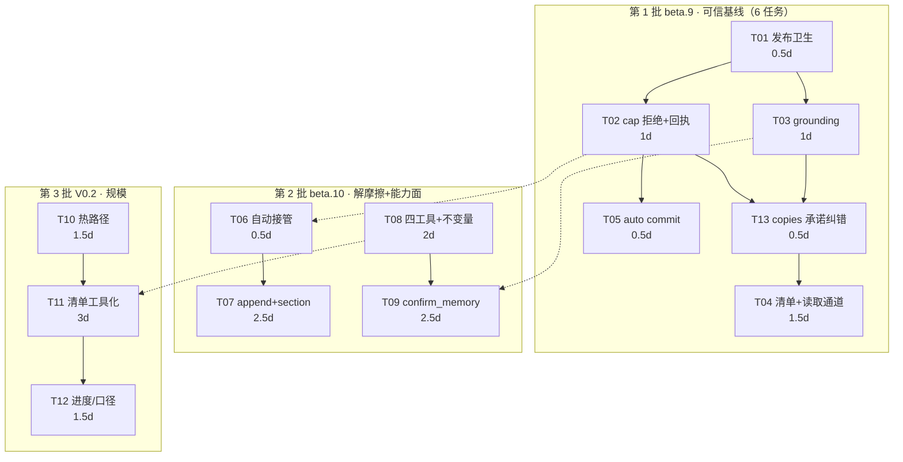

> 本文是 2026-10 的**历史记录**（已归档）。现行真相见 [`docs/README.md`](../README.md)：`docs/omem-v0.3-implementation-plan.md`（v0.3 工程决策）、[`ARCHITECTURE.md`](../../ARCHITECTURE.md)、[`docs/omem-重构方案-路B.md`](../omem-重构方案-路B.md)（v0.2 决策）。

# omem 三方协同 · 技术评审与落地任务清单（架构师高见远）

> 被评审：`2026-10-28-三方协同-改进规划方案.md`（PM）、`2026-10-28-MCP调用与写入实测-三方协同.md`（QA）。
> 基线：HEAD=`c665702`（`v0.1.0-beta.8-4-gc665702`）。真实仓实测：PROCESS.md 80,310 B / 612 行；session 1,101；`tools/list` 10,219 字符。
> 本文只做三件事：**表态四处结构性改动**、**答复 Q1–Q5 并给契约文本**、**给研发可直接执行的分批任务**。不改源码、不 commit。

---

## 0. 表态总表（四处结构性改动）

| # | PM 的改动 | 我的表态 | 依据 / 我加的条件 |
| --- | --- | --- | --- |
| 1 | 正确性先于吞吐；N2/N1 为 P0-1/P0-2，排在我的 R3-A1 之前 | **接受，且加强** | 截断只发生在 `src/mcp/tools.ts:526-529`（`save_memory` 自己的入参截断），`omem add`（`add.ts:27`）与 pipeline **都没有上限** → N2 的真身是「上限规则没有单一事实源，三条写路径三套纪律」。先做吞吐会把上层策略问题放大成事实源污染。**加的条件**：cap 策略必须下沉到 `commitEntry`，统一三条路径 |
| 2 | 「A1 + C1 同 PR」拆成 beta.9（渲染）/ beta.10（C1） | **接受，且实现上确实可解耦** | 见 §1.2：两者只共享导入关系，无调用依赖，可独立合并且各自独立回滚 |
| 3 | 默认面 2 → 5（search/save/pending/status/topic），写运维与破坏性显式开，`backup` 永不提供 | **接受，但降为 4 个工具** | token 预算硬约束：5 个工具 ≈ 12,669 字符 > PM 自己的 S3 门槛 12,500。**`status` 字段并入 `pending_memory` 返回体**，不单独成工具（§2-Q3 有算式） |
| 4 | verified 历史语义并存 / 只对未来放宽 / 不加新 frontmatter 字段；否决我的 R2-B | **接受，无条件** | `source`（`manual` vs `agent`）+ `tags: user-assented` + `confirmations` 足以审计（`EntrySource` 已含 `manual`，`entry.ts:8`）。R2-B 我自己也判过「动 `FM_ORDER` 不可逆」，撤回不保留 |

**需要 PM 修正的 5 处技术事实**（详见各节；C-5 为 QA 补测后新增）：

| # | PM 表述 | 事实 | 落点 |
| --- | --- | --- | --- |
| C-1 | Q4 立场②「拒绝 + 落 `stale` + `tags: truncated`，把半截从检索面挪开」 | `stale` **不在**检索面之外（`search.ts:52` 默认只排除 archived/superseded）；且 `stale` 文档**永不进入 review 队列**（`review.ts:25` 的 `status !== 'active'` 直接 return false）、**gc 也不再处理**（`lifecycle.ts:49` 只遍历 active） | §2-Q4，改判「纯拒绝」 |
| C-2 | Q3「该值由 `omem install` 写进 `~/.claude.json`，改名让既有安装静默失效」 | `install` **从不写任何 `OMEM_*` 变量**：`src/install/` 与 `src/commands/install.ts` 对 `OMEM_HOME`/`OMEM_MCP_TOOLS` **零命中** | §2-Q3，不可逆风险降级 |
| C-3 | P0-3「beta.9 只去绝对路径前缀、保留 `workbuddy/8225ff29`」 | 该形式**不是可读路径**，宿主 `Read` 打不开；而 `install` 不写 env（C-2），没有第二条路 | §2-Q5，读取通道与渲染必须同批 |
| C-4 | P0-3 用 `per_group_limit=20` 把 551 行裁到 100 行 | 451 个会话**从清单消失且无翻页入口**（`pending_memory` 在 V0.2）= 能力净损失 | §5-T04，改为无损瘦身 |
| C-5 | D1（`copies: N` 语义）记为「已修」 | **QA H5 证伪**：26 个 `copies≥3` 组里 **25 组 assistant 段实质不同**（最大组 25 copies → 25 个不同回答），`## user` 段 26/26 一致。`guide.ts:126` 的 "distilling the listed one covers all copies" 是**错误承诺** | **D1 → 误修**；新增 §5-T13；且连带发现账本级静默丢单（§9.2） |

---

## 1. 三处拆解与依赖的裁定

### 1.1 「N2/N1 优先」——接受，补代码依据

| 写路径 | 上限行为 | 证据 |
| --- | --- | --- |
| MCP `save_memory` | 截断 + 回执（→ 半截事实） | `src/mcp/tools.ts:526-529` |
| CLI `omem add` | **无上限**，原样落盘 | `src/commands/add.ts:27-36` 无 cap 分支 |
| pipeline | **无上限** | `commitEntry` 内无 cap 检查 |

三条路径三套纪律，正是 N2 的结构成因。**修正建议**：cap 判定下沉到 `commitEntry`，用 `CommitInput.overCap?: 'reject' | 'truncate'`（默认 `reject`）。副作用：`omem add` 对超长内容从「静默接受」变为「拒绝」——**这是 CLI 行为变更，必须写进 release note**，`--force` 可绕过（`force` 已有绕过护栏语义，`commit.ts:155`）。

### 1.2 「A1/C1 拆两个版本」——可解耦，我签字

`guide.ts` 与 `commit.ts` 的耦合只有一条：`commit.ts:18` import 了 `refreshProcessGuide` 并在 `:280` 调用，目的是写入后减待办（`AGENTS.md` 未约束，是 2026-10-26 修的缺口）。拆分判定：

| 改动 | 落点 | 是否依赖另一侧 |
| --- | --- | --- |
| 渲染瘦身（行格式 / topic 全列 / 头部去重） | `guide.ts` 的 `renderGuide` | **不依赖** `commit.ts`，纯字符串拼装，输入不变 |
| C1 自动接管 | `commit.ts:199-213` 的拒绝分支 | **不依赖** `renderGuide`，只影响 `CommitResult` |
| 共享面 | `commit.ts:280` 调 `refreshProcessGuide` | 签名不变，两侧各自改动互不影响 |

**结论：可解耦，两次提交各自独立回滚。** 唯一要守的纪律：T04 改 `renderGuide` 时**不要动 `pendingTopics` 的返回结构**（`guide.ts:373-383` 的 `counts` 被 `pipeline.ts:396-401` 消费），否则会把 C1 的版本和 pipeline 一起卷进来。

### 1.3 「P0-2 → confirm_memory 硬依赖」——接受，且比 PM 写的更严重

PM 说「安全阀第一道条件可被元数据刷过」。实际是**两道锁同时失效**：

| 锁 | 判据 | 被 N1 击穿的原因 |
| --- | --- | --- |
| 锁一 | `confidence >= 0.55` 且不带 `ungrounded` | 元数据 JSON 能拿到 0.55（QA W9 实证） |
| 锁二 | `user_said` 必须能在 `## user` 段核对上 | 走的是**同一个** `evidenceIn` + `userSectionText`（`score.ts:58-62`、`:154`）→ `user_said` 写成 `{"message_id":"…"}` 一样通过 |

即 N1 不是削弱一道锁，是让 grounding 从「用户说过」退化为「字符串在 `## user` 段出现过」。**在 N1 修好前上线 `confirm_memory` = 发布一个任何人都能把自己刷到 0.9 的权限提升通道。** 硬依赖成立，且应写进不变量（§4）。

---

## 2. Q1–Q5

### Q1｜`append` 的 `section` 命名空间

**结论：接受 PM 三条立场（不落 frontmatter / 撞名拒绝 / 落盘只是普通 `##`），并给出精确判定。**

**现状事实**：知识库正文基本不用 `##`（正文是叙述 + 编号列表，QA D3 样本为 `49. 既存结论…` / `99. 新增事实：…`）；`##` 只在**会话文件**里作 `## user`/`## assistant` 分隔符（`session-store.ts:175`）。所以本规则服务的是未来，不是迁移。

| 判定项 | 定稿 | 理由 |
| --- | --- | --- |
| 匹配形式 | 仅 `^##\s+<name>\s*$`，**只认 h2** | `###` 是节内结构，不是节边界；把它当边界会让"替换一节"吃掉子结构 |
| 闭合式 atx 标题 | 允许 `## <name> ##`，比对前剥尾部 `#` 序列 | CommonMark 合法写法，用户手写会遇到 |
| 大小写 | **比较时 `toLowerCase()` 归一，落盘保留调用方原样** | 中文无大小写；英文 `Setup` vs `setup` 若算两节，撞名拒绝就形同虚设 |
| 空白 | 比较前 `trim` + 连续空白折叠为单个 | 同 `normalizeTopic` 的口径（`commit.ts:307-310`） |
| 命中 0 处 | **新建**节：`\n\n## <name>\n\n<content>\n` | — |
| 命中 1 处 | **替换**该节正文（从标题行之后到下一个 `^##\s` 行或 EOF 之前；含其下的 `###` 子结构） | 这是"更新这一节"的唯一语义 |
| 命中 ≥2 处 | `status:"excluded"`，`reason:"ambiguous section: ## <name> appears at lines 41, 207"` | 报**行号**+条数，不猜、不取最后一个 |
| 省略 `section` | 追加到文末（最后一个非空行后，空行分隔），不建标题 | "加一段话"与"更新一节"是两种意图，不能默认成后者 |
| `section` 约束 | 1–60 字符；不以 `omem-` 开头；不含换行 | 前缀保留给未来元数据小节 |
| 禁止 | 任何启发式（"取最后一个 `##`" / "取最长的"） | QA N2 的教训：启发式 = 静默吃内容 |

**`splitSections` 放哪：`src/core/entry.ts`，不放 `util.ts`。**
- `util.ts` 是通用件（`normalizeForHash` / `contentHash` / `truncate` / `atomicWrite`），不知道 Entry 结构；
- `entry.ts` 已经在做「body 结构 → 语义」的解析（`serializeEntry` / `parseEntry` / `deriveTitle` / `deriveSummary` / `mergeEvidence` / `isNearDupTopic`），节解析属同一层；
- 消费方是 `commit.ts`（已 import `entry.ts` 六个符号），不需要新依赖方向。

**一个必须一起改的顺序陷阱（PM 未提）**：`commitEntry:161` 在**入参**上算 `contentHash` 去重。append 的入参只是片段，永远匹配不到库里全文 hash。正确顺序：`解析 base → 读旧 body → 合并 → cap 检查 → contentHash(合并后全文) → 落盘`。好处：重复 append 同一节同一内容自然 `deduped`（幂等），**不需要新参数**。

### Q2｜grounding 修完后 confidence 各档是否重定义

**结论：全档不重定义；PM 的「只影响新写入」自动成立，零回填——但必须以「新增函数」而非「改 `userSectionText`」实现。**

**为什么"只影响新写入"是免费的**：`confidence` 写在 frontmatter（`FM_ORDER`，`entry.ts:41`），是落盘时的常量；`scoreEvidence` 只在写入时调用（`tools.ts:556`）。改打分逻辑**不可能**改动存量文件，也不需要迁移。

| 档 | 值 | 来源 | 本轮是否改 |
| --- | --- | --- | --- |
| ungrounded | 0.35 | 证据一条都锚不上 | **不改** |
| grounded | 0.55 | 至少一条锚上（+印证加分至 0.8） | **不改** |
| 自动封顶 | 0.8 | `confirm_ids` / 主题 `once` 策略 | **不改** |
| verified | 0.9 | `omem add`；beta.10 起加 `confirm_memory` | 只扩来源集合，**不改数值语义** |

**必须避开的坑：不要改 `userSectionText`。** 它是三处共用：

| 用途 | 调用点 | 改了的后果 |
| --- | --- | --- |
| evidence 核对 | `score.ts:93`、`:154`、`:220` | 目标行为，正确 |
| `sessionUserHash` 的输入 | `session-store.ts:188-190` | **`user_hash` 全体变化** |
| `user_hash` 消费 | `guide.ts:237-242`、`:295` | 待办折叠 / `copies` 口径漂移 |

而且有存量陷阱：`guide.ts:273` 是 `stored.userHash ?? sessionUserHash(stored.body)`——**优先用落盘旧值**。改算法后新会话用新 hash、旧会话仍用旧 hash，两套指纹并行且**无任何报错**。

**定稿**：新增 `evidenceUserText(body)`（`collect/session-store.ts`），只剥**段首**围栏块（段首为 `Conversation info (untrusted metadata):` / `Sender (untrusted metadata):` 时，跳过其后直到围栏闭合或首个非围栏非空行）；`userSectionText`、`sessionUserHash` **一行不动**。`scoreEvidence` / `scoreApiDoc` / `searchSessions` 的 snippet 一并改调新函数（否则 N1 会从摘要侧复发）。

> 附带发现（对 H5 有正面价值，本轮不动）：`normalizeForHash` 删 `\p{P}`（`util.ts:13`），但 `message_id`/`timestamp` 的**值不同** → 带 per-session metadata 的会话 `user_hash` 天然不同 → **片段级去重对这类会话本来就没生效**。这解释 QA B3「551 行里只有 50 行带 copies」：不是折叠算法弱，是 fence 污染了指纹。剥离能改善，但要 hash 版本标记 + 全量重算 → 归 T12。

### Q3｜`OMEM_MCP_TOOLS` 定稿

**结论：冻结 4 个 token（不是冻结工具清单）；`core` 恒含读扩展；`status` 并进 `pending_memory`；`feedback` 作 legacy 别名。**

先纠前提（C-2）：**`install` 从不写 env**，所以不存在"既有安装静默失效"。真正持有该值的只有两类：按 `docs/记忆可信度的人工核实与Agent协作手册.md:88` 手改 `mcp.json` 的用户 + `tests/unit/mcp-tools.test.ts:39` 与 `tests/mcp-probe.mjs`。

```bash
OMEM_MCP_TOOLS=                                   # 缺省/空 = core（含读扩展）
OMEM_MCP_TOOLS=core                               # 显式写法，等价缺省
OMEM_MCP_TOOLS=core,ops-write                     # + skip_session, confirm_memory, memory_feedback
OMEM_MCP_TOOLS=core,ops-write,ops-destructive     # + redact_entry（destructiveHint + 双参确认）
OMEM_MCP_TOOLS=all                                # = 三档全开（手写便利）
```

**解析规则（只改 `tools.ts:266` 一处）**：①`split(',')` → trim → lower → 去空；②识别 `core`/`ops-write`/`ops-destructive`/`all`；③档位包含且**自动补齐**（给了 `ops-destructive` 却漏 `core` 时补 core，不允许基础工具消失）；④**识别到 0 个已知 token → 按 `core` 处理**（向后兼容关键）；⑤`feedback` → 等价 `ops-write`（它改 confidence/verified，属写运维）；⑥未识别 token 走 **stderr** 告警，不静默丢（stdout 只走协议）。

**为什么冻结 token 而不是工具**：PM 约束"并列值 ≤4"，同时未来还要加工具。解法是 **token 集合冻结、工具挂载关系随版本演进**——未来加工具不需要用户改 env，也不需要第二次"永不改名"声明。

**`status` 为什么不单独成工具**——token 预算算式（对齐 S3 ≤12,500）：

| 项 | 增量 | 累计 |
| --- | --- | --- |
| 现状 2 工具 | — | 10,219 |
| `topic_list`（desc ≤400 + schema ≈250） | +≈700 | 10,919 |
| `pending_memory`（desc ≤400 + schema ≈450） | +≈900 | 11,819 |
| `search_memory` 增 `session_id`/`offset`/`limit` | +≈335 | 12,154 |
| **`status` 独立成工具** | +≈550 | **12,704 ✗ 超门槛** |
| `status` 字段并入 `pending_memory` | +0 | **12,154 ✓** |

`pendingTopics` 已经算出这四个数（`guide.ts:373-383`），单独成工具是纯 token 税。

### Q4｜N2 截断策略

**结论：否决 PM 的「`stale` + `tags: truncated`」，改判「纯拒绝 + 旧 active 不动 + 回执给出路」。理由是代码事实。**

**`stale` 是最差象限**，四个通道同时关闭：

| 通道 | 行为 | 证据 |
| --- | --- | --- |
| 检索 | **仍返回**，只降权 ×0.5 | `search.ts:52` 默认只排除 `archived`/`superseded`；`:108`/`:124` 排名乘 `staleWeight` |
| review 队列 | **永不进入** | `review.ts:25` `if (fm.verified \|\| fm.status !== 'active') return false` |
| gc | **不再处理**（已 stale） | `lifecycle.ts:49` `if (status !== 'active') continue` |
| 清理 | 只剩 `redact` 硬删 | `AGENTS.md:13` |

即：一份刚写入的半截事实会**留在检索面、进不了复查、gc 不管、只能硬删**。另外 `formatStaleness` 对 stale 的文案是 `recorded …, not reconfirmed (cooled)`（`lifecycle.ts:35`）——语义是"曾经成立待复认"，半截事实从未成立；把它标 stale 是**新增一条错误语义**。

**「拒绝会让 4/58 满文档完全无法更新」这个担忧不成立**，因为拒绝相对现状是**严格改善**：

| | 现状（截断） | 改后（拒绝） |
| --- | --- | --- |
| 旧文档 | 被 supersede → 退出检索，**内容永久丢失** | **保持 active 且完整、可检索** |
| 新事实 | 落盘 `99. 新增事实：…`，**是 active** | 不落盘，回执给出口 |
| 可恢复性 | 需人肉发现 + 手改 | 一次重试即可 |

现状连"旧文档完好"都保不住（它被 supersede 了）。

**定稿（P0-1 最小可交付）**：
1. cap 判定下沉到 `commitEntry`（`overCap` 默认 `reject`），三条路径统一；
2. 拒绝分支**在 supersede 解析之前**返回，旧文档零改动（复用 W11 已验证的原子性口径）；
3. 回执四段（这就是"出口"）：
   ```
   Not written: content is 2,063 characters, over the 2,000 limit by 63.
   Nothing was superseded; 2026-10-28-4f2525 is still active and unchanged.
   Over-cap preview (not written): "99. 新增事实：指数退避…"
   Options: (a) tighten the existing body to under 2,000 and resend;
            (b) start a narrower topic, e.g. "matea-hermes-runs", for the new fact.
   ```
4. **不加 `tags: truncated`**：标签是事实源的一部分，且 PM 已签字「不加新字段/新状态」；
5. 存量 2 份 2,001 字符文档按 PM §8-R8 处置（只登记 id、不自动改写）——同意。

**关于 `truncate()` 的调用方核查（Lead 特别问）**：`src/core/util.ts:46` 的 `truncate()` **不在写入路径上**——8 个调用方全是渲染（`gc.ts:21`、`search.ts:80/94`、`lifecycle.ts:311`、`tools.ts:316/459`、`web/review-data.ts:86/138`）。写入路径的截断是 `tools.ts:527` 的**内联 slice**（`chars.slice(0,max).join('') + '…'`），与 `util.ts` 无关。**所以 `truncate()` 一行都不用改，也没有任何调用方依赖"截断成功"。** 只需删掉 `tools.ts:526-529` 那段内联逻辑。

### Q5｜「按 session id 取全文」的归属与形态

**结论：`search_memory` 参数扩展（0 新工具），但它必须与 P0-3 的路径压缩同批发布。**

**归属：core 默认面，不是 ops 读扩展。** 理由：它是"读清单"的组成部分（清单给 `agent/id`，正文从这里取），不是运维；且它不改变任何状态（`readOnlyHint: true`）。

**契约文本**：
```jsonc
// search_memory 新增三属性（不改既有字段）
"session_id": { "type": "string",
  "description": "Bare session id from PROCESS.md (no collector prefix). Implies scope=sessions and returns that transcript's ## user text as quotable segments; `query` is then optional." },
"offset": { "type": "number", "minimum": 0,
  "description": "scope=sessions + session_id: index of the first segment to return. Default 0." },
"limit": { "type": "number", "minimum": 1, "maximum": 20,
  "description": "scope=sessions + session_id: max segments per call. Default 5." }
```

**与 `scope=sessions` 的关系（三句话）**：①不给 `scope` 时，`session_id` **隐含** `scope=sessions`；②显式给 `scope="conclusions"` + `session_id` → 拒绝并提示（避免两种语义打架）；③`query` 与 `session_id` 可同时给，此时在**该会话内**做子串过滤，不做 FTS。

**返回体（新增字段，既有字段不变）**：
```jsonc
{ "scope":"sessions", "session_id":"8225ff29",
  "path":"C:\\Users\\wei\\.omem\\sessions\\workbuddy\\8225ff29.md",
  "segments":[ { "role":"user", "chars":[1204,1480], "text":"…剥净后的可复制原文…" } ],
  "assistant_segments": 6,
  "note": "Only ## user text is returned; assistant text is never evidence." }
```

**实现成本**：`readSessionsById` 已在 `tools.ts:22` import；守卫只需在 `:351`（`!query && !topic` 抛错）与 `:357`（`scope=sessions needs a query`）两处放行 + 一个 `session_id` 优先短路。新增 ≈335 字符 schema。

**它同时交付 PM 的 P1-7 前半与 C2 的正确修法**：QA A3 的根因是 `snippet()` 只在 FTS 上做、不知道段落归属 → 「摘录越可读越可能是 assistant 段」。按 `session_id` 直取 `## user` 段（剥净 + 字符范围）+ 报 `assistant_segments` 计数，从结构上消掉这个陷阱。

---

## 3. 三条依赖与口径清理

### 3.1 P0-2 剥离位置与"是否回填"

| 问题 | 答复 |
| --- | --- |
| 剥离放哪 | **新增 `evidenceUserText()` 于 `collect/session-store.ts`**，紧邻 `userSectionText`（`:163`）。**不改 `userSectionText`** |
| 为什么不放评分侧 | 评分侧（`score.ts`）已经在调 `userSectionText`（`:93`/`:154`/`:220`）；若在评分侧再包一层去剥，`searchSessions` 的 snippet（`search.ts:186-194`）与未来的 `confirm_memory` 都要各写一遍 → 回到"同一规则多份副本"的老病。收在 session-store 才有单一事实源 |
| 是否改变历史条目的 grounding 判定 | **不会。** `confidence` 是落盘常量，`scoreEvidence`/`scoreApiDoc` 只在写入时调用，`reconfirm`/`applyAssent` 不重新打分（`lifecycle.ts:70-79`、`:96-122`）。零回填，符合 PM 禁令 |
| 会不会误剥真人话 | 只剥**段首**围栏块，不做全文清洗；验收加一条「真实仓随机 10 个 workbuddy 会话 grounding 成功率下降 ≤5%」，若超则收窄到"只剥 `message_id`/`timestamp` 两键所在 JSON 块" |

### 3.2 发布卫生（P0-4，流程级，单列一节供研发在 beta.9 前执行）

先修正一处事实：`package.json` **已有** `files` 白名单（`"files": ["dist","bin","README.md","NOTICE"]`），当前 `dist/` 也**干净**、无 `.omem-test` 残留。QA 报告的残留我在本机**未能复核到**（`npm root -g` 指向 WorkBuddy 内置 node，非 QA 观测的 `<npm>/@jeeinn/omem`）。因此**治理点不是加 `.npmignore`，而是把"打包内容"变成一条可断言的门**。

| # | 检查项 | 命令 / 断言 | 现状 |
| --- | --- | --- | --- |
| 1 | 版本号与 tag 一致 | `node -e "p=require('./package.json');d=execSync('git describe --tags --exact-match').toString().trim();if(p.version!=='v'+d.replace(/^v/,''))process.exit(1)"` | ✗ 版本 sticky 在 `0.1.0-beta.8`，tag 已到 beta.9 |
| 2 | 打包内容清单可断言 | `npm pack --dry-run --json` → 断言无 `/test/`、`/.omem-test`、`/docs/`、`*.test.*` | ✗ 无此断言 |
| 3 | 产物 md5 登记 | `npm pack` 后 `md5sum *.tgz` 写入 `docs/releases.md` | ✗ 无 |
| 4 | `prepublishOnly` 内容 | 现为 `npm run build`；应改为 `npm run build && npm test && node scripts/release-check.mjs` | ✗ 只 build |
| 5 | `omem --version` 带 commit | `version.ts` 输出 `0.1.0-beta.9+<short>` | ✗ 只有版本号 |
| 6 | 干净目录安装后冒烟 | `npm i -g <tarball>` 后跑 `omem --version` + 一次 `omem sync`，快照 PROCESS.md 尺寸 | ✗ 无 |

> 硬规则（建议写进 `AGENTS.md` Commands 段）：**`package.json.version` 未 bump 时禁止 `npm publish`。**

### 3.3 active 57 vs 58

**差异来源：不是笔误，也不是 `stale` 计入与否，而是 QA 读 sqlite 时用了 `mode=ro&immutable=1`。**

- QA §1 的 `entries：active 57 / superseded 41 / archived 7 / stale 2` 来自只读 sqlite，但 `immutable=1` 告诉 SQLite "这个文件不会变、没有 WAL 要应用" → **40MB WAL 里的内容被整段忽略**，读到的是主 db 文件的旧快照。
- QA R7/W16 的 58 来自渲染路径（`listEntries()` 走磁盘，`generateMemoryIndex` → `lifecycle.ts:287`），是当前真实值。

**口径定稿**：按 `AGENTS.md:15`「Markdown 是事实源」，**验收一律以磁盘 `listEntries()` 为准**；需要查 sqlite 时**不要加 `immutable=1`**（改用 `mode=ro`，会正常读 WAL）。

**⚠ 连带影响**：QA 的其余 sqlite 派生数字（`superseded 41` / `archived 7` / `stale 2` / `sessions 1101`）**同样可能落后于 WAL**。这些数字被 PM 引用为验收基线（§1.3 的 4/58、§8-R8 的 2 份 2,001 字），建议 QA 用 `mode=ro` 重取一次再冻结基线。这不阻塞任何决策，但基线差 1 会让 P0-3 的"topic 58/58"验收反复。

**顺带一个建议**：`omem status`（T12）**同时输出两个数**，不一致时打 `index/file drift: N` —— 把口径问题变成漂移告警，比统一口径更有价值（索引漂移是"可 rebuild 但不能静默"的那类错误）。

---

## 4. `AGENTS.md` 改写文本（逐条：原文 → 新文）

### 4.1 `:17` verified 来源

**原文**：
> - **Automatically processed output is always `verified: false`.** Only an explicit `omem add` / `review --confirm` marks an entry confirmed (and raises confidence to 0.9). `save_memory` `confirm_ids` caps confidence at 0.8 and does not set verified. Tone is not scored: [...]

**新文**：
> - **Automatically processed output is always `verified: false`.** An entry becomes confirmed (confidence 0.9) through exactly two kinds of evidence: a person asserting it on the CLI (`omem add` / `review --confirm`), or a person asserting it in conversation and the assistant relaying that assertion through `confirm_memory`. `confirm_memory` requires **both** conditions — the entry's evidence is already grounded (confidence ≥ 0.55 and no `ungrounded` tag) **and** the quoted `user_said` matches the cited session's `## user` text. `save_memory` `confirm_ids` still caps confidence at 0.8 and never sets verified. The verified flag means "a person asserted this"; the channel is how we know, not what it means. Historical entries confirmed on the CLI keep their meaning unchanged. Tone is not scored: [...]

### 4.2 `:27` 默认工具面

**原文**：
> - **MCP stdout carries protocol only.** Logs go to stderr or `logs/omem.log`. Default tools are only `search_memory` / `save_memory`; `memory_feedback` is enabled via `OMEM_MCP_TOOLS=feedback`. Do not expand the default tool surface.

**新文**：
> - **MCP stdout carries protocol only.** Logs go to stderr or `logs/omem.log`. The default surface is the **read-and-write loop**, and it is on by default: `search_memory` (including the `session_id` reader), `save_memory`, `pending_memory`, `topic_list`. Anything that mutates state outside a normal write — `skip_session`, `confirm_memory`, `memory_feedback` (`ops-write`) and `redact_entry` (`ops-destructive`) — is off unless enabled. `backup` is never exposed: it pushes to a remote and is gated by `assertExportAllowed`. `OMEM_MCP_TOOLS` accepts exactly four tokens (`core` / `ops-write` / `ops-destructive` / `all`), tiers are cumulative and auto-filled, an empty or unrecognised value means `core`, and `feedback` is a legacy alias for `ops-write`. **The token set is frozen; tools may be added to an existing tier but no new token may be introduced.** Every tool description stays ≤400 characters. Do not add a tool to the default surface without moving it into a tier.

### 4.3 新增两条不变量（放 `:19` 之后）

> - **A living document's body may carry `## <section>` headings, and only `##` (h2) delimits a section.** `save_memory` `mode:"append"` addresses one section by name; matching is exact after trim, whitespace collapse and lowercase comparison, and a closed atx heading (`## foo ##`) compares as `foo`. Zero matches creates the section; one match replaces that section's body (up to the next `##` or EOF, sub-headings included); **two or more matches are rejected with the line numbers** — never pick one silently. Omitting `section` appends to the end of the body without creating a heading. Section names never enter frontmatter and never appear in the path. `splitSections` / `mergeSection` live in `core/entry.ts`; `commitEntry` must compute `contentHash` on the **merged** body so a repeated append is idempotent.
> - **Evidence must be the user's own words, not metadata.** `## user` sections routinely open with a `Conversation info (untrusted metadata):` / `Sender (untrusted metadata):` fence; `evidenceUserText` strips that leading fence before anything compares quotes. Scoring, `confirm_memory` and the `scope=sessions` snippet all use `evidenceUserText`. **`userSectionText` and `sessionUserHash` must not be changed** — they define `user_hash`, and changing them silently rewrites fragment-level dedup for every existing session (see `process/guide.ts` preferring the stored hash).

### 4.4 同 PR 必须同步的四处（`AGENTS.md:23` 的原始缺陷）

| 副本 | 位置 | 处理 |
| --- | --- | --- |
| 常量（唯一来源） | `src/context/instructions.ts:11-15` | 新增 `RULE_VERIFIED` 的第二句；新增 `RULE_SECTION` |
| 引用 | `src/context/export.ts:32-34` | 自动跟随（已 import 常量） |
| **手写副本 1** | `src/mcp/tools.ts:163-180`（`save_memory` description） | **改为 import 常量 + 模板拼接**，删手写句 |
| **手写副本 2** | `src/process/guide.ts:121-131`（PROCESS.md 头部 bullet） | 同上 |

**并加一条单测**：断言 `RULE_EVIDENCE` / `RULE_VERIFIED` 的字面串在 `tools.ts` 与 `guide.ts` 中**不出现第二份硬编码**（grep 源码文件）。这是唯一能防住 `AGENTS.md:23` 原始缺陷复发的机制。

---

## 5. 任务清单

格式：`ID | 目标 | 涉及文件:行 | 依赖 | 变更类型 | 验收口径 | 回滚方式`

### 第 1 批（beta.9 · 可信基线，可独立合并/回滚）

| ID | 目标 | 涉及文件:行 | 依赖 | 类型 | 验收口径 | 回滚方式 |
| --- | --- | --- | --- | --- | --- | --- |
| **T01** | 发布可追溯 | `package.json:31-44`、`src/core/version.ts`、新增 `scripts/release-check.mjs` | 无 | 流程 | `version === v<git tag>`；`npm pack --dry-run --json` 无 `test/`/`.omem-test`/`docs/`；tarball md5 登记；`omem --version` 含 short commit | 删脚本即恢复 |
| **T02** | cap 拒绝 + 回执诚实化 | `src/core/commit.ts:161`（下沉 cap，新增 `overCap`）、`src/mcp/tools.ts:526-529`（删内联截断）、`:635-664`（回执）、`src/commands/add.ts:27` | T01 | 契约 | ①QA N2 用例（1,990+73）→ `status:"excluded"`，落盘 0 条，旧 active **仍可被 `search_memory(topic=)` 取到且 body 完整** ②全库 active 中 `body 长度 == cap+1 且以 … 结尾` 的数量 = 0（走 `listEntries()` 磁盘扫描，不依赖 sqlite 快照） ③`body ≥ 1800 字` 的 active 样本（**取当日 `listEntries()` 实际名单，不钉数量**）全部走新路径 ④supersede 掉 verified 时回执含旧 `confidence` 数值（QA W4 遗漏率 0） | `overCap:'truncate'` 一行回退（旧行为） |
| **T03** | grounding 证据域 | `src/collect/session-store.ts:163`（**新增** `evidenceUserText`，不动原函数）、`src/process/score.ts:93/154/220`、`src/core/search.ts:186-194`（snippet 同源） | T01 | 契约 | ①QA N1 用例（metadata JSON 当 evidence）→ `ungrounded 0.35` ②assistant 段仍 0.35（`8a7d54b` 不回退，`score-ladder` 现有用例保持绿）③正常用户原话仍 0.55 ④真实仓随机 10 会话 grounding 成功率下降 ≤5% | 删新函数 + 三处调用改回 = 单文件级回退 |
| **T13** | **`copies` 等价承诺纠错（P0-5）**<br/>见 §9.1 确切文案 | `src/process/guide.ts:126`（文案）、`:167`（标记改名）、`:237-242` + `:296`（**移除 `absorbedUserHashes` 抑制**）、`tests/unit/guide-dedup-skip.test.ts` | T01 | 渲染（文案 + 派生数据） | ①`grep -c "covers all copies" PROCESS.md == 0` ②`grep -c "same-user-text" ≥ 1` ③三兄弟 fixture（user 段同、assistant 各不同）→ 折成 1 行标 `same-user-text: 3`，且**三份都算待办** ④吸收其中 1 份后，另 2 份**仍在待办**（防账本丢单）⑤待办总数变化被记录（预期上升，上界 ≤143） | `omem sync` 重算即回退（纯派生） |
| **T04** | 清单无损瘦身 + session 读取通道 + **消灭 `guide.ts` 手写副本** | `src/process/guide.ts:111-180`（行格式/topic 全列/`GUIDE_MAX_BYTES`）、**`guide.ts:121-131`（删除手写规则句 → `import` `instructions.ts` 常量）**、`src/mcp/tools.ts:80-115/344-398`（三参数 + `segments`）、`src/context/instructions.ts:27-33` | T02, T03, **T13** | 渲染 + 契约 | **相对口径（不写绝对值）**：①`Read ~/.omem/PROCESS.md` **实测成功** ②`wc -c ≤ 30,000` ③**同一渲染器、同一批会话，瘦身后行数 ≥ 瘦身前**（不写 551/572）④`grep -c 'C:\\Users' == 0` ⑤topic 行数 == 同一次渲染里 `collectExistingTopics` 的长度（不写 58）⑥`search_memory(scope="sessions", session_id="<清单里的 id>")` 返回 ≥1 个 `segments`，`text` 不含 `Conversation info` ⑦**`guide.ts` 内 `RULE_EVIDENCE`/`RULE_VERIFIED` 字面串出现次数 == 0** ⑧大组 fixture（一组 400 会话）渲染 ≤30 KB 且该组带 `hidden by the size budget` 行 | 渲染：`omem sync` 重算即回退；工具参数：不传即不生效 |
| **T05** | 写路径 auto commit | `src/core/commit.ts:281`、`src/sync/git.ts:14`、`src/core/config.ts:28`、`src/mcp/tools.ts:635`（`vcs` 字段） | T02 | 流程 | 13 次写入 → **1 个 commit**（不是 13 个，同一工具调用内合并）；非 git 仓静默跳过 + warning，写入不失败 | `auto_commit = "off"` |

### 第 2 批（beta.10 · 解摩擦 + 能力面）

| ID | 目标 | 涉及文件:行 | 依赖 | 类型 | 验收口径 | 回滚方式 |
| --- | --- | --- | --- | --- | --- | --- |
| **T06** | `supersede` 自动接管 + stale-base 护栏 | `src/core/commit.ts:199-213`、`src/mcp/tools.ts:163-180`（`auto_superseded` 回执） | T02 | 契约 | 省略 `supersedes` 且 topic 命中 active → 成功，回执含 `auto_superseded:["<id>"]`；无 active → 新建；**给了 `supersedes` 但与当前 active 不一致 → `excluded, reason:"stale base"`**（跨进程并发护栏，不得省）；S1 往返 ≤2 | 删自动接管分支 = 恢复拒绝 |
| **T07** | `mode:"append"` + `section` | `src/core/entry.ts`（新增 `splitSections`/`mergeSection`）、`src/core/commit.ts:161`（顺序改：合并→cap→hash）、`src/mcp/tools.ts:181-227`、`AGENTS.md`（§4.3） | T06 | 契约 | ①`matea-pluggable-brain-decisions`（1,841 字）追加第 9 条成功、**0 新建 topic**、提交正文 ≤500 字 ②撞名 0/1/≥2 三分支各自正确，≥2 时报行号 ③重复 append 同节同内容 → `deduped`（幂等） ④当日 `body ≥ 1800 字` 的 active 文档（**取实际名单，不钉 4/58**）全部可追加 | 客户端不传 `mode` 即回旧语义 |
| **T08** | 工具面四工具 + 不变量改写 + **消灭 `tools.ts` 手写副本** + README 释义节 | `src/mcp/tools.ts:266`（token 解析）+ 新增 `topic_list`/`pending_memory`、**`:163-180`（删除手写规则句 → `import` `instructions.ts` 常量）**、`src/mcp/server.ts:58/79`（显式传 env）、`README.md`（新增「`verified` 是什么意思」一节）、`AGENTS.md:27` | T01 | 契约 | ①缺省面 = 4 工具，`tools/list` **≤12,500 字符**（核算 12,154） ②`OMEM_MCP_TOOLS=` 空/`nonsense` → 4 工具（向后兼容）③`OMEM_MCP_TOOLS=feedback` → 4 + `memory_feedback` ④`ops-destructive` 单独给时自动补 `core` ⑤`pending_memory` 返回 `totals` 含 `pending_sessions/pending_groups/absorbed_sessions/topics` ⑥`tests/mcp-probe.mjs` 断言 stdout 无日志 ⑦**`tools.ts` 内 `RULE_EVIDENCE`/`RULE_VERIFIED` 字面串出现次数 == 0**（只 import 不手写）⑧README 有一节解释 verified 的新语义 | 值改回 `core` 或删 env = 4 工具面（**回退点不是 2 工具面**，见 §7 注） |
| **T09** | `confirm_memory` + `AGENTS.md:17` 改写 | `src/mcp/tools.ts`（新工具，挂 `ops-write`）、`src/core/lifecycle.ts:70-79`（复用 `reconfirm` + 校验壳）、`src/context/instructions.ts:11-15`（**唯一源头，改常量正文**）、`src/context/export.ts:32-34`（引用自动跟随）、`AGENTS.md:17`（§4.1） | **T03 硬前置** + T08 同 commit | 契约 | ①QA H9：grounded 真实条目 ≥2/3 能核对上原话 ②`ungrounded` 条目 **100% 被拒** ③`## user` 元数据原话 **100% 被拒** ④落盘 `confidence 0.9 / verified true / tags 含 user-assented` ⑤`instructions.ts` 常量改后，`export.ts` 与 `tools.ts` 输出**自动跟随**（断言三者含同一句） | 工具只在 `ops-write`，不开启即不存在 |

### 第 3 批（V0.2 · 规模与工具化）

| ID | 目标 | 涉及文件:行 | 依赖 | 类型 | 验收口径 | 回滚方式 |
| --- | --- | --- | --- | --- | --- | --- |
| **T10** | 热路径去 O(N)（**严重度 P1 / 排期 V0.2 首项**） | `src/core/index.ts:112-115`（`sessions` 加 `size`/`mtime_ms`）、`:342-373`（去重复读）、`src/mcp/server.ts:61`（对账节流）、`src/core/commit.ts:280` | H2（已验）/ H10 | 性能（无契约变更） | ①**读路径** `search_memory` p50 **≤120 ms**（现 650–717 ms）②**写路径** `save_memory` p50 **≤400 ms**（现 1,526–1,613 ms，**不承诺 100 ms**）③`catchUp()` 单独计时从 596–848 ms 降到 **≤100 ms** ④1,100→2,200 会话时读路径增量 **≤+60 ms**（斜率而非绝对值）⑤老库 `PRAGMA table_info(sessions)` 自动补齐、**无需 `omem rebuild`** | 单文件 revert；新增列可留（`addColumn` 幂等） |
| **T11** | 清单工具化（PROCESS.md → ≤80 行 + cursor） | `src/process/guide.ts:362-372`（`per_group_limit` + cursor）、`src/process/pipeline.ts:395-411`、`src/mcp/tools.ts`（`pending_memory` 分页） | T08 | 契约 | ①PROCESS.md ≤80 行（对齐 `MEMORY-INDEX` 的 `MAX_LINES=80`）②`pending_memory` 能翻到第 2..N 批，`cursor` 覆盖全部待办 ③**往返 +1 但真实 token −20k**（双口径，任一恶化 >10% 重评） | 配置 `guide_batch` 调大即恢复全量渲染 |
| **T12** | 进度 / 去重口径 | 新增 `src/commands/status.ts` + `src/cli.ts`、`src/commands/topic.ts:169`、`src/collect/session-store.ts:188`（`userHash` 版本标记） | T11, H5 | 渲染 + 迁移 | ①`omem status` 输出一行三数（`<unabsorbed> unabsorbed / <collected> collected / <topics> topics`，数取自同一次 `listEntries()`，**门槛只断言"三项都出现且 unabsorbed+absorbed==collected"**，不钉具体数值）②同时输出 `index/file drift`（§3.3）③topic TITLE 全可见 ④`user_hash` 升级后 `same-user-text` 折叠数**上升或持平**且无新旧指纹并存 | `status` 删除即回退；`userHash` 迁移必须一次性回填（不可灰度） |

---

## 6. 测试清单

### 6.1 会变红的现有测试（必须先改断言）

| 测试 | 为什么红 | 改法 |
| --- | --- | --- |
| `tests/unit/commit.test.ts` | T02 把 cap 从截断改拒绝；T06 把「拒绝」改「自动接管」；T07 改 hash 计算顺序 | 原「拒绝」用例改为断言 `auto_superseded`；新增 cap 拒绝用例；`0355873` 钉住的「回执==落盘」两组**保持不动**（它们是防止回执撒谎的护栏） |
| `tests/unit/mcp-tools.test.ts:39-40` | `buildTools({OMEM_MCP_TOOLS:'feedback'})` 断言的工具数变了 | 改为断言「4 + memory_feedback」；新增「空值/乱值 → 4 工具」用例 |
| `tests/unit/guide-{dedup-skip,docid,queue,topics}.test.ts` | `renderGuide` 行格式变了（去路径 / topic 全列 / 头部删 bullet） | 断言改为「行含 `agent`/`id`、不含盘符」；`guide-dedup-skip` 的 7 个用例只改文案断言，逻辑断言不动 |
| `tests/unit/process-guide-refresh.test.ts`、`run-summary.test.ts` | 头部计数文案随 §2.2 变化 | 只改期望串（`c665702` 刚对齐过双口径，别改口径本身） |
| `tests/unit/search-command.test.ts` | T04 给 `search_memory` 加参数、`scope=sessions` 放行 `session_id` | 加用例，不改既有断言 |
| `tests/mcp-probe.mjs` | 工具数 2 → 4 | 断言默认面 4 个 + **stdout 无反协议输出**（`AGENTS.md:27` 的硬约束） |
| `tests/smoke.sh` | T05 auto commit 让 `git log` 非空 | 加「commit 数 = 写入轮次」断言；隔离列表仍从 `registry.ts` 派生（`AGENTS.md:78` 的纪律不能破） |

### 6.2 必须新增的断言

| 断言 | 落点 | 防的是 |
| --- | --- | --- |
| N2 回归 fixture：1,990 字 + 73 字 → 0 落盘 + 旧 active 完整可检索 | `commit.test.ts` | 半截事实复活 |
| N1 回归 fixture：metadata JSON 当 evidence → 0.35 | `score-ladder.test.ts` | 伪证通道 |
| 真话不被误剥：含围栏但围栏后有真人话 → 仍 0.55 | 新增 | 剥离规则写宽 |
| `evidenceUserText` 与 `userSectionText` **必须不同**且后者**未被修改** | 新增快照断言 | 隐性 `user_hash` 迁移 |
| section 三分支（0/1/≥2）+ 闭合式 `## foo ##` + `###` 不算边界 | 新增 `entry` 用例 | 静默合并 |
| `tools/list` 总字符 ≤12,500 | `mcp-tools.test.ts` | token 预算失控 |
| `RULE_EVIDENCE`/`RULE_VERIFIED` 字面串无第二份硬编码 | 新增 grep 断言 | `AGENTS.md:23` 原始缺陷复发 |
| `## user` 段剥净后不含 `Conversation info` | `mcp-tools.test.ts` | C2 从摘要侧复发 |
| **`grep "covers all copies"` 在渲染产物与源码中均为 0** | 新增（T13） | 错误等价承诺复活 |
| **三兄弟 fixture：吸收 1 份后另 2 份仍在待办** | 新增（T13） | 账本级静默丢单（§9.2） |
| **大组 fixture（一组 400 会话）→ 输出 ≤30 KB 且带 `hidden by the size budget`** | 新增（T04） | 「无窗口渲染」回归再来一次（H3，16.3×） |
| 隔离硬约束：`collector-isolation.test.ts` 覆盖 11 个采集根（不是 4 个） | 现有，须确认随 registry 自动覆盖 | 隔离测试搬运真实数据（QA E5/N4） |

---

## 7. 未验证假设对排期的影响

**PM 的约束「H2/H5/H6/H10 未验完不排 beta.9 工期」——我确认成立，但要收窄：它只应阻塞 V0.2，不应阻塞 beta.9。**

| 假设 | 本轮状态 | 阻塞谁 | 我的判定 |
| --- | --- | --- | --- |
| **H2**（catchUp 占 2–4s 的比例） | **已验（QA §8）**：`catchUp()` 596–848 ms；只读 `search_memory`×5 = 650–717 ms（2 会话小库 10 ms）；真写 1,526–1,613 ms − `dry_run` ⇒ 落盘 + 清单重算 ≈ **820 ms** | **不阻塞 beta.9**；决定 T10 的验收线 | 我原设的两条 P0 判定线（只读普遍 2–4s / catchUp >1s）**都未触发** → **R6 降 P1、留 V0.2**；但验收必须按读/写分列（§9.3），**不写全局 `p50<1s`** |
| **H5**（copies 的 assistant 段等价性） | **已验（QA §8）→ 证伪**：26 个 `copies≥3` 组里 **25 组 assistant 段实质不同**（最大组 25 copies → 25 个不同回答），`## user` 26/26 一致 | **不阻塞 beta.9** | **D1 → 误修**，升 **P0-5 / T13**（§9.1）；文案已定稿，折叠逻辑不改 |
| **H6**（fence 占比） | 未验 | **只影响 T03 的回归样本量**，不影响 T03 本身，**不影响任何发布门槛** | P0-2 无论如何都要做（N1 已实证）。H6 只决定「grounding 成功率下降 ≤5%」这条阈值要不要按样本量放宽 |
| **H10**（`addColumn` 免 rebuild） | 未验 | **阻塞 T10**（不可灰度） | 若 `addColumn` 在有 40MB WAL 的老库上报错 → T10 重新设计；**`omem rebuild` 路线直接否决**（PM §7-2） |
| **R10**（57 vs 58） | 本评审已给出解释（§3.3 `immutable=1` 跳过 WAL） | 不阻塞 | 建议 QA 用 `mode=ro` 重取全部 entry 计数再冻结基线 |

**QA 补测状态与剩余最小集合**：

| # | 项 | 状态 |
| --- | --- | --- |
| 1 | H2 最小版（只读调用耗时 + `catchUp()` 单独计时） | **已完成**（QA §8：596–848 ms / 650–717 ms / 真写 1,526–1,613 ms） |
| 2 | H5（`copies≥3` 组的 assistant 段 diff） | **已完成 → 证伪**（25/26 组不同） |
| 3 | WAL 重取（`sqlite3 'file:…?mode=ro'`，**不带 `immutable=1`**）重取 `entries by status`、4/58、2 份 2,001 字、H5 三数 | **进行中（team-lead 已派）** |

**⚠ 基线冻结规则（所有验收阈值必须遵守）**：`immutable=1` 会忽略 40 MB WAL，QA 早前那批 sqlite 派生数（`active 57` / `superseded 41` / `archived 7` / `stale 2` / `sessions 1101` / `4/58 满文档` / `2 份 2,001 字`）**是 WAL 修正前的快照**。凡引用这些绝对值的位置，一律：
1. 改为**相对口径**（如 T04：同一渲染器前后对比，而非「≥551 行」）；
2. 或标注「**以 QA §8.5 的 `mode=ro` 重取快照为准**」，不得把旧快照钉进发布门槛。

已按此改过的位置：T04 验收（改相对口径）、T12 验收（`omem status` 示例数改为占位）、§9.3（性能基线全部用本轮实测区间而非单点）。

> **注**：T08 回退点表述须修正——PM §9-4 写「不带扩展位即回到 2 工具面」，但 `core` 恒含读扩展后**这个回退点不存在**。正确表述：**回退到 core 的 4 个工具面**。

---

## 8. 实施顺序（3 批，各自独立合并/回滚）



| 批 | 内容 | 可独立合并的理由 | 独立回滚方式 | 合计 |
| --- | --- | --- | --- | --- |
| **1** | T01→T02→T03→**T13**→T04→T05（**6 个任务**） | 全部在 `commit.ts`/`guide.ts`/`tools.ts`/`session-store.ts` 四个文件内，且 T04 是本批唯一的**用户可见**改动（清单可读） | 逐任务独立（每种都有明确回退点，§5 末列）；整批回滚 = revert 该批 commit 序列 | 5.0 人天 |
| **2** | T06→T07 ‖ T08→T09 | T06/T07 与 T08/T09 无共享文件（前者 `commit.ts`+`entry.ts`，后者 `tools.ts` 的 `buildTools` + `instructions.ts`）→ **可两人并行**；T08 先合（T09 的工具要挂到 `ops-write` 档） | T06/T07 靠"不传 `mode`/`supersedes`"退回旧语义；T08/T09 靠 env 与不装工具 | 7.5 人天 |
| **3** | T10→T11→T12 | T10 纯性能（无契约）、T11 是 `per_group_limit` 的**正确落点**（有 cursor 才无损）、T12 与 T11 共享 `guide` 的 counts | T10 单文件 revert；T11 靠 `guide_batch` 放大；T12 的 `userHash` 迁移**不可灰度**（必须一次回填） | 6 人天 |

**跨批纪律（不可省）**：
1. T04 与 T05 虽同批，**T05 可延后**（auto commit 与清单可读无关），若工期紧第 1 批可只发 T01–T04（含 T13）。
2. **T13 必须先于 T04 合入**（两者同改 `guide.ts:121-131` 同一代码块；header 里若还写着错误承诺，T04 判断"删哪三条 bullet"会变）；T13 与 T04 **必须同一人**。
3. T09 **必须等 T03 合并并回归绿**（§1.3 的权限提升风险）。
4. `AGENTS.md:17` 与 `:27` 的改写**都在第 2 批同一个 commit**（team-lead 已裁定，理由：拆开会让"文档说不允许、实现允许"的窗口变长）。
5. 第 1 批**不含任何 `AGENTS.md` 改写、不含新工具**——PM 发布门槛⑥。T04 只改 `instructions.ts` 的工作循环第 1 步文案（属 `AGENTS.md:23` 的契约同步），**不是**不变量改写。
6. **beta.10 发布说明必须用用户可读语言解释 verified 语义变化**（从「只能 CLI 确认」到「CLI 或对话内确认 + 原话可核对」），README 保留「`verified` 是什么意思」一节（归 T08），避免第三方 Agent 按旧文档行事。

---

# 9. 补测裁决（H2 / H3 / H5）与口径修订

> 输入：QA 追加的 §8（`2026-10-28-MCP调用与写入实测-三方协同.md`，518 行），方法已交叉核对（真实仓整套复制到隔离 HOME；PROCESS.md 用 `git archive v0.1.0-beta.8` + `tsc` 分别构建，对**同一批 1,101 会话**各渲染一次）。
> 本节是本文件的**最终口径**；与 §5–§8 冲突处以本节为准（§5–§8 已就地改过一轮）。

## 9.1 五条裁定

| # | 问题 | 裁定 |
| --- | --- | --- |
| 1 | T04 预算是否重算 / 「大组优先」是否该撤 / P0-3 是否提前 | 预算重算后**手段不变**（≈24.4 KB）；**排序不撤**；P0-3 定性为回归修复但**顺序不变**（不提前于 T02/T03） |
| 2 | H5 是否新增任务 | **新增 T13（P0-5，beta.9，0.5 天）**；且 H5 连带暴露**账本级静默丢单**，一并纳入 |
| 3 | H2 之后 T10 的落点与验收 | 留 V0.2 不变；**严重度 P1、排期 V0.2 首项**；验收按读/写分列（读 ≤120 ms 可达，写 ≤400 ms 到不了 100 ms） |
| 4 | H 系列阻塞范围 | 收窄成立：H2/H5 已验完；**H6 只影响 T03 的回归样本量，不影响任何发布门槛**；H10 仍阻塞 T10 |
| 5 | QA 的 WAL 方法问题 | QA 已用 `mode=ro` 重取中；**旧 sqlite 绝对值一律不得钉进门槛**，改相对口径或标注「以 §8.5 快照为准」 |

## 9.2 H3：P0-3 的性质与「三个数字并存」= 回归的证明

| 版本 | 行数 / 字节 | session 行 | 最大单组 | copies 合并 |
| --- | --- | --- | --- | --- |
| `v0.1.0-beta.8` 渲染 | 64 行 / 7,221 B | **29** | 8 行 | 0 |
| HEAD `c665702` 渲染 | 611 行 / **117,752 B** | **572**（占字节 97.4%） | **478 行** | 51 |
| 用户现场文件 | 611 行 / **80,310 B** | 551 | `## local:7578434e` 第 18–488 行 = **471 行** | — |

**「551 / 572 / 64」三个数字并存，本身就是回归的证明**——它们是三个不同渲染器（或不同吸收状态）对**同一批 1,101 会话**的输出。同一份输入出现 16.3× 的字节差，只可能来自渲染逻辑变更，不可能来自数据变更。这也是 P0-4（发布可追溯）必须排第一的直接证据：**版本标签已无法把这份文件归属到任何 commit**。

**三条写死的结论（防止研发误改）**：

1. **`3fe8c9c` 的排序必须保留。** `guide.ts:366-367` 解决的是「566 会话的大组永远进不了窗口」——beta.8 的 64 行里只有 **29 条 session 行 / 1,101 会话**，那是**积压不可见**，不是"瘦"。撤销排序 = 把"看不见"装回去。
2. **真正的缺陷是"窗口只加了一个维度"**：`guide.ts:368` 限了组数，`guide.ts:162-169` 组内无上限。修的是后者（由 T04 的字节预算承担），不是前者。
3. **beta.8 的 64 行不是目标形态**，任何"回到 beta.8 那样就好"的判断都要否决。目标形态是「572 行全保留 + 无路径 + topic 全列 + 有预算上限」。

**T04 预算重算（手段不变）**：最大单组 478 行 × ≈30 B ≈ 14.3 KB + 其余 94 行 ≈ 2.8 KB + 头部 ≈ 2.6 KB + topic ≈ 2.6 KB + 标记 ≈ 0.8 KB + prose ≈ 1.3 KB ≈ **24.4 KB / 572 行**。
两个口径都过：宿主本机判据（`字符数÷4`）≈ 6,050 tokens；真实 tokenizer 估算 ≈ 10,800 tokens（ASCII 行 ~4,300 + CJK ~6,500），均 < 20,000，**2× 余量**。

**但必须加预算护栏**：H3 的教训不是"文件大"，是**"渲染没有任何预算"**。`GUIDE_MAX_BYTES = 30_000`，超限按固定阶梯降级（①删 topic 的 id 列 → ②按组尾截隐藏 session 行并**每组输出显式标记** → ③头部永不删），并 `appendLog(home,'guide',{degraded:true})`。无此护栏，同型回归会以另一种形式再来一次。

## 9.3 H5：D1 → 误修、新增 T13，以及 QA 未测的账本级丢单

**判定**：26 个 `copies≥3` 组里 **25 组 assistant 段实质不同**（最大组 25 copies → 25 个不同回答，1,075–3,073 字符），`## user` 段 26/26 逐字一致。唯一"成立"的组是 assistant 段全空那组。
**`guide.ts:126` 的 "distilling the listed one covers all copies" 是错误承诺，按它操作最多静默丢 24 份独立结论。**

**它比 N2 更常见**：N2 命中 4/58 份满文档（6.9%），H5 命中 **25/26 组（96%）**。同型错误（以为记下了、其实内容没了），同批进 beta.9。

### T13 的确切文案

| 项 | 内容 |
| --- | --- |
| **原文**（`guide.ts:126`） | `- Sessions sharing one user-section fingerprint are collapsed into a single line with \`(copies: N)\`; distilling the listed one covers all copies.` |
| **新文** | `- Sessions sharing one \`## user\` fingerprint are collapsed into one line as \`(same-user-text: N)\`. They share **only what the user typed** — the assistant's answers differ across the N sessions, so read every copy you intend to distil, or state in the body which answer you relied on.` |
| **标记改名** | `(copies: N)` → **`(same-user-text: N)`**（**不采纳 `user-dup`**，理由见下） |
| **折叠逻辑** | **不改**。按 `user_hash` 折叠作为**显示层去重**是对的（自动化重复落盘是常态）；错的是文案承诺了它没做的事 |
| **验收** | 见 §5-T13 行（`grep "covers all copies" == 0`、三兄弟 fixture、吸收 1 份后另 2 份仍在待办） |

**为什么用 `same-user-text` 而不是 `user-dup`**：`dup` 仍然在断言"被计数的那 N 份是彼此重复的"，而这正是错误本身。标记应该**说明共享的是什么**（user 段文本），而不是**断言整体等价**。成本差可忽略（`same-user-text: N` 比 `user-dup: N` 长约 6 字符 × 51 行 ≈ +306 B）。

### 9.3.1 QA 未测但 H5 直接连带的第二个缺陷（本裁决新增，已并入 T13）

`guide.ts:237-242` 建「已吸收指纹集」，`:296` 用它判待办：

```ts
const absorbedUserHashes = new Set<string>();          // 任何文档引用过的会话的 user_hash
const isPending = !handled && !absorbedUserHashes.has(uh);   // :296
```

结合 H5：**吸收兄弟组中的 1 份，同指纹的其余 N−1 份会一起退出待办**，而它们的 assistant 段各不相同 → **最多 24 份独立结论被永久移出积压，且无任何提示**。这是**账本级的静默丢单**，比文案误导更严重（文案是"说错了"，这是"丢掉了"）。

**上界可算**：1,101 份 → 958 个指纹组 → 多出 143 份"组内副本" → 被静默隐藏的会话 **≤143 份**。

**为什么可以放心移除抑制（成本论证）**：显示侧已有按 `project → uh` 的折叠（`guide.ts:344-354` 的 `seenHashByGroup`），兄弟会话被标 pending 后会**折进已有的行**（`copies` 递增），**不新增行** → ≈ **0 字节**，只让 `same-user-text: N` 变诚实。

**副作用必须进 release note**：**`405 unabsorbed` 这个数字会变大**（此前虚低），而变大是对的——它把"被隐藏的积压"归还给用户。

## 9.4 H2：T10 的验收线（按读/写分列，不自欺）

| 指标 | 实测现状（QA §8） | 目标 | 能否到 100 ms 量级 |
| --- | --- | --- | --- |
| `catchUp()` 单独 | 596–848 ms | **≤100 ms** | **能**（`sessions` 加 `(size,mtime_ms)` 快路径后稳态只 stat 不读全文，1,101 × ≈40 µs ≈ 45 ms） |
| **读路径** `search_memory` p50 | 650–717 ms | **≤120 ms** | **能**（唯一大头是 catchUp；2 会话小库实测 10 ms 说明查询本身可忽略） |
| **写路径** `save_memory` p50 | 1,526–1,613 ms | **≤400 ms** | **不能到 100 ms**：落盘 + `index.upsert` + 清单全量重算（≈820 ms）是真实工作，再降必须先有 T11 的增量台账 |
| 斜率 | 会话数翻倍 ≈ 线性恶化 | 1,100→2,200 时读路径增量 **≤+60 ms** | 能（stat-only 路径常数极小） |

**明确否掉 PM 的「p50 <1s」**：写路径今天已经是 1.5 s（p50/p95 未区分），这条门槛**既测不出收益，又会掩盖「读路径被对账从 10 ms 压到 700 ms（≈70×）」这个真问题**。写验收必须读/写分列 + 加斜率项。

**R6 的表述纪律（按 team-lead 裁定）**：**严重度 P1、排期 V0.2 首项**，并加一条「**若 beta.10 后实测 p50 相对 650–717 ms / 1,526–1,613 ms 恶化超 1.5×，提前到 beta.10**」。不得写成「因量级不足所以 P2」——它确实把 10 ms 的检索变成 700 ms。

## 9.5 我自己撤回的三处表述（留痕）

| 我原来的说法 | 实测 | 修正 |
| --- | --- | --- |
| 「2–4 秒」是写入成本 | `catchUp()` 596–848 ms；只读 ×5 = 650–717 ms；真写 1,526–1,613 ms − `dry_run` ≈ 820 ms | 我设的两条 P0 判定线（只读普遍 2–4 s / `catchUp` >1 s）**都未触发** |
| 「写入通道是健康的」 | 写入本体 ≈0.8 s 健康；读路径被对账压垮 | 改为「**写入本体 0.8 s 健康，读路径被对账从 10 ms 压到 700 ms（≈70×）**」 |
| R6 应进 P0 | 不阻断，只是把 10 ms 变 700 ms | **降 P1**（严重度），排期 V0.2 首项 |

另修正我自己在初版 §8.4 的一处顺序笔误：曾写「T01 → T13 → T02 → T03 → T04」却又说「T13 仍在 T02/T03 之后」，自相矛盾。**最终顺序以 §8 的依赖图为准：T01 → T02 → T03 → T13 → T04 → T05。**

## 9.6 验收基线冻结规则（所有阈值必须遵守）

QA 早前那批 sqlite 派生数（`active 57` / `superseded 41` / `archived 7` / `stale 2` / `sessions 1101` / `4/58 满文档` / `2 份 2,001 字`）来自 `mode=ro&immutable=1`，而该模式**忽略 40 MB WAL**。凡引用这些绝对值的位置，一律二选一：

1. **改相对口径**（T04 已改：「同一渲染器、同一批会话，瘦身前后对比」；T12 已改用占位）；
2. 或标注「**以 QA §8.5 的 `mode=ro` 重取快照为准**」。

**不得把旧快照钉进发布门槛**——否则会出现「代码对了、门槛却因为基线差 1 而反复红」的情况，而那种反复会掩盖真回归。
